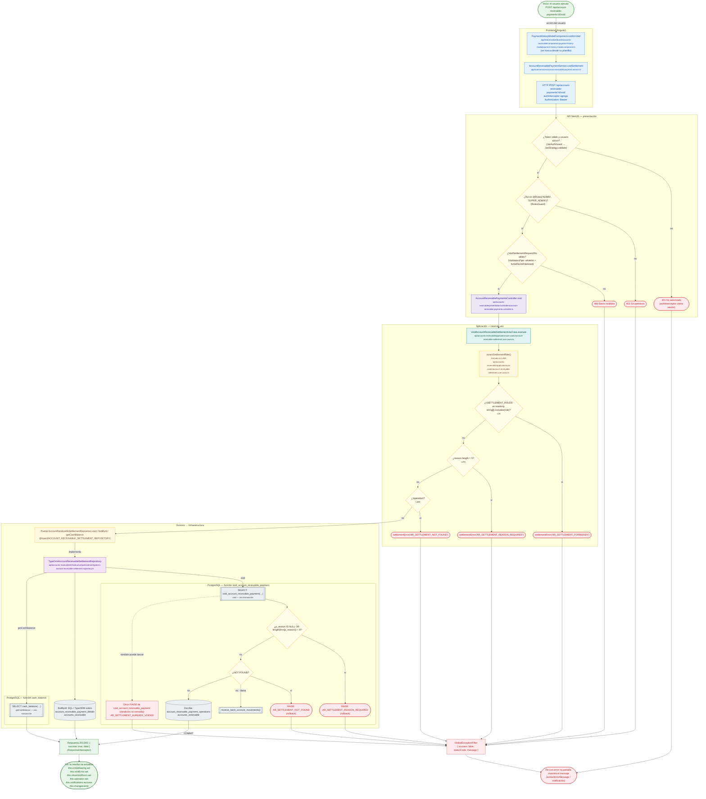

# POST /api/account-receivable-payments/:id/void

Módulo: **Cuentas por Cobrar (accounts-receivable)** · Fuente editable: [`post-account-receivable-payments-id-void.mmd`](post-account-receivable-payments-id-void.mmd) · [Índice de diagramas](../../README.md)

## Explicación

1. **¿Qué proceso representa?** Flujo de decisiones real de POST /api/account-receivable-payments/:id/void: guards, DTO, validaciones del caso de uso (if … throw) y reglas de las funciones PL/pgSQL (IF … RAISE).
2. **¿Dónde comienza?** PaymentHistoryModalComponent.confirmVoid (comercial-jhoel-app/src/app/features/dashboard/accounts-receivable/components/payment-history-modal/payment-history-modal.component.ts)
3. **¿Qué archivos intervienen?** [`comercial-jhoel-api/src/modules/accounts-receivable/presentation/controllers/account-receivable-payments.controller.ts`](../../../../comercial-jhoel-api/src/modules/accounts-receivable/presentation/controllers/account-receivable-payments.controller.ts), [`comercial-jhoel-app/src/app/core/services/account-receivable-payment.service.ts`](../../../../comercial-jhoel-app/src/app/core/services/account-receivable-payment.service.ts), [`comercial-jhoel-app/src/app/features/dashboard/accounts-receivable/components/payment-history-modal/payment-history-modal.component.ts`](../../../../comercial-jhoel-app/src/app/features/dashboard/accounts-receivable/components/payment-history-modal/payment-history-modal.component.ts), [`comercial-jhoel-api/src/modules/accounts-receivable/application/use-cases/account-receivable-settlement.use-cases.ts`](../../../../comercial-jhoel-api/src/modules/accounts-receivable/application/use-cases/account-receivable-settlement.use-cases.ts), [`comercial-jhoel-api/src/modules/accounts-receivable/domain/repositories/account-receivable-settlement.repository.ts`](../../../../comercial-jhoel-api/src/modules/accounts-receivable/domain/repositories/account-receivable-settlement.repository.ts), [`comercial-jhoel-api/src/modules/accounts-receivable/infrastructure/persistence/typeorm-account-receivable-settlement.repository.ts`](../../../../comercial-jhoel-api/src/modules/accounts-receivable/infrastructure/persistence/typeorm-account-receivable-settlement.repository.ts)
4. **¿Qué función ejecuta cada archivo?** Cada nodo muestra la clase y el método (`Clase.metodo`) y, debajo, la ruta del archivo. El color indica la capa: azul = frontend, morado = controlador, verde azulado = caso de uso, amarillo = dominio/puerto, lila = infraestructura, gris = PostgreSQL, amarillo claro = decisión, rojo = error.
5. **¿Qué decisiones toma el sistema?** sesión JWT válida | rol 'ADMIN', 'SUPER_ADMIN' | DTO VoidSettlementRequestDto | !(SETTLEMENT_ROLES as readonly string[]).includes(role) | reason.length < 5 | !operation | SQL void_account_receivable_payment: p_reason IS NULL OR length(trim(p_reason)) < 5 | SQL void_account_receivable_payment: NOT FOUND
6. **¿Dónde se almacenan los datos?** void_account_receivable_payment(), cash_balance(), account_receivable_payment_operations, accounts_receivable, account_receivable_payment_details
7. **¿Cómo termina el proceso?** Respuesta { success: true, data } y actualización de la pantalla
8. **¿Qué sucede cuando ocurre un error?** Cada rama roja termina en GlobalExceptionFilter → { success: false, message } y la pantalla muestra el mensaje; un RAISE en SQL revierte toda la transacción

> Generado desde el código. Las condiciones de los rombos son el texto literal de los `if … throw` (TypeScript) y de los `IF … RAISE EXCEPTION` (PL/pgSQL).
