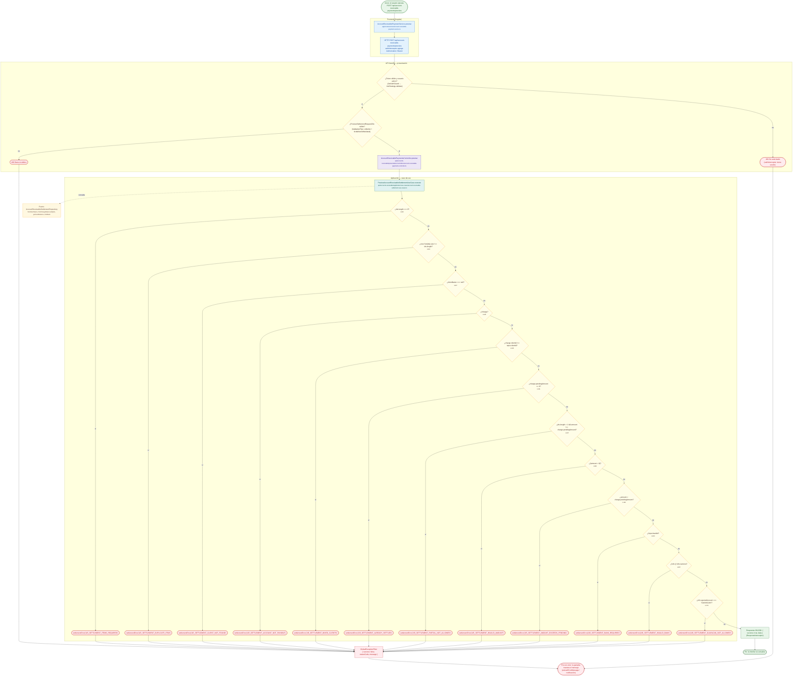

# POST /api/account-receivable-payments/preview

Módulo: **Cuentas por Cobrar (accounts-receivable)** · Fuente editable: [`post-account-receivable-payments-preview.mmd`](post-account-receivable-payments-preview.mmd) · [Índice de diagramas](../../README.md)

## Explicación

1. **¿Qué proceso representa?** Flujo de decisiones real de POST /api/account-receivable-payments/preview: guards, DTO, validaciones del caso de uso (if … throw) y reglas de las funciones PL/pgSQL (IF … RAISE).
2. **¿Dónde comienza?** AccountReceivablePaymentService.preview
3. **¿Qué archivos intervienen?** [`comercial-jhoel-api/src/modules/accounts-receivable/presentation/controllers/account-receivable-payments.controller.ts`](../../../../comercial-jhoel-api/src/modules/accounts-receivable/presentation/controllers/account-receivable-payments.controller.ts), [`comercial-jhoel-app/src/app/core/services/account-receivable-payment.service.ts`](../../../../comercial-jhoel-app/src/app/core/services/account-receivable-payment.service.ts), [`comercial-jhoel-api/src/modules/accounts-receivable/application/use-cases/account-receivable-settlement.use-cases.ts`](../../../../comercial-jhoel-api/src/modules/accounts-receivable/application/use-cases/account-receivable-settlement.use-cases.ts), [`comercial-jhoel-api/src/modules/accounts-receivable/domain/repositories/account-receivable-settlement.repository.ts`](../../../../comercial-jhoel-api/src/modules/accounts-receivable/domain/repositories/account-receivable-settlement.repository.ts)
4. **¿Qué función ejecuta cada archivo?** Cada nodo muestra la clase y el método (`Clase.metodo`) y, debajo, la ruta del archivo. El color indica la capa: azul = frontend, morado = controlador, verde azulado = caso de uso, amarillo = dominio/puerto, lila = infraestructura, gris = PostgreSQL, amarillo claro = decisión, rojo = error.
5. **¿Qué decisiones toma el sistema?** sesión JWT válida | DTO PreviewSettlementRequestDto | ids.length === 0 | new Set(ids).size !== ids.length | clientName === null | !charge | charge.clientId !== input.clientId | charge.pendingAmount <= 0 | ids.length > 1 && amount !== charge.pendingAmount | !(amount > 0) | amount > charge.pendingAmount | !input.bankId | !info || !info.isActive | info.specialAccount === 'GUAYACAN'
6. **¿Dónde se almacenan los datos?** ver repositorio
7. **¿Cómo termina el proceso?** Respuesta { success: true, data } y actualización de la pantalla
8. **¿Qué sucede cuando ocurre un error?** Cada rama roja termina en GlobalExceptionFilter → { success: false, message } y la pantalla muestra el mensaje; un RAISE en SQL revierte toda la transacción

> Generado desde el código. Las condiciones de los rombos son el texto literal de los `if … throw` (TypeScript) y de los `IF … RAISE EXCEPTION` (PL/pgSQL).
