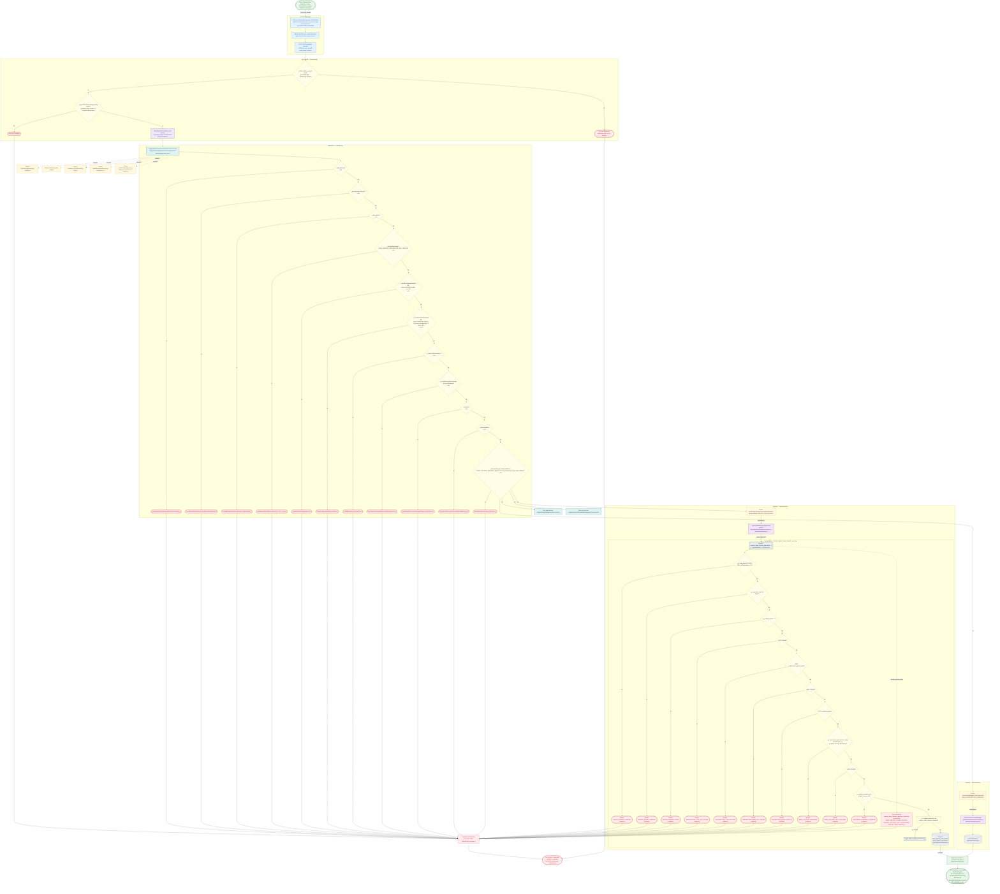

# Transaccionar: depósitos, retiros, desembolsos y pagos Génesis, reintegros

Módulo: **Transaccionar (operaciones bancarias) (bank-deposits)** · Fuente editable: [`post-bank-deposits.mmd`](post-bank-deposits.mmd) · [Índice de diagramas](../../README.md)

## Explicación

1. **¿Qué proceso representa?** Flujo de decisiones real de POST /api/bank-deposits: guards, DTO, validaciones del caso de uso (if … throw) y reglas de las funciones PL/pgSQL (IF … RAISE).
2. **¿Dónde comienza?** TransaccionarPageComponent.confirmSave (comercial-jhoel-app/src/app/features/dashboard/transaccionar/transaccionar-page.component.ts)
3. **¿Qué archivos intervienen?** [`comercial-jhoel-api/src/modules/bank-deposits/presentation/controllers/bank-deposits.controller.ts`](../../../../comercial-jhoel-api/src/modules/bank-deposits/presentation/controllers/bank-deposits.controller.ts), [`comercial-jhoel-app/src/app/core/services/bank-deposit.service.ts`](../../../../comercial-jhoel-app/src/app/core/services/bank-deposit.service.ts), [`comercial-jhoel-app/src/app/features/dashboard/transaccionar/transaccionar-page.component.ts`](../../../../comercial-jhoel-app/src/app/features/dashboard/transaccionar/transaccionar-page.component.ts), [`comercial-jhoel-api/src/modules/bank-deposits/application/use-cases/register-bank-deposit-operation.use-case.ts`](../../../../comercial-jhoel-api/src/modules/bank-deposits/application/use-cases/register-bank-deposit-operation.use-case.ts), [`comercial-jhoel-api/src/modules/banks/domain/repositories/day-opening.repository.ts`](../../../../comercial-jhoel-api/src/modules/banks/domain/repositories/day-opening.repository.ts), [`comercial-jhoel-api/src/modules/clients/domain/repositories/client.repository.ts`](../../../../comercial-jhoel-api/src/modules/clients/domain/repositories/client.repository.ts), [`comercial-jhoel-api/src/modules/transaction-types/domain/repositories/transaction-type.repository.ts`](../../../../comercial-jhoel-api/src/modules/transaction-types/domain/repositories/transaction-type.repository.ts), [`comercial-jhoel-api/src/modules/banks/domain/repositories/bank-movement.repository.ts`](../../../../comercial-jhoel-api/src/modules/banks/domain/repositories/bank-movement.repository.ts), [`comercial-jhoel-api/src/modules/cash-control/domain/repositories/cash-control.repository.ts`](../../../../comercial-jhoel-api/src/modules/cash-control/domain/repositories/cash-control.repository.ts), [`comercial-jhoel-api/src/modules/bank-deposits/domain/repositories/bank-deposit.repository.ts`](../../../../comercial-jhoel-api/src/modules/bank-deposits/domain/repositories/bank-deposit.repository.ts), [`comercial-jhoel-api/src/modules/bank-deposits/infrastructure/persistence/typeorm-bank-deposit.repository.ts`](../../../../comercial-jhoel-api/src/modules/bank-deposits/infrastructure/persistence/typeorm-bank-deposit.repository.ts), [`comercial-jhoel-api/src/shared/application/ports/transaction-manager.port.ts`](../../../../comercial-jhoel-api/src/shared/application/ports/transaction-manager.port.ts), [`comercial-jhoel-api/src/shared/infrastructure/services/typeorm-transaction-manager.service.ts`](../../../../comercial-jhoel-api/src/shared/infrastructure/services/typeorm-transaction-manager.service.ts)
4. **¿Qué función ejecuta cada archivo?** Cada nodo muestra la clase y el método (`Clase.metodo`) y, debajo, la ruta del archivo. El color indica la capa: azul = frontend, morado = controlador, verde azulado = caso de uso, amarillo = dominio/puerto, lila = infraestructura, gris = PostgreSQL, amarillo claro = decisión, rojo = error.
5. **¿Qué decisiones toma el sistema?** sesión JWT válida | DTO CreateBankDepositRequestDto | !dayOpening | dayOpening.isClosed | !description | description.length > BANK_DEPOSIT_DESCRIPTION_MAX_LENGTH | cashBreakdownEnabled && input.cashDetails.length === 0 | !cashBreakdownEnabled && (input.cashDetails.length > 0 || (input.changeGiven ?? 0) !== 0) | !client || !client.isActive | sendToAccountsReceivable && sendToAssets | !clientId | !input.isAdmin | !transactionType?.balanceEffect || !ASSET_ELIGIBLE_BALANCE_EFFECTS.includes(transactionType.balanceEffect) | SQL register_bank_deposit_operation: p_total_amount IS NULL OR p_total_amount <= 0
6. **¿Dónde se almacenan los datos?** register_bank_deposit_operation(), bank_deposit_cash_details, bank_deposit_operations, bank_deposit_transactions
7. **¿Cómo termina el proceso?** Respuesta { success: true, data } y actualización de la pantalla
8. **¿Qué sucede cuando ocurre un error?** Cada rama roja termina en GlobalExceptionFilter → { success: false, message } y la pantalla muestra el mensaje; un RAISE en SQL revierte toda la transacción

> Generado desde el código. Las condiciones de los rombos son el texto literal de los `if … throw` (TypeScript) y de los `IF … RAISE EXCEPTION` (PL/pgSQL).
