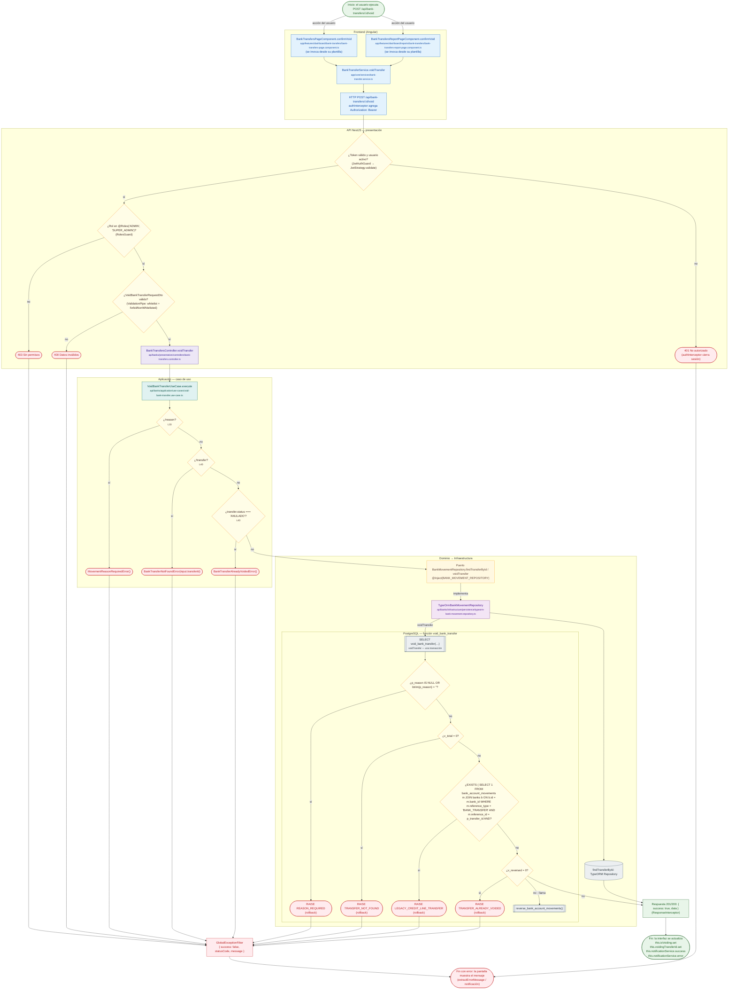

# POST /api/bank-transfers/:id/void

Módulo: **Bancos y Agentes Bancarios (día, saldos, cuadre, transferencias) (banks)** · Fuente editable: [`post-bank-transfers-id-void.mmd`](post-bank-transfers-id-void.mmd) · [Índice de diagramas](../../README.md)

## Explicación

1. **¿Qué proceso representa?** Flujo de decisiones real de POST /api/bank-transfers/:id/void: guards, DTO, validaciones del caso de uso (if … throw) y reglas de las funciones PL/pgSQL (IF … RAISE).
2. **¿Dónde comienza?** BankTransfersPageComponent.confirmVoid (comercial-jhoel-app/src/app/features/dashboard/bank-transfers/bank-transfers-page.component.ts)
3. **¿Qué archivos intervienen?** [`comercial-jhoel-api/src/modules/banks/presentation/controllers/bank-transfers.controller.ts`](../../../../comercial-jhoel-api/src/modules/banks/presentation/controllers/bank-transfers.controller.ts), [`comercial-jhoel-app/src/app/core/services/bank-transfer.service.ts`](../../../../comercial-jhoel-app/src/app/core/services/bank-transfer.service.ts), [`comercial-jhoel-app/src/app/features/dashboard/bank-transfers/bank-transfers-page.component.ts`](../../../../comercial-jhoel-app/src/app/features/dashboard/bank-transfers/bank-transfers-page.component.ts), [`comercial-jhoel-app/src/app/features/dashboard/reports/bank-transfers/bank-transfers-report-page.component.ts`](../../../../comercial-jhoel-app/src/app/features/dashboard/reports/bank-transfers/bank-transfers-report-page.component.ts), [`comercial-jhoel-api/src/modules/banks/application/use-cases/void-bank-transfer.use-case.ts`](../../../../comercial-jhoel-api/src/modules/banks/application/use-cases/void-bank-transfer.use-case.ts), [`comercial-jhoel-api/src/modules/banks/domain/repositories/bank-movement.repository.ts`](../../../../comercial-jhoel-api/src/modules/banks/domain/repositories/bank-movement.repository.ts), [`comercial-jhoel-api/src/modules/banks/infrastructure/persistence/typeorm-bank-movement.repository.ts`](../../../../comercial-jhoel-api/src/modules/banks/infrastructure/persistence/typeorm-bank-movement.repository.ts)
4. **¿Qué función ejecuta cada archivo?** Cada nodo muestra la clase y el método (`Clase.metodo`) y, debajo, la ruta del archivo. El color indica la capa: azul = frontend, morado = controlador, verde azulado = caso de uso, amarillo = dominio/puerto, lila = infraestructura, gris = PostgreSQL, amarillo claro = decisión, rojo = error.
5. **¿Qué decisiones toma el sistema?** sesión JWT válida | rol 'ADMIN', 'SUPER_ADMIN' | DTO VoidBankTransferRequestDto | !reason | !transfer | transfer.status === 'ANULADO' | SQL void_bank_transfer: p_reason IS NULL OR btrim(p_reason) = '' | SQL void_bank_transfer: v_total = 0 | SQL void_bank_transfer: EXISTS ( SELECT 1 FROM bank_account_movements m JOIN banks b ON b.id = m.bank_id WHERE m.reference_type = 'BANK_TRANSFER' AND m.reference_id = p_transfer_id AND | SQL void_bank_transfer: v_reversed = 0
6. **¿Dónde se almacenan los datos?** void_bank_transfer()
7. **¿Cómo termina el proceso?** Respuesta { success: true, data } y actualización de la pantalla
8. **¿Qué sucede cuando ocurre un error?** Cada rama roja termina en GlobalExceptionFilter → { success: false, message } y la pantalla muestra el mensaje; un RAISE en SQL revierte toda la transacción

> Generado desde el código. Las condiciones de los rombos son el texto literal de los `if … throw` (TypeScript) y de los `IF … RAISE EXCEPTION` (PL/pgSQL).
