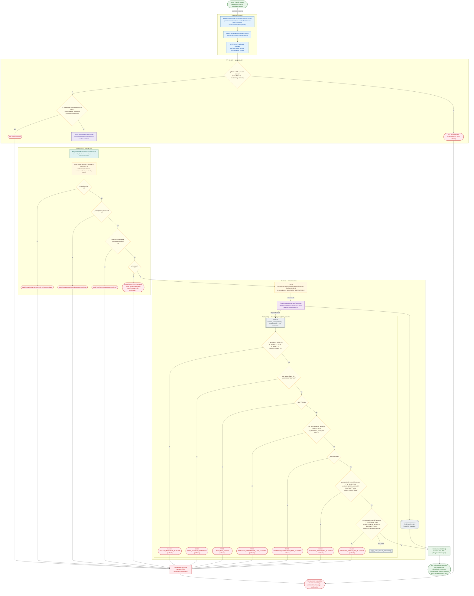

# Transferencias bancarias y retiro de efectivo en banco

Módulo: **Bancos y Agentes Bancarios (día, saldos, cuadre, transferencias) (banks)** · Fuente editable: [`post-bank-transfers.mmd`](post-bank-transfers.mmd) · [Índice de diagramas](../../README.md)

## Explicación

1. **¿Qué proceso representa?** Flujo de decisiones real de POST /api/bank-transfers: guards, DTO, validaciones del caso de uso (if … throw) y reglas de las funciones PL/pgSQL (IF … RAISE).
2. **¿Dónde comienza?** BankTransfersPageComponent.confirmTransfer (comercial-jhoel-app/src/app/features/dashboard/bank-transfers/bank-transfers-page.component.ts)
3. **¿Qué archivos intervienen?** [`comercial-jhoel-api/src/modules/banks/presentation/controllers/bank-transfers.controller.ts`](../../../../comercial-jhoel-api/src/modules/banks/presentation/controllers/bank-transfers.controller.ts), [`comercial-jhoel-app/src/app/core/services/bank-transfer.service.ts`](../../../../comercial-jhoel-app/src/app/core/services/bank-transfer.service.ts), [`comercial-jhoel-app/src/app/features/dashboard/bank-transfers/bank-transfers-page.component.ts`](../../../../comercial-jhoel-app/src/app/features/dashboard/bank-transfers/bank-transfers-page.component.ts), [`comercial-jhoel-api/src/modules/banks/application/use-cases/register-bank-transfer.use-case.ts`](../../../../comercial-jhoel-api/src/modules/banks/application/use-cases/register-bank-transfer.use-case.ts), [`comercial-jhoel-api/src/modules/banks/application/use-cases/assert-bank-operation-day-open.ts`](../../../../comercial-jhoel-api/src/modules/banks/application/use-cases/assert-bank-operation-day-open.ts), [`comercial-jhoel-api/src/modules/banks/domain/repositories/bank-movement.repository.ts`](../../../../comercial-jhoel-api/src/modules/banks/domain/repositories/bank-movement.repository.ts), [`comercial-jhoel-api/src/modules/banks/infrastructure/persistence/typeorm-bank-movement.repository.ts`](../../../../comercial-jhoel-api/src/modules/banks/infrastructure/persistence/typeorm-bank-movement.repository.ts)
4. **¿Qué función ejecuta cada archivo?** Cada nodo muestra la clase y el método (`Clase.metodo`) y, debajo, la ruta del archivo. El color indica la capa: azul = frontend, morado = controlador, verde azulado = caso de uso, amarillo = dominio/puerto, lila = infraestructura, gris = PostgreSQL, amarillo claro = decisión, rojo = error.
5. **¿Qué decisiones toma el sistema?** sesión JWT válida | DTO CreateBankTransferRequestDto | !dayOpening | dayOpening.isClosed | !cashWithdrawal && !destinationBankId | !transfer | SQL register_bank_transfer: p_amount IS NULL OR p_amount <= 0 OR p_amount <> round(p_amount, 2) | SQL register_bank_transfer: p_source_bank_id = p_destination_bank_id | SQL register_bank_transfer: NOT FOUND | SQL register_bank_transfer: (v_source.special_account = 'BI_CLUB') y (p_destination_bank_id IS NULL) | SQL register_bank_transfer: NOT FOUND | SQL register_bank_transfer: v_destination.special_account = 'BI_CLUB' AND v_source.special_account IS DISTINCT FROM 'BANCO_INDUSTRIAL' | SQL register_bank_transfer: v_destination.special_account = 'DISTRICOL' AND v_source.special_account IS DISTINCT FROM 'BANCO_AGROMERCANTIL'
6. **¿Dónde se almacenan los datos?** register_bank_transfer()
7. **¿Cómo termina el proceso?** Respuesta { success: true, data } y actualización de la pantalla
8. **¿Qué sucede cuando ocurre un error?** Cada rama roja termina en GlobalExceptionFilter → { success: false, message } y la pantalla muestra el mensaje; un RAISE en SQL revierte toda la transacción

> Generado desde el código. Las condiciones de los rombos son el texto literal de los `if … throw` (TypeScript) y de los `IF … RAISE EXCEPTION` (PL/pgSQL).
