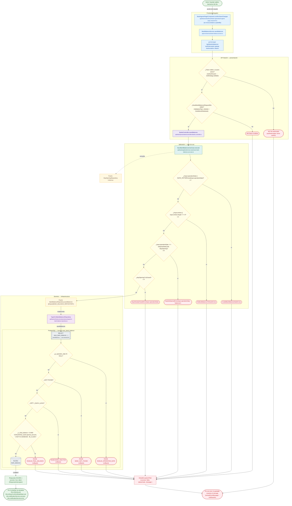

# Guardar saldos bancarios del día

Módulo: **Bancos y Agentes Bancarios (día, saldos, cuadre, transferencias) (banks)** · Fuente editable: [`post-banks-balances.mmd`](post-banks-balances.mmd) · [Índice de diagramas](../../README.md)

## Explicación

1. **¿Qué proceso representa?** Flujo de decisiones real de POST /api/banks/balances: guards, DTO, validaciones del caso de uso (if … throw) y reglas de las funciones PL/pgSQL (IF … RAISE).
2. **¿Dónde comienza?** BankAgentsPageComponent.confirmSaveChanges (comercial-jhoel-app/src/app/features/dashboard/bank-agents/bank-agents-page.component.ts)
3. **¿Qué archivos intervienen?** [`comercial-jhoel-api/src/modules/banks/presentation/controllers/banks.controller.ts`](../../../../comercial-jhoel-api/src/modules/banks/presentation/controllers/banks.controller.ts), [`comercial-jhoel-app/src/app/core/services/bank-balance.service.ts`](../../../../comercial-jhoel-app/src/app/core/services/bank-balance.service.ts), [`comercial-jhoel-app/src/app/features/dashboard/bank-agents/bank-agents-page.component.ts`](../../../../comercial-jhoel-app/src/app/features/dashboard/bank-agents/bank-agents-page.component.ts), [`comercial-jhoel-api/src/modules/banks/application/use-cases/save-bank-balances.use-case.ts`](../../../../comercial-jhoel-api/src/modules/banks/application/use-cases/save-bank-balances.use-case.ts), [`comercial-jhoel-api/src/modules/banks/domain/repositories/day-opening.repository.ts`](../../../../comercial-jhoel-api/src/modules/banks/domain/repositories/day-opening.repository.ts), [`comercial-jhoel-api/src/modules/banks/domain/repositories/bank-balance.repository.ts`](../../../../comercial-jhoel-api/src/modules/banks/domain/repositories/bank-balance.repository.ts), [`comercial-jhoel-api/src/modules/banks/infrastructure/persistence/typeorm-bank-balance.repository.ts`](../../../../comercial-jhoel-api/src/modules/banks/infrastructure/persistence/typeorm-bank-balance.repository.ts)
4. **¿Qué función ejecuta cada archivo?** Cada nodo muestra la clase y el método (`Clase.metodo`) y, debajo, la ruta del archivo. El color indica la capa: azul = frontend, morado = controlador, verde azulado = caso de uso, amarillo = dominio/puerto, lila = infraestructura, gris = PostgreSQL, amarillo claro = decisión, rojo = error.
5. **¿Qué decisiones toma el sistema?** sesión JWT válida | DTO SaveBankBalancesRequestDto | !input.operationDate || !DATE_PATTERN.test(input.operationDate) | !input.entries || input.entries.length === 0 | input.operationDate === todayIsoDate() && !dayOpening | dayOpening?.isClosed | SQL save_bank_balance: p_operation_date IS NULL | SQL save_bank_balance: NOT FOUND | SQL save_bank_balance: NOT v_bank.is_active | SQL save_bank_balance: v_final_balance < 0 AND COALESCE(v_bank.special_account, '') NOT IN ('GENESIS', 'BI_CLUB')
6. **¿Dónde se almacenan los datos?** save_bank_balance(), bank_balances
7. **¿Cómo termina el proceso?** Respuesta { success: true, data } y actualización de la pantalla
8. **¿Qué sucede cuando ocurre un error?** Cada rama roja termina en GlobalExceptionFilter → { success: false, message } y la pantalla muestra el mensaje; un RAISE en SQL revierte toda la transacción

> Generado desde el código. Las condiciones de los rombos son el texto literal de los `if … throw` (TypeScript) y de los `IF … RAISE EXCEPTION` (PL/pgSQL).
