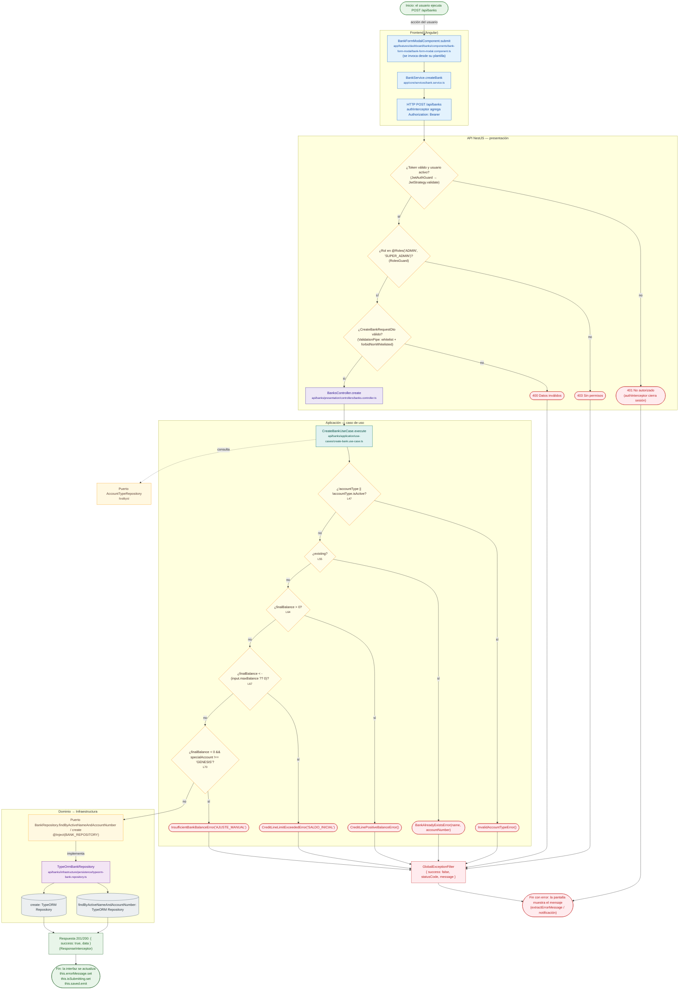

# POST /api/banks

Módulo: **Bancos y Agentes Bancarios (día, saldos, cuadre, transferencias) (banks)** · Fuente editable: [`post-banks.mmd`](post-banks.mmd) · [Índice de diagramas](../../README.md)

## Explicación

1. **¿Qué proceso representa?** Flujo de decisiones real de POST /api/banks: guards, DTO, validaciones del caso de uso (if … throw) y reglas de las funciones PL/pgSQL (IF … RAISE).
2. **¿Dónde comienza?** BankFormModalComponent.submit (comercial-jhoel-app/src/app/features/dashboard/banks/components/bank-form-modal/bank-form-modal.component.ts)
3. **¿Qué archivos intervienen?** [`comercial-jhoel-api/src/modules/banks/presentation/controllers/banks.controller.ts`](../../../../comercial-jhoel-api/src/modules/banks/presentation/controllers/banks.controller.ts), [`comercial-jhoel-app/src/app/core/services/bank.service.ts`](../../../../comercial-jhoel-app/src/app/core/services/bank.service.ts), [`comercial-jhoel-app/src/app/features/dashboard/banks/components/bank-form-modal/bank-form-modal.component.ts`](../../../../comercial-jhoel-app/src/app/features/dashboard/banks/components/bank-form-modal/bank-form-modal.component.ts), [`comercial-jhoel-api/src/modules/banks/application/use-cases/create-bank.use-case.ts`](../../../../comercial-jhoel-api/src/modules/banks/application/use-cases/create-bank.use-case.ts), [`comercial-jhoel-api/src/modules/account-types/domain/repositories/account-type.repository.ts`](../../../../comercial-jhoel-api/src/modules/account-types/domain/repositories/account-type.repository.ts), [`comercial-jhoel-api/src/modules/banks/domain/repositories/bank.repository.ts`](../../../../comercial-jhoel-api/src/modules/banks/domain/repositories/bank.repository.ts), [`comercial-jhoel-api/src/modules/banks/infrastructure/persistence/typeorm-bank.repository.ts`](../../../../comercial-jhoel-api/src/modules/banks/infrastructure/persistence/typeorm-bank.repository.ts)
4. **¿Qué función ejecuta cada archivo?** Cada nodo muestra la clase y el método (`Clase.metodo`) y, debajo, la ruta del archivo. El color indica la capa: azul = frontend, morado = controlador, verde azulado = caso de uso, amarillo = dominio/puerto, lila = infraestructura, gris = PostgreSQL, amarillo claro = decisión, rojo = error.
5. **¿Qué decisiones toma el sistema?** sesión JWT válida | rol 'ADMIN', 'SUPER_ADMIN' | DTO CreateBankRequestDto | !accountType || !accountType.isActive | existing | finalBalance > 0 | finalBalance < -(input.maxBalance ?? 0) | finalBalance < 0 && specialAccount !== 'GENESIS'
6. **¿Dónde se almacenan los datos?** ver repositorio
7. **¿Cómo termina el proceso?** Respuesta { success: true, data } y actualización de la pantalla
8. **¿Qué sucede cuando ocurre un error?** Cada rama roja termina en GlobalExceptionFilter → { success: false, message } y la pantalla muestra el mensaje; un RAISE en SQL revierte toda la transacción

> Generado desde el código. Las condiciones de los rombos son el texto literal de los `if … throw` (TypeScript) y de los `IF … RAISE EXCEPTION` (PL/pgSQL).
