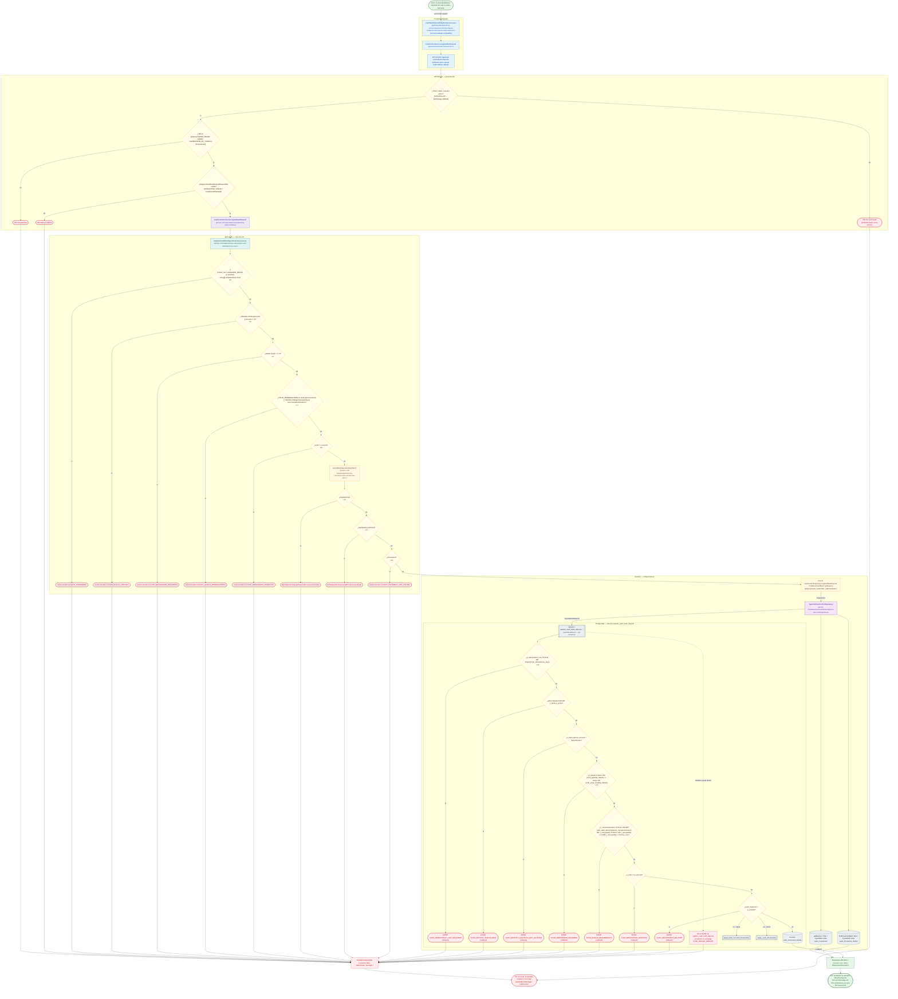

# Control de Efectivo: depósito de caja a cuenta bancaria

Módulo: **Control de Efectivo (Kardex, cortes, arqueos, Bodega) (cash-control)** · Fuente editable: [`post-cash-control-bank-deposits.mmd`](post-cash-control-bank-deposits.mmd) · [Índice de diagramas](../../README.md)

## Explicación

1. **¿Qué proceso representa?** Flujo de decisiones real de POST /api/cash-control/bank-deposits: guards, DTO, validaciones del caso de uso (if … throw) y reglas de las funciones PL/pgSQL (IF … RAISE).
2. **¿Dónde comienza?** CashBankDepositModalComponent.save (comercial-jhoel-app/src/app/features/dashboard/cash-control/components/cash-bank-deposit-modal/cash-bank-deposit-modal.component.ts)
3. **¿Qué archivos intervienen?** [`comercial-jhoel-api/src/modules/cash-control/presentation/controllers/cash-control.controller.ts`](../../../../comercial-jhoel-api/src/modules/cash-control/presentation/controllers/cash-control.controller.ts), [`comercial-jhoel-app/src/app/core/services/cash-control.service.ts`](../../../../comercial-jhoel-app/src/app/core/services/cash-control.service.ts), [`comercial-jhoel-app/src/app/features/dashboard/cash-control/components/cash-bank-deposit-modal/cash-bank-deposit-modal.component.ts`](../../../../comercial-jhoel-app/src/app/features/dashboard/cash-control/components/cash-bank-deposit-modal/cash-bank-deposit-modal.component.ts), [`comercial-jhoel-api/src/modules/cash-control/application/use-cases/register-cash-bank-deposit.use-case.ts`](../../../../comercial-jhoel-api/src/modules/cash-control/application/use-cases/register-cash-bank-deposit.use-case.ts), [`comercial-jhoel-api/src/modules/banks/application/use-cases/assert-bank-operation-day-open.ts`](../../../../comercial-jhoel-api/src/modules/banks/application/use-cases/assert-bank-operation-day-open.ts), [`comercial-jhoel-api/src/modules/cash-control/domain/repositories/cash-control.repository.ts`](../../../../comercial-jhoel-api/src/modules/cash-control/domain/repositories/cash-control.repository.ts), [`comercial-jhoel-api/src/modules/cash-control/infrastructure/persistence/typeorm-cash-control.repository.ts`](../../../../comercial-jhoel-api/src/modules/cash-control/infrastructure/persistence/typeorm-cash-control.repository.ts)
4. **¿Qué función ejecuta cada archivo?** Cada nodo muestra la clase y el método (`Clase.metodo`) y, debajo, la ruta del archivo. El color indica la capa: azul = frontend, morado = controlador, verde azulado = caso de uso, amarillo = dominio/puerto, lila = infraestructura, gris = PostgreSQL, amarillo claro = decisión, rojo = error.
5. **¿Qué decisiones toma el sistema?** sesión JWT válida | rol 'SUPER_ADMIN', 'ADMIN', 'SUPERVISOR_DE_TURNO' | DTO RegisterCashBankDepositRequestDto | !(CASH_CUT_MANAGER_ROLES as readonly string[]).includes(input.role) | !Number.isFinite(amount) || amount <= 0 | details.length === 0 | !VALID_DENOMINATIONS.includes(denomination) || !Number.isInteger(row.quantity) || seen.has(denomination) | total !== amount | !dayOpening | dayOpening.isClosed | !movement | SQL register_cash_bank_deposit: p_idempotency_key IS NULL OR length(trim(p_idempotency_key)) = 0 | SQL register_cash_bank_deposit: NOT FOUND OR NOT v_bank.is_active | SQL register_cash_bank_deposit: v_bank.special_account = 'GUAYACAN'
6. **¿Dónde se almacenan los datos?** register_cash_bank_deposit(), cash_movements, cash_movement_details
7. **¿Cómo termina el proceso?** Respuesta { success: true, data } y actualización de la pantalla
8. **¿Qué sucede cuando ocurre un error?** Cada rama roja termina en GlobalExceptionFilter → { success: false, message } y la pantalla muestra el mensaje; un RAISE en SQL revierte toda la transacción

> Generado desde el código. Las condiciones de los rombos son el texto literal de los `if … throw` (TypeScript) y de los `IF … RAISE EXCEPTION` (PL/pgSQL).
