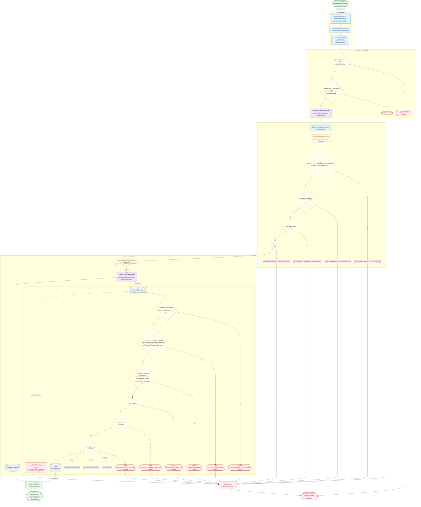

# Arqueo de Caja (con conteo opcional de Bodega = arqueo de Bodega)

Módulo: **Control de Efectivo (Kardex, cortes, arqueos, Bodega) (cash-control)** · Fuente editable: [`post-cash-control-counts.mmd`](post-cash-control-counts.mmd) · [Índice de diagramas](../../README.md)

## Explicación

1. **¿Qué proceso representa?** Flujo de decisiones real de POST /api/cash-control/counts: guards, DTO, validaciones del caso de uso (if … throw) y reglas de las funciones PL/pgSQL (IF … RAISE).
2. **¿Dónde comienza?** CashCountModalComponent.save (comercial-jhoel-app/src/app/features/dashboard/cash-control/components/cash-count-modal/cash-count-modal.component.ts)
3. **¿Qué archivos intervienen?** [`comercial-jhoel-api/src/modules/cash-control/presentation/controllers/cash-custody.controller.ts`](../../../../comercial-jhoel-api/src/modules/cash-control/presentation/controllers/cash-custody.controller.ts), [`comercial-jhoel-app/src/app/core/services/cash-custody.service.ts`](../../../../comercial-jhoel-app/src/app/core/services/cash-custody.service.ts), [`comercial-jhoel-app/src/app/features/dashboard/cash-control/components/cash-count-modal/cash-count-modal.component.ts`](../../../../comercial-jhoel-app/src/app/features/dashboard/cash-control/components/cash-count-modal/cash-count-modal.component.ts), [`comercial-jhoel-api/src/modules/cash-control/application/use-cases/cash-custody.use-cases.ts`](../../../../comercial-jhoel-api/src/modules/cash-control/application/use-cases/cash-custody.use-cases.ts), [`comercial-jhoel-api/src/modules/cash-control/domain/policies/cash-control.policy.ts`](../../../../comercial-jhoel-api/src/modules/cash-control/domain/policies/cash-control.policy.ts), [`comercial-jhoel-api/src/modules/cash-control/domain/repositories/cash-custody.repository.ts`](../../../../comercial-jhoel-api/src/modules/cash-control/domain/repositories/cash-custody.repository.ts), [`comercial-jhoel-api/src/modules/cash-control/infrastructure/persistence/typeorm-cash-custody.repository.ts`](../../../../comercial-jhoel-api/src/modules/cash-control/infrastructure/persistence/typeorm-cash-custody.repository.ts)
4. **¿Qué función ejecuta cada archivo?** Cada nodo muestra la clase y el método (`Clase.metodo`) y, debajo, la ruta del archivo. El color indica la capa: azul = frontend, morado = controlador, verde azulado = caso de uso, amarillo = dominio/puerto, lila = infraestructura, gris = PostgreSQL, amarillo claro = decisión, rojo = error.
5. **¿Qué decisiones toma el sistema?** sesión JWT válida | DTO RegisterCashCountRequestDto | !(CASH_CUSTODY_PERMISSION_ROLES[permission] as readonly string[]).includes( role ?? '', ) | !input.correctionReason || input.correctionReason.trim().length < 5 | !input.details?.length | !count | SQL register_cash_count: p_idempotency_key IS NULL OR length(trim(p_idempotency_key)) = 0 | SQL register_cash_count: v_row.denomination IS NULL OR NOT cash_valid_denomination(v_row.denomination) OR v_row.quantity IS NULL OR v_row.quantity < 0 OR v_row.quantity <> trunc(v_row.q | SQL register_cash_count: p_warehouse_counted IS NOT NULL AND (p_warehouse_counted < 0 OR p_warehouse_counted <> round(p_warehouse_counted, 2)) | SQL register_cash_count: NOT FOUND | SQL register_cash_count: v_original.status <> 'VIGENTE' | SQL register_cash_count: v_day.day_opening_id IS NULL
6. **¿Dónde se almacenan los datos?** register_cash_count(), cash_count_details, cash_counts
7. **¿Cómo termina el proceso?** Respuesta { success: true, data } y actualización de la pantalla
8. **¿Qué sucede cuando ocurre un error?** Cada rama roja termina en GlobalExceptionFilter → { success: false, message } y la pantalla muestra el mensaje; un RAISE en SQL revierte toda la transacción

> Generado desde el código. Las condiciones de los rombos son el texto literal de los `if … throw` (TypeScript) y de los `IF … RAISE EXCEPTION` (PL/pgSQL).
