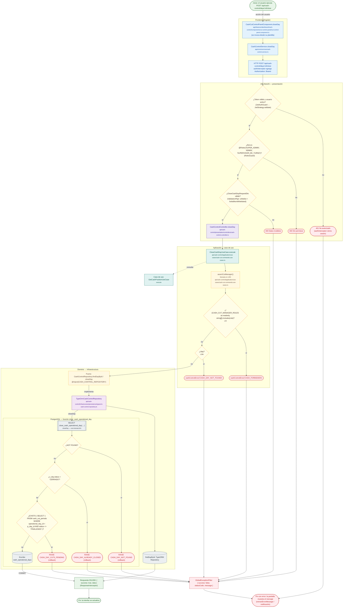

# POST /api/cash-control/days/:id/close

Módulo: **Control de Efectivo (Kardex, cortes, arqueos, Bodega) (cash-control)** · Fuente editable: [`post-cash-control-days-id-close.mmd`](post-cash-control-days-id-close.mmd) · [Índice de diagramas](../../README.md)

## Explicación

1. **¿Qué proceso representa?** Flujo de decisiones real de POST /api/cash-control/days/:id/close: guards, DTO, validaciones del caso de uso (if … throw) y reglas de las funciones PL/pgSQL (IF … RAISE).
2. **¿Dónde comienza?** CashCutControlPanelComponent.closeDay (comercial-jhoel-app/src/app/features/dashboard/cash-control/components/cut-control-panel/cut-control-panel.component.ts)
3. **¿Qué archivos intervienen?** [`comercial-jhoel-api/src/modules/cash-control/presentation/controllers/cash-control.controller.ts`](../../../../comercial-jhoel-api/src/modules/cash-control/presentation/controllers/cash-control.controller.ts), [`comercial-jhoel-app/src/app/core/services/cash-control.service.ts`](../../../../comercial-jhoel-app/src/app/core/services/cash-control.service.ts), [`comercial-jhoel-app/src/app/features/dashboard/cash-control/components/cut-control-panel/cut-control-panel.component.ts`](../../../../comercial-jhoel-app/src/app/features/dashboard/cash-control/components/cut-control-panel/cut-control-panel.component.ts), [`comercial-jhoel-api/src/modules/cash-control/application/use-cases/cash-cut-commands.use-cases.ts`](../../../../comercial-jhoel-api/src/modules/cash-control/application/use-cases/cash-cut-commands.use-cases.ts), [`comercial-jhoel-api/src/modules/cash-control/application/use-cases/get-cash-position.use-case.ts`](../../../../comercial-jhoel-api/src/modules/cash-control/application/use-cases/get-cash-position.use-case.ts), [`comercial-jhoel-api/src/modules/cash-control/domain/repositories/cash-control.repository.ts`](../../../../comercial-jhoel-api/src/modules/cash-control/domain/repositories/cash-control.repository.ts), [`comercial-jhoel-api/src/modules/cash-control/infrastructure/persistence/typeorm-cash-control.repository.ts`](../../../../comercial-jhoel-api/src/modules/cash-control/infrastructure/persistence/typeorm-cash-control.repository.ts)
4. **¿Qué función ejecuta cada archivo?** Cada nodo muestra la clase y el método (`Clase.metodo`) y, debajo, la ruta del archivo. El color indica la capa: azul = frontend, morado = controlador, verde azulado = caso de uso, amarillo = dominio/puerto, lila = infraestructura, gris = PostgreSQL, amarillo claro = decisión, rojo = error.
5. **¿Qué decisiones toma el sistema?** sesión JWT válida | rol 'SUPER_ADMIN', 'ADMIN', 'SUPERVISOR_DE_TURNO' | DTO CloseCashDayRequestDto | !(CASH_CUT_MANAGER_ROLES as readonly string[]).includes(role) | !day | SQL close_cash_operational_day: NOT FOUND | SQL close_cash_operational_day: v_day.status = 'CERRADO' | SQL close_cash_operational_day: EXISTS ( SELECT 1 FROM cash_cut_periods WHERE operational_day_id = p_day_id AND status <> 'FINALIZADO' )
6. **¿Dónde se almacenan los datos?** close_cash_operational_day(), cash_operational_days
7. **¿Cómo termina el proceso?** Respuesta { success: true, data } y actualización de la pantalla
8. **¿Qué sucede cuando ocurre un error?** Cada rama roja termina en GlobalExceptionFilter → { success: false, message } y la pantalla muestra el mensaje; un RAISE en SQL revierte toda la transacción

> Generado desde el código. Las condiciones de los rombos son el texto literal de los `if … throw` (TypeScript) y de los `IF … RAISE EXCEPTION` (PL/pgSQL).
