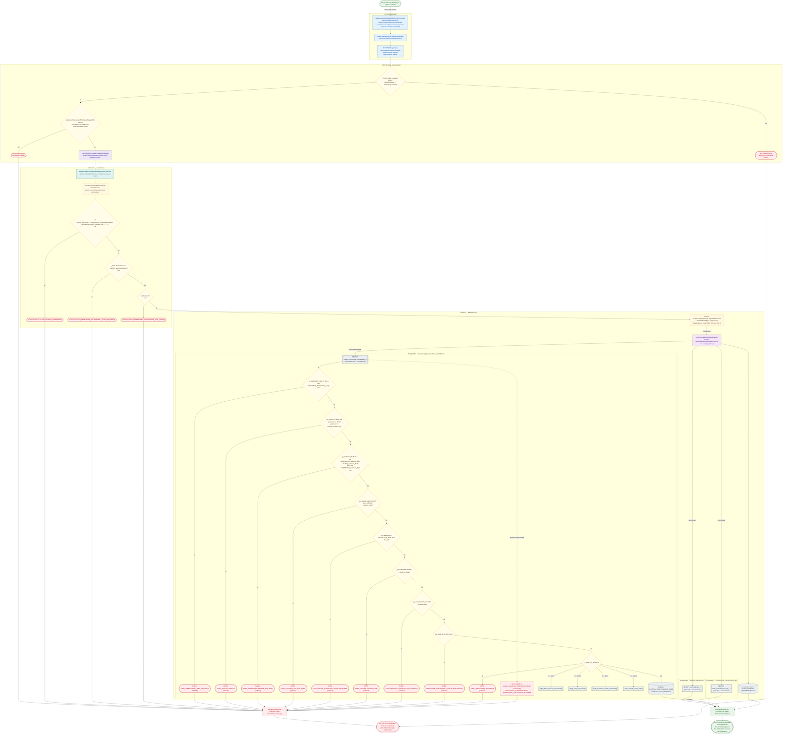

# Retiro de Bodega (a caja o a cuenta)

Módulo: **Control de Efectivo (Kardex, cortes, arqueos, Bodega) (cash-control)** · Fuente editable: [`post-cash-control-warehouse-withdrawals.mmd`](post-cash-control-warehouse-withdrawals.mmd) · [Índice de diagramas](../../README.md)

## Explicación

1. **¿Qué proceso representa?** Flujo de decisiones real de POST /api/cash-control/warehouse/withdrawals: guards, DTO, validaciones del caso de uso (if … throw) y reglas de las funciones PL/pgSQL (IF … RAISE).
2. **¿Dónde comienza?** WarehouseWithdrawalModalComponent.save (comercial-jhoel-app/src/app/features/dashboard/cash-control/components/warehouse-withdrawal-modal/warehouse-withdrawal-modal.component.ts)
3. **¿Qué archivos intervienen?** [`comercial-jhoel-api/src/modules/cash-control/presentation/controllers/cash-custody.controller.ts`](../../../../comercial-jhoel-api/src/modules/cash-control/presentation/controllers/cash-custody.controller.ts), [`comercial-jhoel-app/src/app/core/services/cash-custody.service.ts`](../../../../comercial-jhoel-app/src/app/core/services/cash-custody.service.ts), [`comercial-jhoel-app/src/app/features/dashboard/cash-control/components/warehouse-withdrawal-modal/warehouse-withdrawal-modal.component.ts`](../../../../comercial-jhoel-app/src/app/features/dashboard/cash-control/components/warehouse-withdrawal-modal/warehouse-withdrawal-modal.component.ts), [`comercial-jhoel-api/src/modules/cash-control/application/use-cases/cash-custody.use-cases.ts`](../../../../comercial-jhoel-api/src/modules/cash-control/application/use-cases/cash-custody.use-cases.ts), [`comercial-jhoel-api/src/modules/cash-control/domain/policies/cash-control.policy.ts`](../../../../comercial-jhoel-api/src/modules/cash-control/domain/policies/cash-control.policy.ts), [`comercial-jhoel-api/src/modules/cash-control/domain/repositories/cash-custody.repository.ts`](../../../../comercial-jhoel-api/src/modules/cash-control/domain/repositories/cash-custody.repository.ts), [`comercial-jhoel-api/src/modules/cash-control/infrastructure/persistence/typeorm-cash-custody.repository.ts`](../../../../comercial-jhoel-api/src/modules/cash-control/infrastructure/persistence/typeorm-cash-custody.repository.ts)
4. **¿Qué función ejecuta cada archivo?** Cada nodo muestra la clase y el método (`Clase.metodo`) y, debajo, la ruta del archivo. El color indica la capa: azul = frontend, morado = controlador, verde azulado = caso de uso, amarillo = dominio/puerto, lila = infraestructura, gris = PostgreSQL, amarillo claro = decisión, rojo = error.
5. **¿Qué decisiones toma el sistema?** sesión JWT válida | DTO RegisterWarehouseWithdrawalRequestDto | !(CASH_CUSTODY_PERMISSION_ROLES[permission] as readonly string[]).includes( role ?? '', ) | input.destination === 'BANCO' && !input.bankId | !withdrawal | SQL register_warehouse_withdrawal: p_idempotency_key IS NULL OR length(trim(p_idempotency_key)) = 0 | SQL register_warehouse_withdrawal: p_amount IS NULL OR p_amount <= 0 OR p_amount <> round(p_amount, 2) | SQL register_warehouse_withdrawal: p_delivered_by IS NULL OR length(btrim(p_delivered_by)) < 3 OR p_received_by IS NULL OR length(btrim(p_received_by)) < 3 | SQL register_warehouse_withdrawal: v_day.day_opening_id IS NULL OR NOT v_day.is_open | SQL register_warehouse_withdrawal: (p_destination = 'BANCO') y (p_bank_id IS NULL) | SQL register_warehouse_withdrawal: NOT FOUND OR NOT v_bank.is_active | SQL register_warehouse_withdrawal: v_bank.special_account = 'GUAYACAN' | SQL register_warehouse_withdrawal: p_bank_id IS NOT NULL | SQL register_warehouse_withdrawal: v_total <> p_amount
6. **¿Dónde se almacenan los datos?** cash_balance(), cash_current_bank_day(), register_warehouse_withdrawal(), warehouse_cash_movements, warehouse_cash_withdrawals, warehouse_cash_movement_details
7. **¿Cómo termina el proceso?** Respuesta { success: true, data } y actualización de la pantalla
8. **¿Qué sucede cuando ocurre un error?** Cada rama roja termina en GlobalExceptionFilter → { success: false, message } y la pantalla muestra el mensaje; un RAISE en SQL revierte toda la transacción

> Generado desde el código. Las condiciones de los rombos son el texto literal de los `if … throw` (TypeScript) y de los `IF … RAISE EXCEPTION` (PL/pgSQL).
