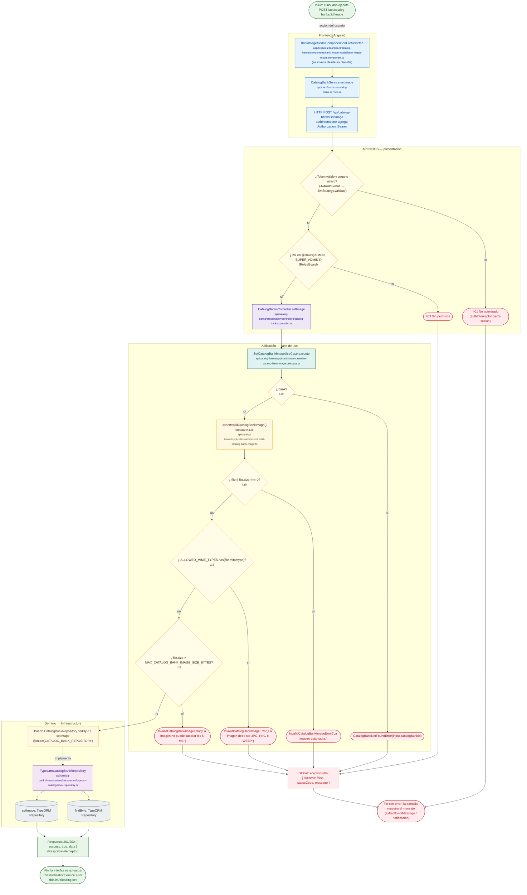

# POST /api/catalog-banks/:id/image

Módulo: **Catálogo de bancos (catalog-banks)** · Fuente editable: [`post-catalog-banks-id-image.mmd`](post-catalog-banks-id-image.mmd) · [Índice de diagramas](../../README.md)

## Explicación

1. **¿Qué proceso representa?** Flujo de decisiones real de POST /api/catalog-banks/:id/image: guards, DTO, validaciones del caso de uso (if … throw) y reglas de las funciones PL/pgSQL (IF … RAISE).
2. **¿Dónde comienza?** BankImageModalComponent.onFileSelected (comercial-jhoel-app/src/app/features/dashboard/catalog-banks/components/bank-image-modal/bank-image-modal.component.ts)
3. **¿Qué archivos intervienen?** [`comercial-jhoel-api/src/modules/catalog-banks/presentation/controllers/catalog-banks.controller.ts`](../../../../comercial-jhoel-api/src/modules/catalog-banks/presentation/controllers/catalog-banks.controller.ts), [`comercial-jhoel-app/src/app/core/services/catalog-bank.service.ts`](../../../../comercial-jhoel-app/src/app/core/services/catalog-bank.service.ts), [`comercial-jhoel-app/src/app/features/dashboard/catalog-banks/components/bank-image-modal/bank-image-modal.component.ts`](../../../../comercial-jhoel-app/src/app/features/dashboard/catalog-banks/components/bank-image-modal/bank-image-modal.component.ts), [`comercial-jhoel-api/src/modules/catalog-banks/application/use-cases/set-catalog-bank-image.use-case.ts`](../../../../comercial-jhoel-api/src/modules/catalog-banks/application/use-cases/set-catalog-bank-image.use-case.ts), [`comercial-jhoel-api/src/modules/catalog-banks/application/utils/assert-valid-catalog-bank-image.ts`](../../../../comercial-jhoel-api/src/modules/catalog-banks/application/utils/assert-valid-catalog-bank-image.ts), [`comercial-jhoel-api/src/modules/catalog-banks/domain/repositories/catalog-bank.repository.ts`](../../../../comercial-jhoel-api/src/modules/catalog-banks/domain/repositories/catalog-bank.repository.ts), [`comercial-jhoel-api/src/modules/catalog-banks/infrastructure/persistence/typeorm-catalog-bank.repository.ts`](../../../../comercial-jhoel-api/src/modules/catalog-banks/infrastructure/persistence/typeorm-catalog-bank.repository.ts)
4. **¿Qué función ejecuta cada archivo?** Cada nodo muestra la clase y el método (`Clase.metodo`) y, debajo, la ruta del archivo. El color indica la capa: azul = frontend, morado = controlador, verde azulado = caso de uso, amarillo = dominio/puerto, lila = infraestructura, gris = PostgreSQL, amarillo claro = decisión, rojo = error.
5. **¿Qué decisiones toma el sistema?** sesión JWT válida | rol 'ADMIN', 'SUPER_ADMIN' | !bank | !file || file.size === 0 | !ALLOWED_MIME_TYPES.has(file.mimetype) | file.size > MAX_CATALOG_BANK_IMAGE_SIZE_BYTES
6. **¿Dónde se almacenan los datos?** ver repositorio
7. **¿Cómo termina el proceso?** Respuesta { success: true, data } y actualización de la pantalla
8. **¿Qué sucede cuando ocurre un error?** Cada rama roja termina en GlobalExceptionFilter → { success: false, message } y la pantalla muestra el mensaje; un RAISE en SQL revierte toda la transacción

> Generado desde el código. Las condiciones de los rombos son el texto literal de los `if … throw` (TypeScript) y de los `IF … RAISE EXCEPTION` (PL/pgSQL).
