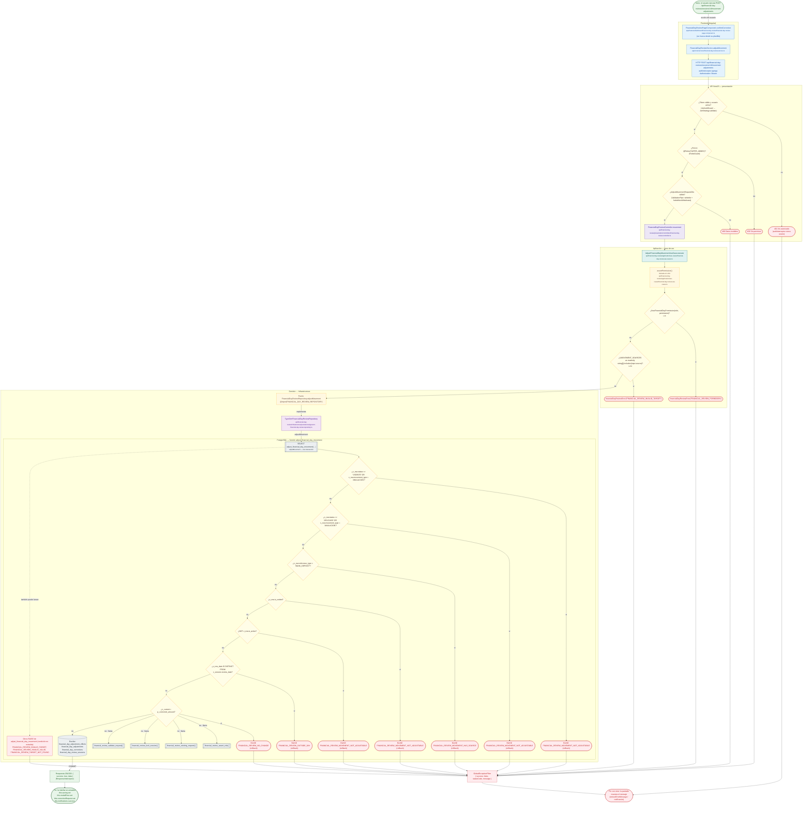

# POST /api/financial-day-reviews/sessions/:id/movement-adjustments

Módulo: **Revisión de días operativos (financial-day-review)** · Fuente editable: [`post-financial-day-reviews-sessions-id-movement-adjustments.mmd`](post-financial-day-reviews-sessions-id-movement-adjustments.mmd) · [Índice de diagramas](../../README.md)

## Explicación

1. **¿Qué proceso representa?** Flujo de decisiones real de POST /api/financial-day-reviews/sessions/:id/movement-adjustments: guards, DTO, validaciones del caso de uso (if … throw) y reglas de las funciones PL/pgSQL (IF … RAISE).
2. **¿Dónde comienza?** FinancialDayReviewPageComponent.confirmCorrection (comercial-jhoel-app/src/app/features/dashboard/financial-day-review/financial-day-review-page.component.ts)
3. **¿Qué archivos intervienen?** [`comercial-jhoel-api/src/modules/financial-day-review/presentation/controllers/financial-day-review.controller.ts`](../../../../comercial-jhoel-api/src/modules/financial-day-review/presentation/controllers/financial-day-review.controller.ts), [`comercial-jhoel-app/src/app/core/services/financial-day-review.service.ts`](../../../../comercial-jhoel-app/src/app/core/services/financial-day-review.service.ts), [`comercial-jhoel-app/src/app/features/dashboard/financial-day-review/financial-day-review-page.component.ts`](../../../../comercial-jhoel-app/src/app/features/dashboard/financial-day-review/financial-day-review-page.component.ts), [`comercial-jhoel-api/src/modules/financial-day-review/application/use-cases/financial-day-review.use-cases.ts`](../../../../comercial-jhoel-api/src/modules/financial-day-review/application/use-cases/financial-day-review.use-cases.ts), [`comercial-jhoel-api/src/modules/financial-day-review/domain/repositories/financial-day-review.repository.ts`](../../../../comercial-jhoel-api/src/modules/financial-day-review/domain/repositories/financial-day-review.repository.ts), [`comercial-jhoel-api/src/modules/financial-day-review/infrastructure/persistence/typeorm-financial-day-review.repository.ts`](../../../../comercial-jhoel-api/src/modules/financial-day-review/infrastructure/persistence/typeorm-financial-day-review.repository.ts)
4. **¿Qué función ejecuta cada archivo?** Cada nodo muestra la clase y el método (`Clase.metodo`) y, debajo, la ruta del archivo. El color indica la capa: azul = frontend, morado = controlador, verde azulado = caso de uso, amarillo = dominio/puerto, lila = infraestructura, gris = PostgreSQL, amarillo claro = decisión, rojo = error.
5. **¿Qué decisiones toma el sistema?** sesión JWT válida | rol 'SUPER_ADMIN' | DTO AdjustMovementRequestDto | !hasFinancialDayPermission(role, permission) | !(MOVEMENT_SOURCES as readonly string[]).includes(input.source) | SQL adjust_financial_day_movement: v_row.status <> 'VIGENTE' OR v_row.movement_type = 'ANULACION' | SQL adjust_financial_day_movement: v_row.status <> 'APLICADO' OR v_row.movement_type = 'ANULACION' | SQL adjust_financial_day_movement: v_row.reference_type = 'BANK_DEPOSIT' | SQL adjust_financial_day_movement: v_row.is_voided | SQL adjust_financial_day_movement: NOT v_row.is_active | SQL adjust_financial_day_movement: v_row_date IS DISTINCT FROM v_session.review_date | SQL adjust_financial_day_movement: v_current = p_corrected_amount
6. **¿Dónde se almacenan los datos?** adjust_financial_day_movement(), financial_day_adjustment_effects, financial_day_adjustments, financial_day_corrections, financial_day_review_sessions
7. **¿Cómo termina el proceso?** Respuesta { success: true, data } y actualización de la pantalla
8. **¿Qué sucede cuando ocurre un error?** Cada rama roja termina en GlobalExceptionFilter → { success: false, message } y la pantalla muestra el mensaje; un RAISE en SQL revierte toda la transacción

> Generado desde el código. Las condiciones de los rombos son el texto literal de los `if … throw` (TypeScript) y de los `IF … RAISE EXCEPTION` (PL/pgSQL).
