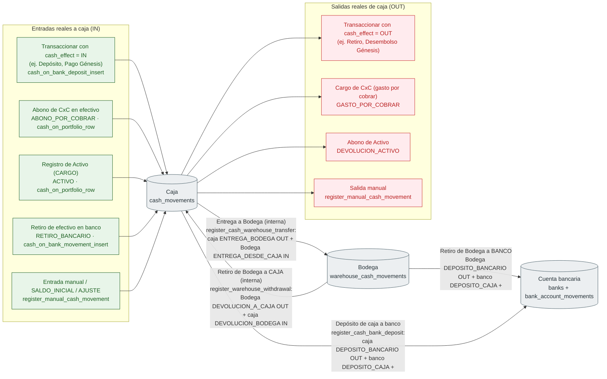

# Efectivo — entradas, salidas y transferencias internas entre caja, Bodega y bancos

Módulo: **Control de Efectivo (cash-control) · Bancos · CxC · Activos** · Fuente editable: [`cash-custody-movements.mmd`](cash-custody-movements.mmd) · [Índice de diagramas](../../README.md)

## Explicación

1. **¿Qué proceso representa?** Qué operación escribe cada movimiento del Kardex de caja (cash_movements) y del Kardex de Bodega (warehouse_cash_movements), y cuáles son transferencias internas (no cambian el total bajo custodia caja + Bodega) frente a entradas o salidas reales.
2. **¿Dónde comienza?** Cualquier operación que mueve efectivo físico
3. **¿Qué archivos intervienen?** [`comercial-jhoel-api/src/database/migrations/1760006800000-CreateCashControlKardexAndCuts.ts`](../../../../comercial-jhoel-api/src/database/migrations/1760006800000-CreateCashControlKardexAndCuts.ts), [`comercial-jhoel-api/src/database/migrations/1760006900000-CashBankDeposit.ts`](../../../../comercial-jhoel-api/src/database/migrations/1760006900000-CashBankDeposit.ts), [`comercial-jhoel-api/src/database/migrations/1760007000000-AccountsReceivableSettlements.ts`](../../../../comercial-jhoel-api/src/database/migrations/1760007000000-AccountsReceivableSettlements.ts), [`comercial-jhoel-api/src/database/migrations/1760007400000-CashCountsAndWarehouseCustody.ts`](../../../../comercial-jhoel-api/src/database/migrations/1760007400000-CashCountsAndWarehouseCustody.ts), [`comercial-jhoel-api/src/database/migrations/1760007500000-WarehouseWithdrawals.ts`](../../../../comercial-jhoel-api/src/database/migrations/1760007500000-WarehouseWithdrawals.ts), [`comercial-jhoel-api/src/modules/cash-control/infrastructure/persistence/typeorm-cash-custody.repository.ts`](../../../../comercial-jhoel-api/src/modules/cash-control/infrastructure/persistence/typeorm-cash-custody.repository.ts), [`comercial-jhoel-api/src/modules/cash-control/infrastructure/persistence/typeorm-cash-control.repository.ts`](../../../../comercial-jhoel-api/src/modules/cash-control/infrastructure/persistence/typeorm-cash-control.repository.ts)
4. **¿Qué función ejecuta cada archivo?** Cada nodo muestra la clase y el método (`Clase.metodo`) y, debajo, la ruta del archivo. El color indica la capa: azul = frontend, morado = controlador, verde azulado = caso de uso, amarillo = dominio/puerto, lila = infraestructura, gris = PostgreSQL, amarillo claro = decisión, rojo = error.
5. **¿Qué decisiones toma el sistema?** CxC: ¿ABONO? → IN (ABONO_POR_COBRAR), si no OUT (GASTO_POR_COBRAR); un ABONO de una cancelación por DEPOSITO_BANCARIO no toca caja · Activos: ¿ABONO? → OUT (DEVOLUCION_ACTIVO), si no IN (ACTIVO) · Retiro de Bodega: ¿destino CAJA o BANCO?
6. **¿Dónde se almacenan los datos?** cash_movements (cash_balance()), warehouse_cash_movements (warehouse_cash_balance()), banks.final_balance + bank_account_movements
7. **¿Cómo termina el proceso?** Cada flecha es un movimiento escrito por apply_cash_movement / apply_warehouse_cash_movement / apply_bank_account_movement dentro de la misma transacción de la operación
8. **¿Qué sucede cuando ocurre un error?** CASH_INSUFFICIENT_BALANCE (caja), WAREHOUSE_INSUFFICIENT_BALANCE (Bodega), reglas bancarias; los arqueos (register_cash_count) solo toman una foto y nunca mueven saldo

> Diagrama escrito a mano a partir del código; ver la sección de archivos.
