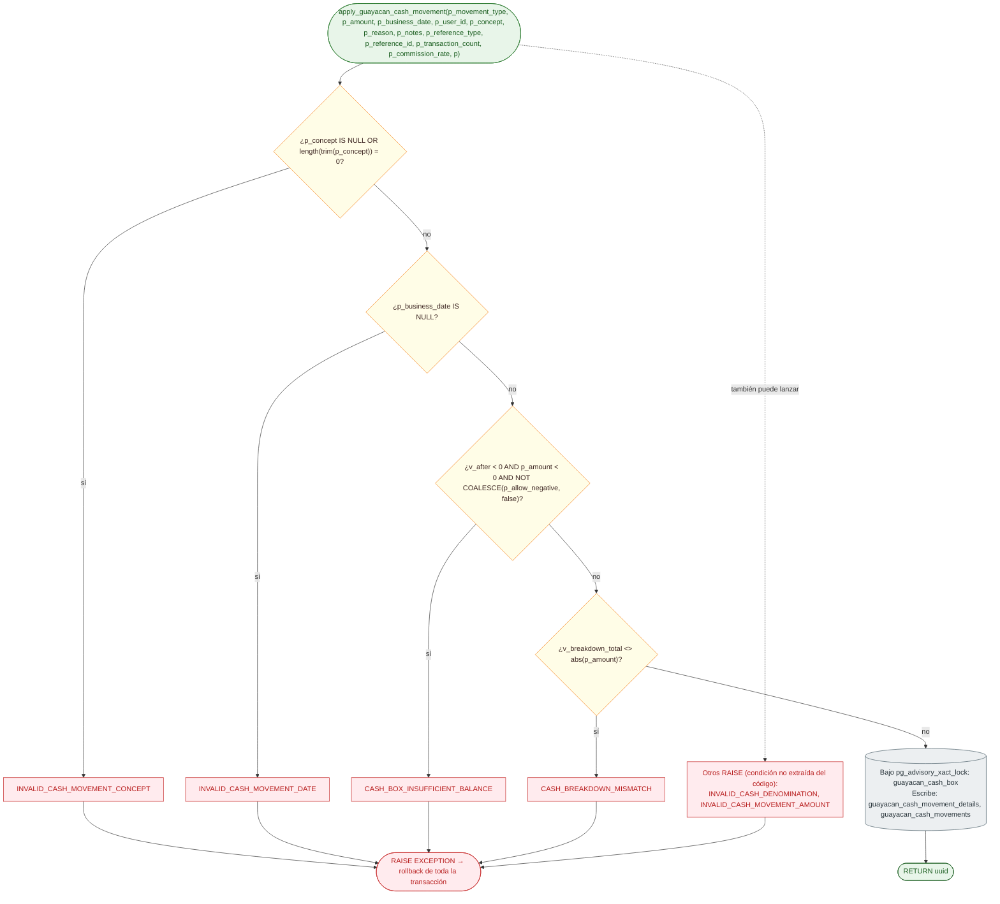

# Función apply_guayacan_cash_movement: validaciones y escritura

Módulo: **Base de datos — escritores de saldos y transferencias** · Fuente editable: [`sql-apply-guayacan-cash-movement.mmd`](sql-apply-guayacan-cash-movement.mmd) · [Índice de diagramas](../../README.md)

## Explicación

1. **¿Qué proceso representa?** Las reglas IF … RAISE EXCEPTION de apply_guayacan_cash_movement en el orden del código fuente de la función, y las tablas que escribe. Es la única forma en que el sistema modifica ese saldo.
2. **¿Dónde comienza?** llamada desde guayacan_commission_on_operation_insert(), guayacan_commission_on_operation_void()
3. **¿Qué archivos intervienen?** [`comercial-jhoel-api/src/database/migrations`](../../../../comercial-jhoel-api/src/database/migrations)
4. **¿Qué función ejecuta cada archivo?** Cada nodo muestra la clase y el método (`Clase.metodo`) y, debajo, la ruta del archivo. El color indica la capa: azul = frontend, morado = controlador, verde azulado = caso de uso, amarillo = dominio/puerto, lila = infraestructura, gris = PostgreSQL, amarillo claro = decisión, rojo = error.
5. **¿Qué decisiones toma el sistema?** INVALID_CASH_MOVEMENT_CONCEPT, INVALID_CASH_MOVEMENT_DATE, CASH_BOX_INSUFFICIENT_BALANCE, CASH_BREAKDOWN_MISMATCH · además lanza (condición no extraída): INVALID_CASH_DENOMINATION, INVALID_CASH_MOVEMENT_AMOUNT
6. **¿Dónde se almacenan los datos?** guayacan_cash_movement_details, guayacan_cash_movements
7. **¿Cómo termina el proceso?** RETURN uuid dentro de la transacción de quien la llamó
8. **¿Qué sucede cuando ocurre un error?** Cada RAISE revierte también lo que hizo la función que la llamó (guayacan_commission_on_operation_insert(), guayacan_commission_on_operation_void())

> Generado desde el código. Las condiciones de los rombos son el texto literal de los `if … throw` (TypeScript) y de los `IF … RAISE EXCEPTION` (PL/pgSQL).
