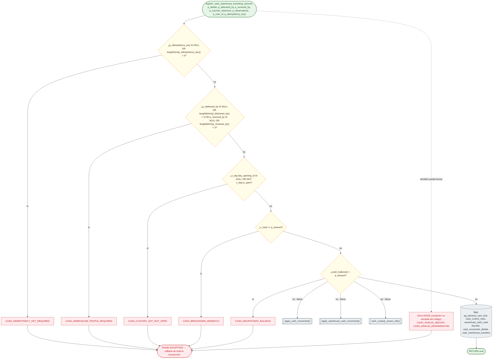

# Función register_cash_warehouse_transfer: validaciones y escritura

Módulo: **Base de datos — escritores de saldos y transferencias** · Fuente editable: [`sql-register-cash-warehouse-transfer.mmd`](sql-register-cash-warehouse-transfer.mmd) · [Índice de diagramas](../../README.md)

## Explicación

1. **¿Qué proceso representa?** Las reglas IF … RAISE EXCEPTION de register_cash_warehouse_transfer en el orden del código fuente de la función, y las tablas que escribe. Es la única forma en que el sistema modifica ese saldo.
2. **¿Dónde comienza?** TypeOrmCashCustodyRepository.registerTransfer (comercial-jhoel-api/src/modules/cash-control/infrastructure/persistence/typeorm-cash-custody.repository.ts)
3. **¿Qué archivos intervienen?** [`comercial-jhoel-api/src/database/migrations`](../../../../comercial-jhoel-api/src/database/migrations), [`comercial-jhoel-api/src/modules/cash-control/infrastructure/persistence/typeorm-cash-custody.repository.ts`](../../../../comercial-jhoel-api/src/modules/cash-control/infrastructure/persistence/typeorm-cash-custody.repository.ts)
4. **¿Qué función ejecuta cada archivo?** Cada nodo muestra la clase y el método (`Clase.metodo`) y, debajo, la ruta del archivo. El color indica la capa: azul = frontend, morado = controlador, verde azulado = caso de uso, amarillo = dominio/puerto, lila = infraestructura, gris = PostgreSQL, amarillo claro = decisión, rojo = error.
5. **¿Qué decisiones toma el sistema?** CASH_IDEMPOTENCY_KEY_REQUIRED, CASH_WAREHOUSE_PEOPLE_REQUIRED, CASH_CUSTODY_DAY_NOT_OPEN, CASH_BREAKDOWN_MISMATCH, CASH_INSUFFICIENT_BALANCE · además lanza (condición no extraída): CASH_INVALID_AMOUNT, CASH_INVALID_DENOMINATION
6. **¿Dónde se almacenan los datos?** cash_movement_details, cash_warehouse_transfers
7. **¿Cómo termina el proceso?** RETURN uuid dentro de la transacción de quien la llamó
8. **¿Qué sucede cuando ocurre un error?** Cada RAISE revierte también lo que hizo la función que la llamó

> Generado desde el código. Las condiciones de los rombos son el texto literal de los `if … throw` (TypeScript) y de los `IF … RAISE EXCEPTION` (PL/pgSQL).
