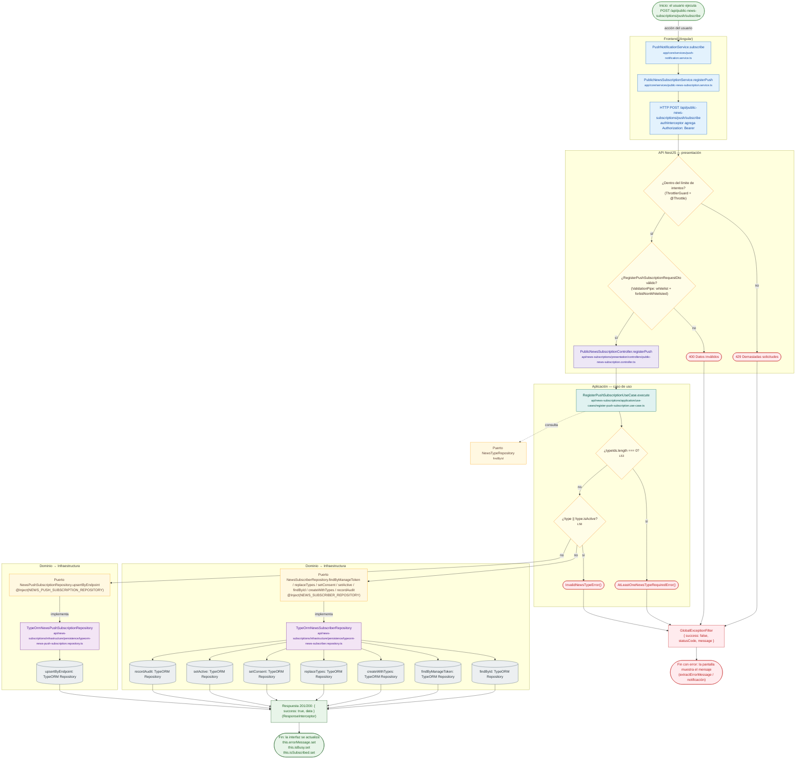

# POST /api/public-news-subscriptions/push/subscribe

Módulo: **Suscripciones a noticias (Web Push) (news-subscriptions)** · Fuente editable: [`post-public-news-subscriptions-push-subscribe.mmd`](post-public-news-subscriptions-push-subscribe.mmd) · [Índice de diagramas](../../README.md)

## Explicación

1. **¿Qué proceso representa?** Flujo de decisiones real de POST /api/public-news-subscriptions/push/subscribe: guards, DTO, validaciones del caso de uso (if … throw) y reglas de las funciones PL/pgSQL (IF … RAISE).
2. **¿Dónde comienza?** PushNotificationService.subscribe (comercial-jhoel-app/src/app/core/services/push-notification.service.ts)
3. **¿Qué archivos intervienen?** [`comercial-jhoel-api/src/modules/news-subscriptions/presentation/controllers/public-news-subscription.controller.ts`](../../../../comercial-jhoel-api/src/modules/news-subscriptions/presentation/controllers/public-news-subscription.controller.ts), [`comercial-jhoel-app/src/app/core/services/public-news-subscription.service.ts`](../../../../comercial-jhoel-app/src/app/core/services/public-news-subscription.service.ts), [`comercial-jhoel-app/src/app/core/services/push-notification.service.ts`](../../../../comercial-jhoel-app/src/app/core/services/push-notification.service.ts), [`comercial-jhoel-api/src/modules/news-subscriptions/application/use-cases/register-push-subscription.use-case.ts`](../../../../comercial-jhoel-api/src/modules/news-subscriptions/application/use-cases/register-push-subscription.use-case.ts), [`comercial-jhoel-api/src/modules/news-types/domain/repositories/news-type.repository.ts`](../../../../comercial-jhoel-api/src/modules/news-types/domain/repositories/news-type.repository.ts), [`comercial-jhoel-api/src/modules/news-subscriptions/domain/repositories/news-subscriber.repository.ts`](../../../../comercial-jhoel-api/src/modules/news-subscriptions/domain/repositories/news-subscriber.repository.ts), [`comercial-jhoel-api/src/modules/news-subscriptions/infrastructure/persistence/typeorm-news-subscriber.repository.ts`](../../../../comercial-jhoel-api/src/modules/news-subscriptions/infrastructure/persistence/typeorm-news-subscriber.repository.ts), [`comercial-jhoel-api/src/modules/news-subscriptions/domain/repositories/news-push-subscription.repository.ts`](../../../../comercial-jhoel-api/src/modules/news-subscriptions/domain/repositories/news-push-subscription.repository.ts), [`comercial-jhoel-api/src/modules/news-subscriptions/infrastructure/persistence/typeorm-news-push-subscription.repository.ts`](../../../../comercial-jhoel-api/src/modules/news-subscriptions/infrastructure/persistence/typeorm-news-push-subscription.repository.ts)
4. **¿Qué función ejecuta cada archivo?** Cada nodo muestra la clase y el método (`Clase.metodo`) y, debajo, la ruta del archivo. El color indica la capa: azul = frontend, morado = controlador, verde azulado = caso de uso, amarillo = dominio/puerto, lila = infraestructura, gris = PostgreSQL, amarillo claro = decisión, rojo = error.
5. **¿Qué decisiones toma el sistema?** límite de intentos (ThrottlerGuard) | DTO RegisterPushSubscriptionRequestDto | typeIds.length === 0 | !type || !type.isActive
6. **¿Dónde se almacenan los datos?** ver repositorio
7. **¿Cómo termina el proceso?** Respuesta { success: true, data } y actualización de la pantalla
8. **¿Qué sucede cuando ocurre un error?** Cada rama roja termina en GlobalExceptionFilter → { success: false, message } y la pantalla muestra el mensaje; un RAISE en SQL revierte toda la transacción

> Generado desde el código. Las condiciones de los rombos son el texto literal de los `if … throw` (TypeScript) y de los `IF … RAISE EXCEPTION` (PL/pgSQL).
