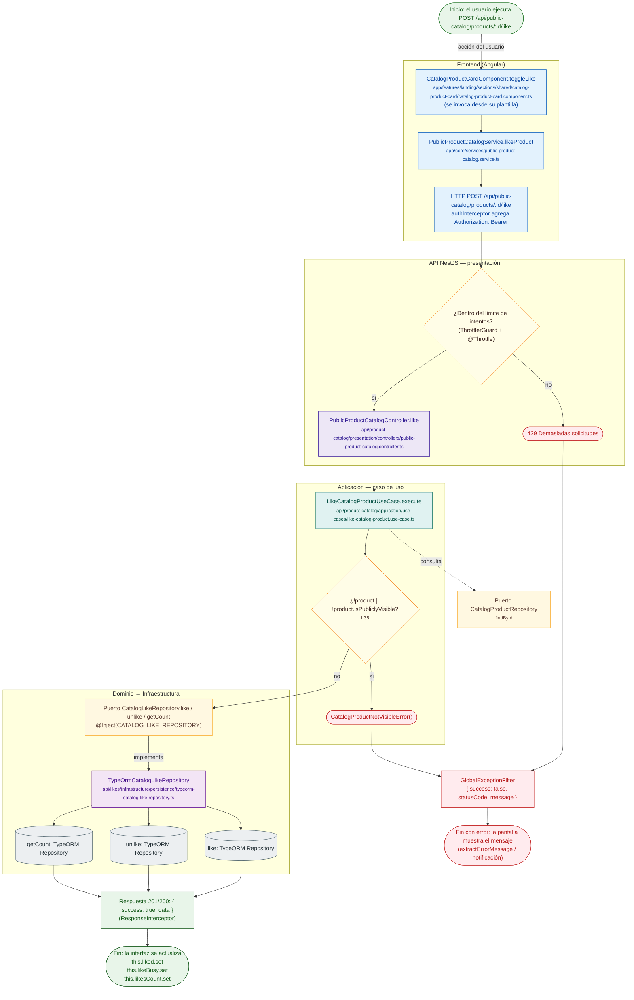

# POST /api/public-catalog/products/:id/like

Módulo: **Catálogo de productos (product-catalog)** · Fuente editable: [`post-public-catalog-products-id-like.mmd`](post-public-catalog-products-id-like.mmd) · [Índice de diagramas](../../README.md)

## Explicación

1. **¿Qué proceso representa?** Flujo de decisiones real de POST /api/public-catalog/products/:id/like: guards, DTO, validaciones del caso de uso (if … throw) y reglas de las funciones PL/pgSQL (IF … RAISE).
2. **¿Dónde comienza?** CatalogProductCardComponent.toggleLike (comercial-jhoel-app/src/app/features/landing/sections/shared/catalog-product-card/catalog-product-card.component.ts)
3. **¿Qué archivos intervienen?** [`comercial-jhoel-api/src/modules/product-catalog/presentation/controllers/public-product-catalog.controller.ts`](../../../../comercial-jhoel-api/src/modules/product-catalog/presentation/controllers/public-product-catalog.controller.ts), [`comercial-jhoel-app/src/app/core/services/public-product-catalog.service.ts`](../../../../comercial-jhoel-app/src/app/core/services/public-product-catalog.service.ts), [`comercial-jhoel-app/src/app/features/landing/sections/shared/catalog-product-card/catalog-product-card.component.ts`](../../../../comercial-jhoel-app/src/app/features/landing/sections/shared/catalog-product-card/catalog-product-card.component.ts), [`comercial-jhoel-api/src/modules/product-catalog/application/use-cases/like-catalog-product.use-case.ts`](../../../../comercial-jhoel-api/src/modules/product-catalog/application/use-cases/like-catalog-product.use-case.ts), [`comercial-jhoel-api/src/modules/product-catalog/domain/repositories/catalog-product.repository.ts`](../../../../comercial-jhoel-api/src/modules/product-catalog/domain/repositories/catalog-product.repository.ts), [`comercial-jhoel-api/src/modules/likes/domain/repositories/catalog-like.repository.ts`](../../../../comercial-jhoel-api/src/modules/likes/domain/repositories/catalog-like.repository.ts), [`comercial-jhoel-api/src/modules/likes/infrastructure/persistence/typeorm-catalog-like.repository.ts`](../../../../comercial-jhoel-api/src/modules/likes/infrastructure/persistence/typeorm-catalog-like.repository.ts)
4. **¿Qué función ejecuta cada archivo?** Cada nodo muestra la clase y el método (`Clase.metodo`) y, debajo, la ruta del archivo. El color indica la capa: azul = frontend, morado = controlador, verde azulado = caso de uso, amarillo = dominio/puerto, lila = infraestructura, gris = PostgreSQL, amarillo claro = decisión, rojo = error.
5. **¿Qué decisiones toma el sistema?** límite de intentos (ThrottlerGuard) | !product || !product.isPubliclyVisible
6. **¿Dónde se almacenan los datos?** ver repositorio
7. **¿Cómo termina el proceso?** Respuesta { success: true, data } y actualización de la pantalla
8. **¿Qué sucede cuando ocurre un error?** Cada rama roja termina en GlobalExceptionFilter → { success: false, message } y la pantalla muestra el mensaje; un RAISE en SQL revierte toda la transacción

> Generado desde el código. Las condiciones de los rombos son el texto literal de los `if … throw` (TypeScript) y de los `IF … RAISE EXCEPTION` (PL/pgSQL).
