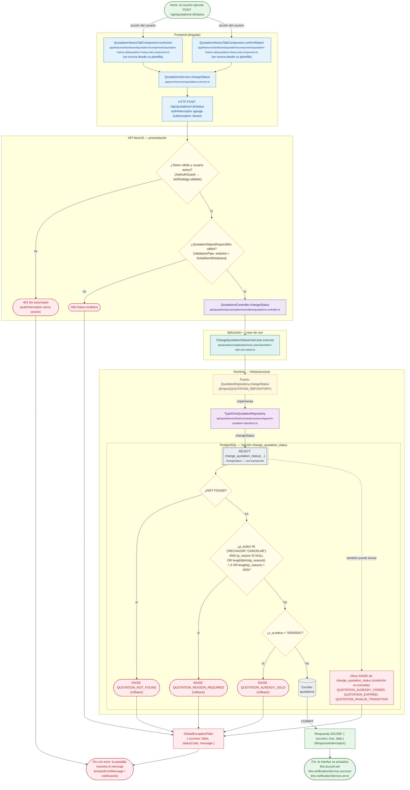

# POST /api/quotations/:id/status

Módulo: **Cotizaciones (quotations)** · Fuente editable: [`post-quotations-id-status.mmd`](post-quotations-id-status.mmd) · [Índice de diagramas](../../README.md)

## Explicación

1. **¿Qué proceso representa?** Flujo de decisiones real de POST /api/quotations/:id/status: guards, DTO, validaciones del caso de uso (if … throw) y reglas de las funciones PL/pgSQL (IF … RAISE).
2. **¿Dónde comienza?** QuotationHistoryTabComponent.runAction (comercial-jhoel-app/src/app/features/dashboard/quotations/components/quotation-history-tab/quotation-history-tab.component.ts)
3. **¿Qué archivos intervienen?** [`comercial-jhoel-api/src/modules/quotations/presentation/controllers/quotations.controller.ts`](../../../../comercial-jhoel-api/src/modules/quotations/presentation/controllers/quotations.controller.ts), [`comercial-jhoel-app/src/app/core/services/quotations.service.ts`](../../../../comercial-jhoel-app/src/app/core/services/quotations.service.ts), [`comercial-jhoel-app/src/app/features/dashboard/quotations/components/quotation-history-tab/quotation-history-tab.component.ts`](../../../../comercial-jhoel-app/src/app/features/dashboard/quotations/components/quotation-history-tab/quotation-history-tab.component.ts), [`comercial-jhoel-api/src/modules/quotations/application/use-cases/quotation-sale.use-cases.ts`](../../../../comercial-jhoel-api/src/modules/quotations/application/use-cases/quotation-sale.use-cases.ts), [`comercial-jhoel-api/src/modules/quotations/domain/repositories/quotation.repository.ts`](../../../../comercial-jhoel-api/src/modules/quotations/domain/repositories/quotation.repository.ts), [`comercial-jhoel-api/src/modules/quotations/infrastructure/persistence/typeorm-quotation.repository.ts`](../../../../comercial-jhoel-api/src/modules/quotations/infrastructure/persistence/typeorm-quotation.repository.ts)
4. **¿Qué función ejecuta cada archivo?** Cada nodo muestra la clase y el método (`Clase.metodo`) y, debajo, la ruta del archivo. El color indica la capa: azul = frontend, morado = controlador, verde azulado = caso de uso, amarillo = dominio/puerto, lila = infraestructura, gris = PostgreSQL, amarillo claro = decisión, rojo = error.
5. **¿Qué decisiones toma el sistema?** sesión JWT válida | DTO QuotationStatusRequestDto | SQL change_quotation_status: NOT FOUND | SQL change_quotation_status: p_action IN ('RECHAZAR','CANCELAR') AND (p_reason IS NULL OR length(btrim(p_reason)) < 5 OR length(p_reason) > 255) | SQL change_quotation_status: v_q.status = 'VENDIDA'
6. **¿Dónde se almacenan los datos?** change_quotation_status(), quotations
7. **¿Cómo termina el proceso?** Respuesta { success: true, data } y actualización de la pantalla
8. **¿Qué sucede cuando ocurre un error?** Cada rama roja termina en GlobalExceptionFilter → { success: false, message } y la pantalla muestra el mensaje; un RAISE en SQL revierte toda la transacción

> Generado desde el código. Las condiciones de los rombos son el texto literal de los `if … throw` (TypeScript) y de los `IF … RAISE EXCEPTION` (PL/pgSQL).
