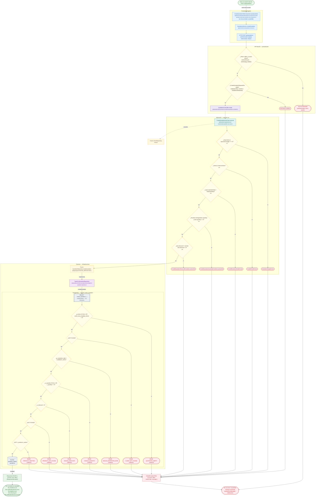

# POST /api/quotations

Módulo: **Cotizaciones (quotations)** · Fuente editable: [`post-quotations.mmd`](post-quotations.mmd) · [Índice de diagramas](../../README.md)

## Explicación

1. **¿Qué proceso representa?** Flujo de decisiones real de POST /api/quotations: guards, DTO, validaciones del caso de uso (if … throw) y reglas de las funciones PL/pgSQL (IF … RAISE).
2. **¿Dónde comienza?** CreateQuotationTabComponent.saveQuotation (comercial-jhoel-app/src/app/features/dashboard/quotations/components/create-quotation-tab/create-quotation-tab.component.ts)
3. **¿Qué archivos intervienen?** [`comercial-jhoel-api/src/modules/quotations/presentation/controllers/quotations.controller.ts`](../../../../comercial-jhoel-api/src/modules/quotations/presentation/controllers/quotations.controller.ts), [`comercial-jhoel-app/src/app/core/services/quotations.service.ts`](../../../../comercial-jhoel-app/src/app/core/services/quotations.service.ts), [`comercial-jhoel-app/src/app/features/dashboard/quotations/components/create-quotation-tab/create-quotation-tab.component.ts`](../../../../comercial-jhoel-app/src/app/features/dashboard/quotations/components/create-quotation-tab/create-quotation-tab.component.ts), [`comercial-jhoel-api/src/modules/quotations/application/use-cases/create-quotation.use-case.ts`](../../../../comercial-jhoel-api/src/modules/quotations/application/use-cases/create-quotation.use-case.ts), [`comercial-jhoel-api/src/modules/clients/domain/repositories/client.repository.ts`](../../../../comercial-jhoel-api/src/modules/clients/domain/repositories/client.repository.ts), [`comercial-jhoel-api/src/modules/quotations/domain/repositories/quotation.repository.ts`](../../../../comercial-jhoel-api/src/modules/quotations/domain/repositories/quotation.repository.ts), [`comercial-jhoel-api/src/modules/quotations/infrastructure/persistence/typeorm-quotation.repository.ts`](../../../../comercial-jhoel-api/src/modules/quotations/infrastructure/persistence/typeorm-quotation.repository.ts)
4. **¿Qué función ejecuta cada archivo?** Cada nodo muestra la clase y el método (`Clase.metodo`) y, debajo, la ruta del archivo. El color indica la capa: azul = frontend, morado = controlador, verde azulado = caso de uso, amarillo = dominio/puerto, lila = infraestructura, gris = PostgreSQL, amarillo claro = decisión, rojo = error.
5. **¿Qué decisiones toma el sistema?** sesión JWT válida | DTO CreateQuotationRequestDto | !input.items || input.items.length === 0 | !client || !client.isActive | input.expirationDate < todayIsoDate() | !Number.isInteger(item.quantity) || item.quantity <= 0 | item.discount != null && item.discount < 0 | SQL create_quotation: p_items IS NULL OR jsonb_array_length(p_items) = 0 | SQL create_quotation: NOT FOUND | SQL create_quotation: p_expiration_date < CURRENT_DATE | SQL create_quotation: v_quantity IS NULL OR v_quantity <= 0 | SQL create_quotation: v_discount < 0 | SQL create_quotation: NOT FOUND | SQL create_quotation: NOT v_product.is_active
6. **¿Dónde se almacenan los datos?** create_quotation(), quotation_details, quotations
7. **¿Cómo termina el proceso?** Respuesta { success: true, data } y actualización de la pantalla
8. **¿Qué sucede cuando ocurre un error?** Cada rama roja termina en GlobalExceptionFilter → { success: false, message } y la pantalla muestra el mensaje; un RAISE en SQL revierte toda la transacción

> Generado desde el código. Las condiciones de los rombos son el texto literal de los `if … throw` (TypeScript) y de los `IF … RAISE EXCEPTION` (PL/pgSQL).
