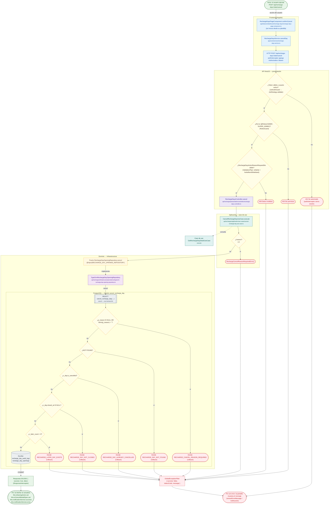

# POST /api/recharge-days/:date/cancel

Módulo: **Recargas electrónicas (recharges)** · Fuente editable: [`post-recharge-days-date-cancel.mmd`](post-recharge-days-date-cancel.mmd) · [Índice de diagramas](../../README.md)

## Explicación

1. **¿Qué proceso representa?** Flujo de decisiones real de POST /api/recharge-days/:date/cancel: guards, DTO, validaciones del caso de uso (if … throw) y reglas de las funciones PL/pgSQL (IF … RAISE).
2. **¿Dónde comienza?** RechargeDaysPageComponent.confirmCancel (comercial-jhoel-app/src/app/features/dashboard/recharge-days/recharge-days-page.component.ts)
3. **¿Qué archivos intervienen?** [`comercial-jhoel-api/src/modules/recharges/presentation/controllers/recharge-days.controller.ts`](../../../../comercial-jhoel-api/src/modules/recharges/presentation/controllers/recharge-days.controller.ts), [`comercial-jhoel-app/src/app/core/services/recharge-days.service.ts`](../../../../comercial-jhoel-app/src/app/core/services/recharge-days.service.ts), [`comercial-jhoel-app/src/app/features/dashboard/recharge-days/recharge-days-page.component.ts`](../../../../comercial-jhoel-app/src/app/features/dashboard/recharge-days/recharge-days-page.component.ts), [`comercial-jhoel-api/src/modules/recharges/application/use-cases/cancel-recharge-day.use-case.ts`](../../../../comercial-jhoel-api/src/modules/recharges/application/use-cases/cancel-recharge-day.use-case.ts), [`comercial-jhoel-api/src/modules/recharges/application/use-cases/get-recharge-day-detail.use-case.ts`](../../../../comercial-jhoel-api/src/modules/recharges/application/use-cases/get-recharge-day-detail.use-case.ts), [`comercial-jhoel-api/src/modules/recharges/domain/repositories/recharge-day-opening.repository.ts`](../../../../comercial-jhoel-api/src/modules/recharges/domain/repositories/recharge-day-opening.repository.ts), [`comercial-jhoel-api/src/modules/recharges/infrastructure/persistence/typeorm-recharge-day-opening.repository.ts`](../../../../comercial-jhoel-api/src/modules/recharges/infrastructure/persistence/typeorm-recharge-day-opening.repository.ts)
4. **¿Qué función ejecuta cada archivo?** Cada nodo muestra la clase y el método (`Clase.metodo`) y, debajo, la ruta del archivo. El color indica la capa: azul = frontend, morado = controlador, verde azulado = caso de uso, amarillo = dominio/puerto, lila = infraestructura, gris = PostgreSQL, amarillo claro = decisión, rojo = error.
5. **¿Qué decisiones toma el sistema?** sesión JWT válida | rol 'ADMIN', 'SUPER_ADMIN' | DTO RechargeDayActionReasonRequestDto | !reason | SQL cancel_recharge_day: p_reason IS NULL OR btrim(p_reason) = '' | SQL cancel_recharge_day: NOT FOUND | SQL cancel_recharge_day: v_day.is_cancelled | SQL cancel_recharge_day: v_day.closed_at IS NULL | SQL cancel_recharge_day: v_later_count > 0
6. **¿Dónde se almacenan los datos?** cancel_recharge_day(), recharge_day_audit_logs, recharge_day_openings
7. **¿Cómo termina el proceso?** Respuesta { success: true, data } y actualización de la pantalla
8. **¿Qué sucede cuando ocurre un error?** Cada rama roja termina en GlobalExceptionFilter → { success: false, message } y la pantalla muestra el mensaje; un RAISE en SQL revierte toda la transacción

> Generado desde el código. Las condiciones de los rombos son el texto literal de los `if … throw` (TypeScript) y de los `IF … RAISE EXCEPTION` (PL/pgSQL).
