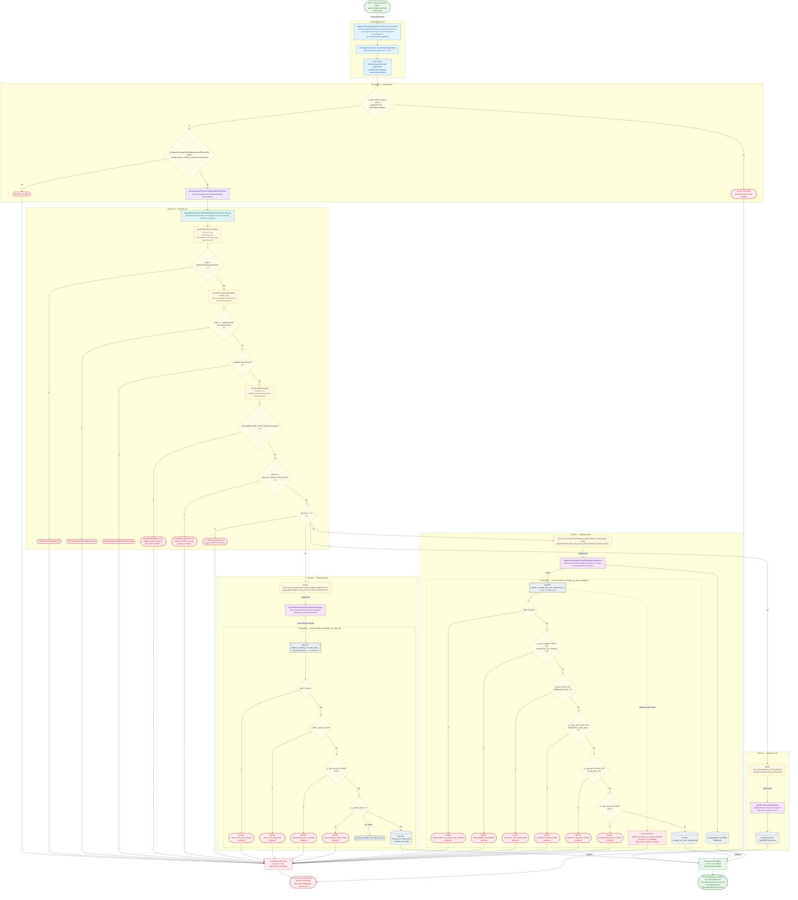

# POST /api/recharges/sims/sale-registrations

Módulo: **Recargas electrónicas (recharges)** · Fuente editable: [`post-recharges-sims-sale-registrations.mmd`](post-recharges-sims-sale-registrations.mmd) · [Índice de diagramas](../../README.md)

## Explicación

1. **¿Qué proceso representa?** Flujo de decisiones real de POST /api/recharges/sims/sale-registrations: guards, DTO, validaciones del caso de uso (if … throw) y reglas de las funciones PL/pgSQL (IF … RAISE).
2. **¿Dónde comienza?** RegisterSimSaleRegistrationFormComponent.submit (comercial-jhoel-app/src/app/features/dashboard/recharges/components/register-sim-sale-registration-form/register-sim-sale-registration-form.component.ts)
3. **¿Qué archivos intervienen?** [`comercial-jhoel-api/src/modules/recharges/presentation/controllers/recharge-sims.controller.ts`](../../../../comercial-jhoel-api/src/modules/recharges/presentation/controllers/recharge-sims.controller.ts), [`comercial-jhoel-app/src/app/core/services/recharge-sims.service.ts`](../../../../comercial-jhoel-app/src/app/core/services/recharge-sims.service.ts), [`comercial-jhoel-app/src/app/features/dashboard/recharges/components/register-sim-sale-registration-form/register-sim-sale-registration-form.component.ts`](../../../../comercial-jhoel-app/src/app/features/dashboard/recharges/components/register-sim-sale-registration-form/register-sim-sale-registration-form.component.ts), [`comercial-jhoel-api/src/modules/recharges/application/use-cases/register-recharge-sim-sale-with-registration.use-case.ts`](../../../../comercial-jhoel-api/src/modules/recharges/application/use-cases/register-recharge-sim-sale-with-registration.use-case.ts), [`comercial-jhoel-api/src/modules/recharge-cash-box/application/utils/assert-valid-operation-date.ts`](../../../../comercial-jhoel-api/src/modules/recharge-cash-box/application/utils/assert-valid-operation-date.ts), [`comercial-jhoel-api/src/modules/recharges/application/utils/assert-recharge-day-writable.ts`](../../../../comercial-jhoel-api/src/modules/recharges/application/utils/assert-recharge-day-writable.ts), [`comercial-jhoel-api/src/modules/phones/application/utils/assert-valid-dpi-image.ts`](../../../../comercial-jhoel-api/src/modules/phones/application/utils/assert-valid-dpi-image.ts), [`comercial-jhoel-api/src/shared/application/ports/transaction-manager.port.ts`](../../../../comercial-jhoel-api/src/shared/application/ports/transaction-manager.port.ts), [`comercial-jhoel-api/src/shared/infrastructure/services/typeorm-transaction-manager.service.ts`](../../../../comercial-jhoel-api/src/shared/infrastructure/services/typeorm-transaction-manager.service.ts), [`comercial-jhoel-api/src/modules/recharges/domain/repositories/recharge-sim-daily-stock.repository.ts`](../../../../comercial-jhoel-api/src/modules/recharges/domain/repositories/recharge-sim-daily-stock.repository.ts), [`comercial-jhoel-api/src/modules/recharges/infrastructure/persistence/typeorm-recharge-sim-daily-stock.repository.ts`](../../../../comercial-jhoel-api/src/modules/recharges/infrastructure/persistence/typeorm-recharge-sim-daily-stock.repository.ts), [`comercial-jhoel-api/src/modules/recharges/domain/repositories/recharge-sim-sale-registration.repository.ts`](../../../../comercial-jhoel-api/src/modules/recharges/domain/repositories/recharge-sim-sale-registration.repository.ts), [`comercial-jhoel-api/src/modules/recharges/infrastructure/persistence/typeorm-recharge-sim-sale-registration.repository.ts`](../../../../comercial-jhoel-api/src/modules/recharges/infrastructure/persistence/typeorm-recharge-sim-sale-registration.repository.ts)
4. **¿Qué función ejecuta cada archivo?** Cada nodo muestra la clase y el método (`Clase.metodo`) y, debajo, la ruta del archivo. El color indica la capa: azul = frontend, morado = controlador, verde azulado = caso de uso, amarillo = dominio/puerto, lila = infraestructura, gris = PostgreSQL, amarillo claro = decisión, rojo = error.
5. **¿Qué decisiones toma el sistema?** sesión JWT válida | DTO RegisterRechargeSimSaleRegistrationRequestDto | date > maxAllowedOperationDate() | date === todayIsoDate() && !dayOpening | dayOpening?.isClosed | !ALLOWED_MIME_TYPES.has(file.mimetype) | file.size > MAX_DPI_IMAGE_SIZE_BYTES | file.size === 0 | SQL register_recharge_sim_sale_unit: NOT FOUND | SQL register_recharge_sim_sale_unit: NOT v_type.is_active | SQL register_recharge_sim_sale_unit: v_day_closed_at IS NOT NULL | SQL register_recharge_sim_sale_unit: v_current_stock < 1 | SQL register_recharge_sim_sale_registration: NOT FOUND | SQL register_recharge_sim_sale_registration: p_sim_number IS NULL OR length(trim(p_sim_number)) = 0
6. **¿Dónde se almacenan los datos?** register_recharge_sim_sale_unit(), register_recharge_sim_sale_registration(), recharge_sim_daily_stock, recharge_sim_sales, recharge_sim_sale_registrations
7. **¿Cómo termina el proceso?** Respuesta { success: true, data } y actualización de la pantalla
8. **¿Qué sucede cuando ocurre un error?** Cada rama roja termina en GlobalExceptionFilter → { success: false, message } y la pantalla muestra el mensaje; un RAISE en SQL revierte toda la transacción

> Generado desde el código. Las condiciones de los rombos son el texto literal de los `if … throw` (TypeScript) y de los `IF … RAISE EXCEPTION` (PL/pgSQL).
