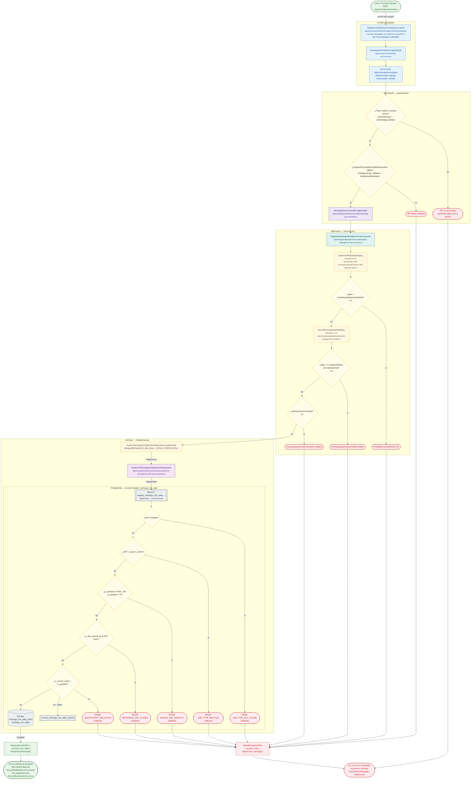

# POST /api/recharges/sims/sales

Módulo: **Recargas electrónicas (recharges)** · Fuente editable: [`post-recharges-sims-sales.mmd`](post-recharges-sims-sales.mmd) · [Índice de diagramas](../../README.md)

## Explicación

1. **¿Qué proceso representa?** Flujo de decisiones real de POST /api/recharges/sims/sales: guards, DTO, validaciones del caso de uso (if … throw) y reglas de las funciones PL/pgSQL (IF … RAISE).
2. **¿Dónde comienza?** RegisterSimSaleFormComponent.submit (comercial-jhoel-app/src/app/features/dashboard/recharges/components/register-sim-sale-form/register-sim-sale-form.component.ts)
3. **¿Qué archivos intervienen?** [`comercial-jhoel-api/src/modules/recharges/presentation/controllers/recharge-sims.controller.ts`](../../../../comercial-jhoel-api/src/modules/recharges/presentation/controllers/recharge-sims.controller.ts), [`comercial-jhoel-app/src/app/core/services/recharge-sims.service.ts`](../../../../comercial-jhoel-app/src/app/core/services/recharge-sims.service.ts), [`comercial-jhoel-app/src/app/features/dashboard/recharges/components/register-sim-sale-form/register-sim-sale-form.component.ts`](../../../../comercial-jhoel-app/src/app/features/dashboard/recharges/components/register-sim-sale-form/register-sim-sale-form.component.ts), [`comercial-jhoel-api/src/modules/recharges/application/use-cases/register-recharge-sim-sale.use-case.ts`](../../../../comercial-jhoel-api/src/modules/recharges/application/use-cases/register-recharge-sim-sale.use-case.ts), [`comercial-jhoel-api/src/modules/recharge-cash-box/application/utils/assert-valid-operation-date.ts`](../../../../comercial-jhoel-api/src/modules/recharge-cash-box/application/utils/assert-valid-operation-date.ts), [`comercial-jhoel-api/src/modules/recharges/application/utils/assert-recharge-day-writable.ts`](../../../../comercial-jhoel-api/src/modules/recharges/application/utils/assert-recharge-day-writable.ts), [`comercial-jhoel-api/src/modules/recharges/domain/repositories/recharge-sim-daily-stock.repository.ts`](../../../../comercial-jhoel-api/src/modules/recharges/domain/repositories/recharge-sim-daily-stock.repository.ts), [`comercial-jhoel-api/src/modules/recharges/infrastructure/persistence/typeorm-recharge-sim-daily-stock.repository.ts`](../../../../comercial-jhoel-api/src/modules/recharges/infrastructure/persistence/typeorm-recharge-sim-daily-stock.repository.ts)
4. **¿Qué función ejecuta cada archivo?** Cada nodo muestra la clase y el método (`Clase.metodo`) y, debajo, la ruta del archivo. El color indica la capa: azul = frontend, morado = controlador, verde azulado = caso de uso, amarillo = dominio/puerto, lila = infraestructura, gris = PostgreSQL, amarillo claro = decisión, rojo = error.
5. **¿Qué decisiones toma el sistema?** sesión JWT válida | DTO RegisterRechargeSimSaleRequestDto | date > maxAllowedOperationDate() | date === todayIsoDate() && !dayOpening | dayOpening?.isClosed | SQL register_recharge_sim_sale: NOT FOUND | SQL register_recharge_sim_sale: NOT v_type.is_active | SQL register_recharge_sim_sale: p_quantity IS NULL OR p_quantity <= 0 | SQL register_recharge_sim_sale: v_day_closed_at IS NOT NULL | SQL register_recharge_sim_sale: v_current_stock < p_quantity
6. **¿Dónde se almacenan los datos?** register_recharge_sim_sale(), recharge_sim_daily_stock, recharge_sim_sales
7. **¿Cómo termina el proceso?** Respuesta { success: true, data } y actualización de la pantalla
8. **¿Qué sucede cuando ocurre un error?** Cada rama roja termina en GlobalExceptionFilter → { success: false, message } y la pantalla muestra el mensaje; un RAISE en SQL revierte toda la transacción

> Generado desde el código. Las condiciones de los rombos son el texto literal de los `if … throw` (TypeScript) y de los `IF … RAISE EXCEPTION` (PL/pgSQL).
