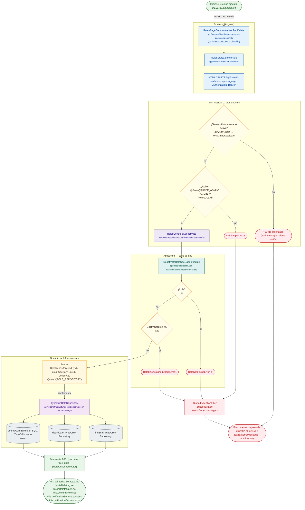

# DELETE /api/roles/:id

Módulo: **Roles (roles)** · Fuente editable: [`delete-roles-id.mmd`](delete-roles-id.mmd) · [Índice de diagramas](../../README.md)

## Explicación

1. **¿Qué proceso representa?** Flujo de decisiones real de DELETE /api/roles/:id: guards, DTO, validaciones del caso de uso (if … throw) y reglas de las funciones PL/pgSQL (IF … RAISE).
2. **¿Dónde comienza?** RolesPageComponent.confirmDelete (comercial-jhoel-app/src/app/features/dashboard/roles/roles-page.component.ts)
3. **¿Qué archivos intervienen?** [`comercial-jhoel-api/src/modules/roles/presentation/controllers/roles.controller.ts`](../../../../comercial-jhoel-api/src/modules/roles/presentation/controllers/roles.controller.ts), [`comercial-jhoel-app/src/app/core/services/role.service.ts`](../../../../comercial-jhoel-app/src/app/core/services/role.service.ts), [`comercial-jhoel-app/src/app/features/dashboard/roles/roles-page.component.ts`](../../../../comercial-jhoel-app/src/app/features/dashboard/roles/roles-page.component.ts), [`comercial-jhoel-api/src/modules/roles/application/use-cases/deactivate-role.use-case.ts`](../../../../comercial-jhoel-api/src/modules/roles/application/use-cases/deactivate-role.use-case.ts), [`comercial-jhoel-api/src/modules/roles/domain/repositories/role.repository.ts`](../../../../comercial-jhoel-api/src/modules/roles/domain/repositories/role.repository.ts), [`comercial-jhoel-api/src/modules/roles/infrastructure/persistence/typeorm-role.repository.ts`](../../../../comercial-jhoel-api/src/modules/roles/infrastructure/persistence/typeorm-role.repository.ts)
4. **¿Qué función ejecuta cada archivo?** Cada nodo muestra la clase y el método (`Clase.metodo`) y, debajo, la ruta del archivo. El color indica la capa: azul = frontend, morado = controlador, verde azulado = caso de uso, amarillo = dominio/puerto, lila = infraestructura, gris = PostgreSQL, amarillo claro = decisión, rojo = error.
5. **¿Qué decisiones toma el sistema?** sesión JWT válida | rol 'SUPER_ADMIN', 'ADMIN' | !role | activeUsers > 0
6. **¿Dónde se almacenan los datos?** users
7. **¿Cómo termina el proceso?** Respuesta { success: true, data } y actualización de la pantalla
8. **¿Qué sucede cuando ocurre un error?** Cada rama roja termina en GlobalExceptionFilter → { success: false, message } y la pantalla muestra el mensaje; un RAISE en SQL revierte toda la transacción

> Generado desde el código. Las condiciones de los rombos son el texto literal de los `if … throw` (TypeScript) y de los `IF … RAISE EXCEPTION` (PL/pgSQL).
