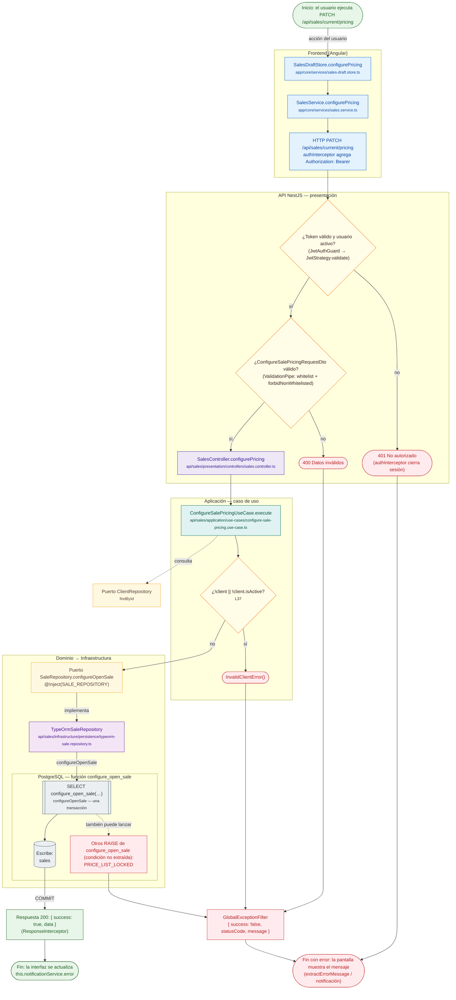

# PATCH /api/sales/current/pricing

Módulo: **Ventas (sales)** · Fuente editable: [`patch-sales-current-pricing.mmd`](patch-sales-current-pricing.mmd) · [Índice de diagramas](../../README.md)

## Explicación

1. **¿Qué proceso representa?** Flujo de decisiones real de PATCH /api/sales/current/pricing: guards, DTO, validaciones del caso de uso (if … throw) y reglas de las funciones PL/pgSQL (IF … RAISE).
2. **¿Dónde comienza?** SalesDraftStore.configurePricing (comercial-jhoel-app/src/app/core/services/sales-draft.store.ts)
3. **¿Qué archivos intervienen?** [`comercial-jhoel-api/src/modules/sales/presentation/controllers/sales.controller.ts`](../../../../comercial-jhoel-api/src/modules/sales/presentation/controllers/sales.controller.ts), [`comercial-jhoel-app/src/app/core/services/sales.service.ts`](../../../../comercial-jhoel-app/src/app/core/services/sales.service.ts), [`comercial-jhoel-app/src/app/core/services/sales-draft.store.ts`](../../../../comercial-jhoel-app/src/app/core/services/sales-draft.store.ts), [`comercial-jhoel-api/src/modules/sales/application/use-cases/configure-sale-pricing.use-case.ts`](../../../../comercial-jhoel-api/src/modules/sales/application/use-cases/configure-sale-pricing.use-case.ts), [`comercial-jhoel-api/src/modules/clients/domain/repositories/client.repository.ts`](../../../../comercial-jhoel-api/src/modules/clients/domain/repositories/client.repository.ts), [`comercial-jhoel-api/src/modules/sales/domain/repositories/sale.repository.ts`](../../../../comercial-jhoel-api/src/modules/sales/domain/repositories/sale.repository.ts), [`comercial-jhoel-api/src/modules/sales/infrastructure/persistence/typeorm-sale.repository.ts`](../../../../comercial-jhoel-api/src/modules/sales/infrastructure/persistence/typeorm-sale.repository.ts)
4. **¿Qué función ejecuta cada archivo?** Cada nodo muestra la clase y el método (`Clase.metodo`) y, debajo, la ruta del archivo. El color indica la capa: azul = frontend, morado = controlador, verde azulado = caso de uso, amarillo = dominio/puerto, lila = infraestructura, gris = PostgreSQL, amarillo claro = decisión, rojo = error.
5. **¿Qué decisiones toma el sistema?** sesión JWT válida | DTO ConfigureSalePricingRequestDto | !client || !client.isActive
6. **¿Dónde se almacenan los datos?** configure_open_sale(), sales
7. **¿Cómo termina el proceso?** Respuesta { success: true, data } y actualización de la pantalla
8. **¿Qué sucede cuando ocurre un error?** Cada rama roja termina en GlobalExceptionFilter → { success: false, message } y la pantalla muestra el mensaje; un RAISE en SQL revierte toda la transacción

> Generado desde el código. Las condiciones de los rombos son el texto literal de los `if … throw` (TypeScript) y de los `IF … RAISE EXCEPTION` (PL/pgSQL).
