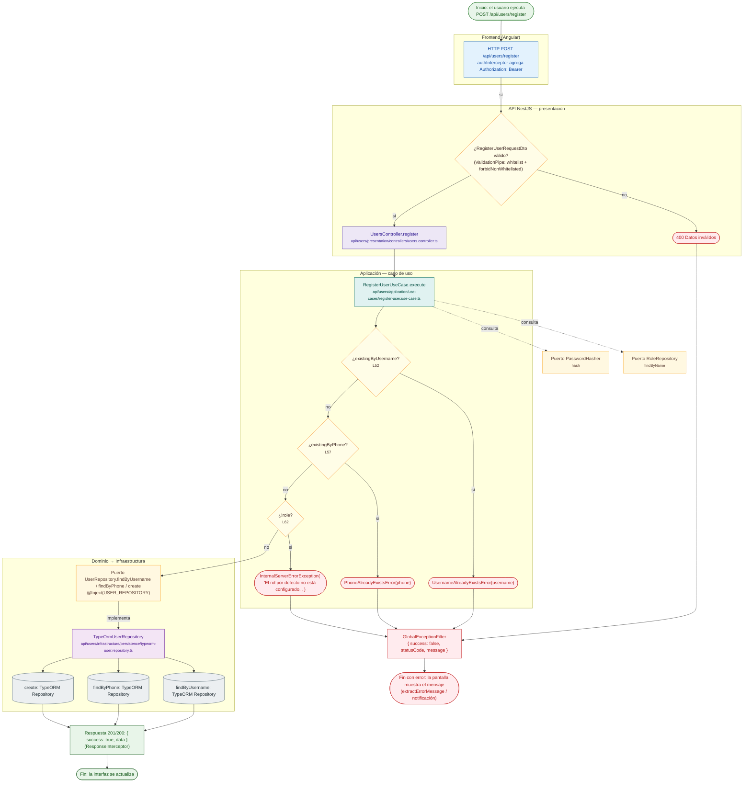

# POST /api/users/register

Módulo: **Usuarios (users)** · Fuente editable: [`post-users-register.mmd`](post-users-register.mmd) · [Índice de diagramas](../../README.md)

## Explicación

1. **¿Qué proceso representa?** Flujo de decisiones real de POST /api/users/register: guards, DTO, validaciones del caso de uso (if … throw) y reglas de las funciones PL/pgSQL (IF … RAISE).
2. **¿Dónde comienza?** cliente HTTP → POST /api/users/register
3. **¿Qué archivos intervienen?** [`comercial-jhoel-api/src/modules/users/presentation/controllers/users.controller.ts`](../../../../comercial-jhoel-api/src/modules/users/presentation/controllers/users.controller.ts), [`comercial-jhoel-api/src/modules/users/application/use-cases/register-user.use-case.ts`](../../../../comercial-jhoel-api/src/modules/users/application/use-cases/register-user.use-case.ts), [`comercial-jhoel-api/src/shared/application/ports/password-hasher.port.ts`](../../../../comercial-jhoel-api/src/shared/application/ports/password-hasher.port.ts), [`comercial-jhoel-api/src/modules/roles/domain/repositories/role.repository.ts`](../../../../comercial-jhoel-api/src/modules/roles/domain/repositories/role.repository.ts), [`comercial-jhoel-api/src/modules/users/domain/repositories/user.repository.ts`](../../../../comercial-jhoel-api/src/modules/users/domain/repositories/user.repository.ts), [`comercial-jhoel-api/src/modules/users/infrastructure/persistence/typeorm-user.repository.ts`](../../../../comercial-jhoel-api/src/modules/users/infrastructure/persistence/typeorm-user.repository.ts)
4. **¿Qué función ejecuta cada archivo?** Cada nodo muestra la clase y el método (`Clase.metodo`) y, debajo, la ruta del archivo. El color indica la capa: azul = frontend, morado = controlador, verde azulado = caso de uso, amarillo = dominio/puerto, lila = infraestructura, gris = PostgreSQL, amarillo claro = decisión, rojo = error.
5. **¿Qué decisiones toma el sistema?** DTO RegisterUserRequestDto | existingByUsername | existingByPhone | !role
6. **¿Dónde se almacenan los datos?** ver repositorio
7. **¿Cómo termina el proceso?** Respuesta { success: true, data } y actualización de la pantalla
8. **¿Qué sucede cuando ocurre un error?** Cada rama roja termina en GlobalExceptionFilter → { success: false, message } y la pantalla muestra el mensaje; un RAISE en SQL revierte toda la transacción

> Generado desde el código. Las condiciones de los rombos son el texto literal de los `if … throw` (TypeScript) y de los `IF … RAISE EXCEPTION` (PL/pgSQL).
