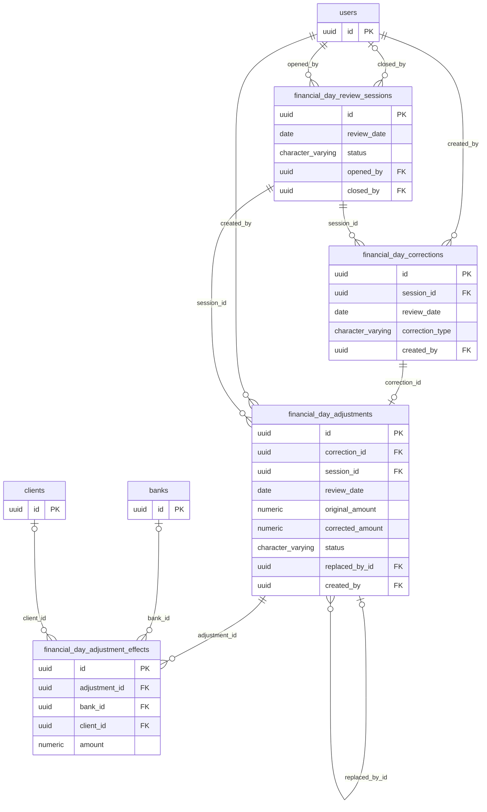

# Modelo entidad-relación — Revisión de días operativos

Módulo: **Revisión de días operativos (financial-day-review)** · Fuente editable: [`er-financial-day-review.mmd`](er-financial-day-review.mmd) · [Índice de diagramas](../README.md)

## Explicación

1. **¿Qué proceso representa?** Tablas del dominio financial-day-review (asignadas al módulo que más las usa), columnas importantes (PK, FK, montos, estados, fechas), llaves foráneas reales y su cardinalidad (|o = FK opcional, o| = relación 1 a 1 por UNIQUE)
2. **¿Dónde comienza?** Esquema real de PostgreSQL (pg_catalog)
3. **¿Qué archivos intervienen?** [`comercial-jhoel-api/src/database/migrations`](../../../comercial-jhoel-api/src/database/migrations), [`docs/codebase-study/05_DATABASE_REFERENCE.md`](../../../docs/codebase-study/05_DATABASE_REFERENCE.md)
4. **¿Qué función ejecuta cada archivo?** Cada nodo muestra la clase y el método (`Clase.metodo`) y, debajo, la ruta del archivo. El color indica la capa: azul = frontend, morado = controlador, verde azulado = caso de uso, amarillo = dominio/puerto, lila = infraestructura, gris = PostgreSQL, amarillo claro = decisión, rojo = error.
5. **¿Qué decisiones toma el sistema?** No aplica (estructura)
6. **¿Dónde se almacenan los datos?** financial_day_adjustment_effects, financial_day_adjustments, financial_day_corrections, financial_day_review_sessions
7. **¿Cómo termina el proceso?** No aplica
8. **¿Qué sucede cuando ocurre un error?** Las restricciones CHECK/UNIQUE/FK rechazan filas inválidas (ver la referencia de la tabla)

> Generado desde el código. Las condiciones de los rombos son el texto literal de los `if … throw` (TypeScript) y de los `IF … RAISE EXCEPTION` (PL/pgSQL).
