# Mapa de AccountReceivablePaymentsController

Módulo: **Cuentas por Cobrar (accounts-receivable)** · Fuente editable: [`accountreceivablepaymentscontroller.mmd`](accountreceivablepaymentscontroller.mmd) · [Índice de diagramas](../../README.md)

```mermaid
flowchart LR
  subgraph s1["Frontend"]
  n2["AccountReceivablePaymentService<br/><small>app/core/services/account-receivable-payment.service.ts</small>"]
  n3["AccountsReceivablePageComponent<br/><small>app/features/dashboard/accounts-receivable/accounts-receivable-page.component.ts</small>"]
  n4["PaymentHistoryModalComponent<br/><small>app/features/dashboard/accounts-receivable/components/payment-history-modal/payment-history-modal.component.ts</small>"]
  n5["SettlementModalComponent<br/><small>app/features/dashboard/accounts-receivable/components/settlement-modal/settlement-modal.component.ts</small>"]
  end
  subgraph s6["AccountReceivablePaymentsController (api/accounts-receivable/presentation/controllers/account-receivable-payments.controller.ts)"]
  n7["GET /api/account-receivable-payments<br/><small>list()</small>"]
  n8["GET /api/account-receivable-payments/clients/:clientId/pending<br/><small>pending()</small>"]
  n9["GET /api/account-receivable-payments/charges/:chargeId<br/><small>chargeHistory()</small>"]
  n10["POST /api/account-receivable-payments/preview<br/><small>preview()</small>"]
  n11["POST /api/account-receivable-payments<br/><small>settle() · 'ADMIN', 'SUPER_ADMIN'</small>"]
  n12["GET /api/account-receivable-payments/:id<br/><small>findOne()</small>"]
  n13["POST /api/account-receivable-payments/:id/void<br/><small>void() · 'ADMIN', 'SUPER_ADMIN'</small>"]
  end
  subgraph s14["Aplicación"]
  n15["ListAccountReceivableSettlementsUseCase<br/><small>api/accounts-receivable/application/use-cases/account-receivable-settlement.use-cases.ts</small>"]
  n16["GetClientPendingChargesUseCase<br/><small>api/accounts-receivable/application/use-cases/account-receivable-settlement.use-cases.ts</small>"]
  n17["GetChargePaymentHistoryUseCase<br/><small>api/accounts-receivable/application/use-cases/account-receivable-settlement.use-cases.ts</small>"]
  n18["PreviewAccountReceivableSettlementUseCase<br/><small>api/accounts-receivable/application/use-cases/account-receivable-settlement.use-cases.ts</small>"]
  n19["SettleAccountsReceivableUseCase<br/><small>api/accounts-receivable/application/use-cases/account-receivable-settlement.use-cases.ts</small>"]
  n20["GetAccountReceivableSettlementUseCase<br/><small>api/accounts-receivable/application/use-cases/account-receivable-settlement.use-cases.ts</small>"]
  n21["VoidAccountReceivableSettlementUseCase<br/><small>api/accounts-receivable/application/use-cases/account-receivable-settlement.use-cases.ts</small>"]
  end
  subgraph s22["Dominio · Infraestructura · PostgreSQL"]
  n23["AccountReceivableSettlementRepository"]
  n24["TypeOrmAccountReceivableSettlementRepository<br/><small>api/accounts-receivable/infrastructure/persistence/typeorm-account-receivable-settlement.repository.ts</small>"]
  n25[("account_receivable_payment_operations")]
  n26[("clients")]
  n27[("accounts_receivable")]
  n28[("account_receivable_payment_details")]
  n29[("users")]
  n30[("banks")]
  n31[["cash_balance()"]]
  n32[["settle_accounts_receivable()"]]
  n33[["void_account_receivable_payment()"]]
  end
  n3 -->|selectAllClientPending→getPendingCharges| n2
  n4 -->|load→getChargeHistory, openOperation→getSettlement, confirmVoid→voidSettlement| n2
  n5 -->|confirm→settle| n2
  n2 -->|getSettlements| n7
  n2 -->|getPendingCharges| n8
  n2 -->|getChargeHistory| n9
  n2 -->|preview| n10
  n2 -->|settle| n11
  n2 -->|getSettlement| n12
  n2 -->|voidSettlement| n13
  n7 --> n15
  n8 --> n16
  n9 --> n17
  n10 --> n18
  n11 --> n19
  n12 --> n20
  n13 --> n21
  n15 -->|findAll| n23
  n23 -->|implementa| n24
  n24 -->|findAll| n25
  n16 -->|findClientName, findChargeBalances| n23
  n24 -->|findClientName| n26
  n17 -->|findChargeBalancesByIds, findChargePayments| n23
  n24 -->|findChargeBalancesByIds| n27
  n24 -->|findChargePayments| n28
  n24 -->|findChargePayments| n25
  n24 -->|findChargePayments| n29
  n24 -->|findChargePayments| n30
  n18 -->|findClientName, findChargeBalancesByIds, getCashBalance …| n23
  n24 -->|getCashBalance| n31
  n24 -->|findBank| n30
  n19 -->|settle, findById, getCashBalance| n23
  n24 -->|settle| n32
  n32 -->|escribe| n28
  n32 -->|escribe| n25
  n24 -->|findById| n28
  n24 -->|findById| n27
  n20 -->|findById| n23
  n21 -->|void, findById, getCashBalance| n23
  n24 -->|void| n33
  n33 -->|escribe| n25
  n33 -->|escribe| n27
  classDef start fill:#e8f5e9,stroke:#2e7d32,color:#1b5e20
  classDef fe fill:#e3f2fd,stroke:#1565c0,color:#0d47a1
  classDef api fill:#ede7f6,stroke:#4527a0,color:#311b92
  classDef app fill:#e0f2f1,stroke:#00695c,color:#004d40
  classDef dom fill:#fff8e1,stroke:#f9a825,color:#5d4037
  classDef infra fill:#f3e5f5,stroke:#6a1b9a,color:#4a148c
  classDef db fill:#eceff1,stroke:#455a64,color:#263238
  classDef dec fill:#fffde7,stroke:#f57f17,color:#3e2723
  classDef err fill:#ffebee,stroke:#c62828,color:#b71c1c
  classDef ok fill:#e8f5e9,stroke:#1b5e20,color:#1b5e20
  class n2,n3,n4,n5 fe
  class n7,n8,n9,n10,n11,n12,n13 api
  class n15,n16,n17,n18,n19,n20,n21 app
  class n23 dom
  class n24 infra
  class n25,n26,n27,n28,n29,n30,n31,n32,n33 db
```

## Explicación

1. **¿Qué proceso representa?** Relación real entre archivos: componentes y servicios Angular que llaman a AccountReceivablePaymentsController, sus 7 rutas, los casos de uso que ejecutan, los puertos de repositorio, sus implementaciones, las funciones SQL y las tablas.
2. **¿Dónde comienza?** Componentes Angular (izquierda) o cualquier cliente HTTP
3. **¿Qué archivos intervienen?** [`comercial-jhoel-api/src/modules/accounts-receivable/presentation/controllers/account-receivable-payments.controller.ts`](../../../../comercial-jhoel-api/src/modules/accounts-receivable/presentation/controllers/account-receivable-payments.controller.ts), [`comercial-jhoel-app/src/app/core/services/account-receivable-payment.service.ts`](../../../../comercial-jhoel-app/src/app/core/services/account-receivable-payment.service.ts), [`comercial-jhoel-app/src/app/features/dashboard/accounts-receivable/accounts-receivable-page.component.ts`](../../../../comercial-jhoel-app/src/app/features/dashboard/accounts-receivable/accounts-receivable-page.component.ts), [`comercial-jhoel-app/src/app/features/dashboard/accounts-receivable/components/payment-history-modal/payment-history-modal.component.ts`](../../../../comercial-jhoel-app/src/app/features/dashboard/accounts-receivable/components/payment-history-modal/payment-history-modal.component.ts), [`comercial-jhoel-app/src/app/features/dashboard/accounts-receivable/components/settlement-modal/settlement-modal.component.ts`](../../../../comercial-jhoel-app/src/app/features/dashboard/accounts-receivable/components/settlement-modal/settlement-modal.component.ts), [`comercial-jhoel-api/src/modules/accounts-receivable/application/use-cases/account-receivable-settlement.use-cases.ts`](../../../../comercial-jhoel-api/src/modules/accounts-receivable/application/use-cases/account-receivable-settlement.use-cases.ts), [`comercial-jhoel-api/src/modules/accounts-receivable/infrastructure/persistence/typeorm-account-receivable-settlement.repository.ts`](../../../../comercial-jhoel-api/src/modules/accounts-receivable/infrastructure/persistence/typeorm-account-receivable-settlement.repository.ts)
4. **¿Qué función ejecuta cada archivo?** Cada nodo muestra la clase y el método (`Clase.metodo`) y, debajo, la ruta del archivo. El color indica la capa: azul = frontend, morado = controlador, verde azulado = caso de uso, amarillo = dominio/puerto, lila = infraestructura, gris = PostgreSQL, amarillo claro = decisión, rojo = error.
5. **¿Qué decisiones toma el sistema?** Ver los flujos de decisiones de cada comando en business-processes/accounts-receivable/
6. **¿Dónde se almacenan los datos?** account_receivable_payment_operations, clients, accounts_receivable, account_receivable_payment_details, users, banks
7. **¿Cómo termina el proceso?** Las flechas terminan en las tablas de PostgreSQL
8. **¿Qué sucede cuando ocurre un error?** Los errores siguen el patrón de 07-error-handling.mmd

> Generado desde el código. Las condiciones de los rombos son el texto literal de los `if … throw` (TypeScript) y de los `IF … RAISE EXCEPTION` (PL/pgSQL).
