# Mapa de BanksController

Módulo: **Bancos y Agentes Bancarios (día, saldos, cuadre, transferencias) (banks)** · Fuente editable: [`bankscontroller.mmd`](bankscontroller.mmd) · [Índice de diagramas](../../README.md)

```mermaid
flowchart LR
  subgraph s1["Frontend"]
  n2["CuadreAgentesService<br/><small>app/core/services/cuadre-agentes.service.ts</small>"]
  n3["DayStatusService<br/><small>app/core/services/day-status.service.ts</small>"]
  n4["BankAgentsPageComponent<br/><small>app/features/dashboard/bank-agents/bank-agents-page.component.ts</small>"]
  n5["BankService<br/><small>app/core/services/bank.service.ts</small>"]
  n6["BankBalanceStripComponent<br/><small>app/shared/ui/bank-balance-strip/bank-balance-strip.component.ts</small>"]
  n7["BankBalanceService<br/><small>app/core/services/bank-balance.service.ts</small>"]
  n8["CuadreAgentesPageComponent<br/><small>app/features/dashboard/bank-agents/cuadre-agentes-page.component.ts</small>"]
  n9["BankFormModalComponent<br/><small>app/features/dashboard/banks/components/bank-form-modal/bank-form-modal.component.ts</small>"]
  n10["BankTransfersPageComponent<br/><small>app/features/dashboard/bank-transfers/bank-transfers-page.component.ts</small>"]
  n11["TransaccionarPageComponent<br/><small>app/features/dashboard/transaccionar/transaccionar-page.component.ts</small>"]
  n12["BalanceCreditComponent<br/><small>app/features/dashboard/bank-transfers/components/balance-credit/balance-credit.component.ts</small>"]
  n13["BanksPageComponent<br/><small>app/features/dashboard/banks/banks-page.component.ts</small>"]
  end
  subgraph s14["BanksController (api/banks/presentation/controllers/banks.controller.ts)"]
  n15["GET /api/banks/day-status<br/><small>getDayStatus()</small>"]
  n16["POST /api/banks/day-status/open<br/><small>openDay()</small>"]
  n17["GET /api/banks/balance-strip<br/><small>getBalanceStrip()</small>"]
  n18["GET /api/banks/balances<br/><small>getBalancesView()</small>"]
  n19["GET /api/banks/cuadre-agentes-summary<br/><small>getCuadreAgentesSummary()</small>"]
  n20["GET /api/banks/balances/validation<br/><small>validateBankBalances()</small>"]
  n21["POST /api/banks/balances<br/><small>saveBalances()</small>"]
  n22["POST /api/banks<br/><small>create() · 'ADMIN', 'SUPER_ADMIN'</small>"]
  n23["GET /api/banks<br/><small>findAll()</small>"]
  n24["GET /api/banks/:id<br/><small>findOne()</small>"]
  n25["PATCH /api/banks/:id<br/><small>update() · 'ADMIN', 'SUPER_ADMIN'</small>"]
  n26["POST /api/banks/:id/balance-adjustments<br/><small>adjustBalance() · 'ADMIN', 'SUPER_ADMIN'</small>"]
  n27["DELETE /api/banks/:id<br/><small>deactivate() · 'ADMIN', 'SUPER_ADMIN'</small>"]
  end
  subgraph s28["Aplicación"]
  n29["GetDayStatusUseCase<br/><small>api/banks/application/use-cases/get-day-status.use-case.ts</small>"]
  n30["OpenDayUseCase<br/><small>api/banks/application/use-cases/open-day.use-case.ts</small>"]
  n31["GetBankBalanceStripUseCase<br/><small>api/banks/application/use-cases/get-bank-balance-strip.use-case.ts</small>"]
  n32["GetBankBalancesViewUseCase<br/><small>api/banks/application/use-cases/get-bank-balances-view.use-case.ts</small>"]
  n33["GetCuadreAgentesSummaryUseCase<br/><small>api/banks/application/use-cases/get-cuadre-agentes-summary.use-case.ts</small>"]
  n34["ValidateBankBalancesForDateUseCase<br/><small>api/banks/application/use-cases/validate-bank-balances-for-date.use-case.ts</small>"]
  n35["SaveBankBalancesUseCase<br/><small>api/banks/application/use-cases/save-bank-balances.use-case.ts</small>"]
  n36["CreateBankUseCase<br/><small>api/banks/application/use-cases/create-bank.use-case.ts</small>"]
  n37["ListBanksUseCase<br/><small>api/banks/application/use-cases/list-banks.use-case.ts</small>"]
  n38["GetBankByIdUseCase<br/><small>api/banks/application/use-cases/get-bank-by-id.use-case.ts</small>"]
  n39["UpdateBankUseCase<br/><small>api/banks/application/use-cases/update-bank.use-case.ts</small>"]
  n40["AdjustBankBalanceUseCase<br/><small>api/banks/application/use-cases/adjust-bank-balance.use-case.ts</small>"]
  n41["DeactivateBankUseCase<br/><small>api/banks/application/use-cases/deactivate-bank.use-case.ts</small>"]
  end
  subgraph s42["Dominio · Infraestructura · PostgreSQL"]
  n43["DayOpeningRepository"]
  n44["TypeOrmDayOpeningRepository<br/><small>api/banks/infrastructure/persistence/typeorm-day-opening.repository.ts</small>"]
  n45["AgentReconciliationRepository"]
  n46["TypeOrmAgentReconciliationRepository<br/><small>api/banks/infrastructure/persistence/typeorm-agent-reconciliation.repository.ts</small>"]
  n47["DayAuditLogRepository"]
  n48["TypeOrmDayAuditLogRepository<br/><small>api/banks/infrastructure/persistence/typeorm-day-audit-log.repository.ts</small>"]
  n49["BankRepository"]
  n50["TypeOrmBankRepository<br/><small>api/banks/infrastructure/persistence/typeorm-bank.repository.ts</small>"]
  n51["BankMovementRepository"]
  n52["TypeOrmBankMovementRepository<br/><small>api/banks/infrastructure/persistence/typeorm-bank-movement.repository.ts</small>"]
  n53[("bank_account_movements")]
  n54[("banks")]
  n55[("guayacan_cash_movements")]
  n56["BankBalanceRepository"]
  n57["TypeOrmBankBalanceRepository<br/><small>api/banks/infrastructure/persistence/typeorm-bank-balance.repository.ts</small>"]
  n58["AssetRepository"]
  n59["TypeOrmAssetRepository<br/><small>api/assets/infrastructure/persistence/typeorm-asset.repository.ts</small>"]
  n60["AccountReceivableRepository"]
  n61["TypeOrmAccountReceivableRepository<br/><small>api/accounts-receivable/infrastructure/persistence/typeorm-account-receivable.repository.ts</small>"]
  n62["WarehouseCashReader"]
  n63["TypeOrmWarehouseCashReader<br/><small>api/banks/infrastructure/persistence/typeorm-warehouse-cash.reader.ts</small>"]
  n64[["warehouse_cash_balance()"]]
  n65[["save_bank_balance()"]]
  n66[("bank_balances")]
  n67["AccountTypeRepository"]
  n68["TypeOrmAccountTypeRepository<br/><small>api/account-types/infrastructure/persistence/typeorm-account-type.repository.ts</small>"]
  n69[["adjust_bank_balance()"]]
  end
  n3 -->|refresh→getDayStatus, openDay→openDay| n2
  n4 -->|fetchPastDateStatusIfNeeded→getDayStatus| n2
  n6 -->|load→getBalanceStrip| n5
  n4 -->|refreshBalances→getBalancesView, fetchBalances→getBalancesView, confirmSaveChanges→saveBalances| n7
  n8 -->|fetchSummary→getSummary, refreshBankSummary→getSummary, validateBankBalances→validateBankBalances| n2
  n9 -->|submit→createBank, submit→updateBank| n5
  n10 -->|loadAccounts→getBanks| n5
  n11 -->|loadBankAccounts→getBanks| n5
  n12 -->|fetchLiveBalance→getBankById| n5
  n13 -->|toggleTransaccionar→setAvailableInTransaccionar, confirmDelete→deleteBank| n5
  n4 -->|confirmAdjust→adjustBalance| n5
  n2 -->|getDayStatus| n15
  n2 -->|openDay| n16
  n5 -->|getBalanceStrip| n17
  n7 -->|getBalancesView| n18
  n2 -->|getSummary| n19
  n2 -->|validateBankBalances| n20
  n7 -->|saveBalances| n21
  n5 -->|createBank| n22
  n5 -->|getBanks| n23
  n5 -->|getBankById| n24
  n5 -->|updateBank| n25
  n5 -->|setAvailableInTransaccionar| n25
  n5 -->|adjustBalance| n26
  n5 -->|deleteBank| n27
  n15 --> n29
  n16 --> n30
  n17 --> n31
  n18 --> n32
  n19 --> n33
  n20 --> n34
  n21 --> n35
  n22 --> n36
  n23 --> n37
  n24 --> n38
  n25 --> n39
  n26 --> n40
  n27 --> n41
  n29 -->|findByDate| n43
  n43 -->|implementa| n44
  n29 -->|existsForDate| n45
  n45 -->|implementa| n46
  n29 -->|execute| n34
  n30 -->|findByDate, open| n43
  n30 -->|record| n47
  n47 -->|implementa| n48
  n30 -->|execute| n29
  n31 -->|findAll| n49
  n49 -->|implementa| n50
  n31 -->|getLastMovementByBank| n51
  n51 -->|implementa| n52
  n52 -->|getLastMovementByBank| n53
  n52 -->|getLastMovementByBank| n54
  n52 -->|getLastMovementByBank| n55
  n32 -->|findBalancesView| n56
  n56 -->|implementa| n57
  n33 -->|findAll| n49
  n33 -->|getReportSummary| n58
  n58 -->|implementa| n59
  n33 -->|getReportSummary| n60
  n60 -->|implementa| n61
  n33 -->|getBalance| n62
  n62 -->|implementa| n63
  n63 -->|getBalance| n64
  n34 -->|findBalancesView| n56
  n35 -->|saveBalances| n56
  n57 -->|saveBalances| n65
  n65 -->|escribe| n66
  n35 -->|findByDate| n43
  n36 -->|findByActiveNameAndAccountNumber, create| n49
  n36 -->|findById| n67
  n67 -->|implementa| n68
  n37 -->|findAll| n49
  n38 -->|findById| n49
  n39 -->|findById, findByActiveNameAndAccountNumber, update| n49
  n39 -->|findById| n67
  n40 -->|adjustBalance| n51
  n52 -->|adjustBalance| n69
  n41 -->|findById, deactivate| n49
  classDef start fill:#e8f5e9,stroke:#2e7d32,color:#1b5e20
  classDef fe fill:#e3f2fd,stroke:#1565c0,color:#0d47a1
  classDef api fill:#ede7f6,stroke:#4527a0,color:#311b92
  classDef app fill:#e0f2f1,stroke:#00695c,color:#004d40
  classDef dom fill:#fff8e1,stroke:#f9a825,color:#5d4037
  classDef infra fill:#f3e5f5,stroke:#6a1b9a,color:#4a148c
  classDef db fill:#eceff1,stroke:#455a64,color:#263238
  classDef dec fill:#fffde7,stroke:#f57f17,color:#3e2723
  classDef err fill:#ffebee,stroke:#c62828,color:#b71c1c
  classDef ok fill:#e8f5e9,stroke:#1b5e20,color:#1b5e20
  class n2,n3,n4,n5,n6,n7,n8,n9,n10,n11,n12,n13 fe
  class n15,n16,n17,n18,n19,n20,n21,n22,n23,n24,n25,n26,n27 api
  class n29,n30,n31,n32,n33,n34,n35,n36,n37,n38,n39,n40,n41 app
  class n43,n45,n47,n49,n51,n56,n58,n60,n62,n67 dom
  class n44,n46,n48,n50,n52,n57,n59,n61,n63,n68 infra
  class n53,n54,n55,n64,n65,n66,n69 db
```

## Explicación

1. **¿Qué proceso representa?** Relación real entre archivos: componentes y servicios Angular que llaman a BanksController, sus 13 rutas, los casos de uso que ejecutan, los puertos de repositorio, sus implementaciones, las funciones SQL y las tablas.
2. **¿Dónde comienza?** Componentes Angular (izquierda) o cualquier cliente HTTP
3. **¿Qué archivos intervienen?** [`comercial-jhoel-api/src/modules/banks/presentation/controllers/banks.controller.ts`](../../../../comercial-jhoel-api/src/modules/banks/presentation/controllers/banks.controller.ts), [`comercial-jhoel-app/src/app/core/services/cuadre-agentes.service.ts`](../../../../comercial-jhoel-app/src/app/core/services/cuadre-agentes.service.ts), [`comercial-jhoel-app/src/app/core/services/day-status.service.ts`](../../../../comercial-jhoel-app/src/app/core/services/day-status.service.ts), [`comercial-jhoel-app/src/app/features/dashboard/bank-agents/bank-agents-page.component.ts`](../../../../comercial-jhoel-app/src/app/features/dashboard/bank-agents/bank-agents-page.component.ts), [`comercial-jhoel-app/src/app/core/services/bank.service.ts`](../../../../comercial-jhoel-app/src/app/core/services/bank.service.ts), [`comercial-jhoel-app/src/app/shared/ui/bank-balance-strip/bank-balance-strip.component.ts`](../../../../comercial-jhoel-app/src/app/shared/ui/bank-balance-strip/bank-balance-strip.component.ts), [`comercial-jhoel-app/src/app/core/services/bank-balance.service.ts`](../../../../comercial-jhoel-app/src/app/core/services/bank-balance.service.ts), [`comercial-jhoel-app/src/app/features/dashboard/bank-agents/cuadre-agentes-page.component.ts`](../../../../comercial-jhoel-app/src/app/features/dashboard/bank-agents/cuadre-agentes-page.component.ts), [`comercial-jhoel-app/src/app/features/dashboard/banks/components/bank-form-modal/bank-form-modal.component.ts`](../../../../comercial-jhoel-app/src/app/features/dashboard/banks/components/bank-form-modal/bank-form-modal.component.ts), [`comercial-jhoel-app/src/app/features/dashboard/bank-transfers/bank-transfers-page.component.ts`](../../../../comercial-jhoel-app/src/app/features/dashboard/bank-transfers/bank-transfers-page.component.ts), [`comercial-jhoel-app/src/app/features/dashboard/transaccionar/transaccionar-page.component.ts`](../../../../comercial-jhoel-app/src/app/features/dashboard/transaccionar/transaccionar-page.component.ts), [`comercial-jhoel-app/src/app/features/dashboard/bank-transfers/components/balance-credit/balance-credit.component.ts`](../../../../comercial-jhoel-app/src/app/features/dashboard/bank-transfers/components/balance-credit/balance-credit.component.ts), [`comercial-jhoel-app/src/app/features/dashboard/banks/banks-page.component.ts`](../../../../comercial-jhoel-app/src/app/features/dashboard/banks/banks-page.component.ts), [`comercial-jhoel-api/src/modules/banks/application/use-cases/get-day-status.use-case.ts`](../../../../comercial-jhoel-api/src/modules/banks/application/use-cases/get-day-status.use-case.ts), [`comercial-jhoel-api/src/modules/banks/application/use-cases/open-day.use-case.ts`](../../../../comercial-jhoel-api/src/modules/banks/application/use-cases/open-day.use-case.ts), [`comercial-jhoel-api/src/modules/banks/application/use-cases/get-bank-balance-strip.use-case.ts`](../../../../comercial-jhoel-api/src/modules/banks/application/use-cases/get-bank-balance-strip.use-case.ts), [`comercial-jhoel-api/src/modules/banks/application/use-cases/get-bank-balances-view.use-case.ts`](../../../../comercial-jhoel-api/src/modules/banks/application/use-cases/get-bank-balances-view.use-case.ts), [`comercial-jhoel-api/src/modules/banks/application/use-cases/get-cuadre-agentes-summary.use-case.ts`](../../../../comercial-jhoel-api/src/modules/banks/application/use-cases/get-cuadre-agentes-summary.use-case.ts), [`comercial-jhoel-api/src/modules/banks/application/use-cases/validate-bank-balances-for-date.use-case.ts`](../../../../comercial-jhoel-api/src/modules/banks/application/use-cases/validate-bank-balances-for-date.use-case.ts), [`comercial-jhoel-api/src/modules/banks/application/use-cases/save-bank-balances.use-case.ts`](../../../../comercial-jhoel-api/src/modules/banks/application/use-cases/save-bank-balances.use-case.ts), [`comercial-jhoel-api/src/modules/banks/application/use-cases/create-bank.use-case.ts`](../../../../comercial-jhoel-api/src/modules/banks/application/use-cases/create-bank.use-case.ts), [`comercial-jhoel-api/src/modules/banks/application/use-cases/list-banks.use-case.ts`](../../../../comercial-jhoel-api/src/modules/banks/application/use-cases/list-banks.use-case.ts), [`comercial-jhoel-api/src/modules/banks/application/use-cases/get-bank-by-id.use-case.ts`](../../../../comercial-jhoel-api/src/modules/banks/application/use-cases/get-bank-by-id.use-case.ts), [`comercial-jhoel-api/src/modules/banks/application/use-cases/update-bank.use-case.ts`](../../../../comercial-jhoel-api/src/modules/banks/application/use-cases/update-bank.use-case.ts), [`comercial-jhoel-api/src/modules/banks/application/use-cases/adjust-bank-balance.use-case.ts`](../../../../comercial-jhoel-api/src/modules/banks/application/use-cases/adjust-bank-balance.use-case.ts) y 11 más
4. **¿Qué función ejecuta cada archivo?** Cada nodo muestra la clase y el método (`Clase.metodo`) y, debajo, la ruta del archivo. El color indica la capa: azul = frontend, morado = controlador, verde azulado = caso de uso, amarillo = dominio/puerto, lila = infraestructura, gris = PostgreSQL, amarillo claro = decisión, rojo = error.
5. **¿Qué decisiones toma el sistema?** Ver los flujos de decisiones de cada comando en business-processes/banks/
6. **¿Dónde se almacenan los datos?** bank_account_movements, banks, guayacan_cash_movements, bank_balances
7. **¿Cómo termina el proceso?** Las flechas terminan en las tablas de PostgreSQL
8. **¿Qué sucede cuando ocurre un error?** Los errores siguen el patrón de 07-error-handling.mmd

> Generado desde el código. Las condiciones de los rombos son el texto literal de los `if … throw` (TypeScript) y de los `IF … RAISE EXCEPTION` (PL/pgSQL).
