# Mapa de BankTransfersController

Módulo: **Bancos y Agentes Bancarios (día, saldos, cuadre, transferencias) (banks)** · Fuente editable: [`banktransferscontroller.mmd`](banktransferscontroller.mmd) · [Índice de diagramas](../../README.md)

```mermaid
flowchart LR
  subgraph s1["Frontend"]
  n2["BankTransferService<br/><small>app/core/services/bank-transfer.service.ts</small>"]
  n3["BalanceCreditComponent<br/><small>app/features/dashboard/bank-transfers/components/balance-credit/balance-credit.component.ts</small>"]
  n4["BankTransfersPageComponent<br/><small>app/features/dashboard/bank-transfers/bank-transfers-page.component.ts</small>"]
  n5["BankTransfersReportPageComponent<br/><small>app/features/dashboard/reports/bank-transfers/bank-transfers-report-page.component.ts</small>"]
  end
  subgraph s6["BankTransfersController (api/banks/presentation/controllers/bank-transfers.controller.ts)"]
  n7["POST /api/bank-transfers/balance-credits<br/><small>createBalanceCredit() · 'ADMIN', 'SUPER_ADMIN'</small>"]
  n8["GET /api/bank-transfers/balance-credits<br/><small>findBalanceCredits() · 'ADMIN', 'SUPER_ADMIN'</small>"]
  n9["POST /api/bank-transfers/balance-credits/:operationId/void<br/><small>voidBalanceCredit() · 'ADMIN', 'SUPER_ADMIN'</small>"]
  n10["POST /api/bank-transfers<br/><small>create()</small>"]
  n11["GET /api/bank-transfers<br/><small>findAll()</small>"]
  n12["POST /api/bank-transfers/:id/void<br/><small>voidTransfer() · 'ADMIN', 'SUPER_ADMIN'</small>"]
  end
  subgraph s13["Aplicación"]
  n14["RegisterBankBalanceCreditUseCase<br/><small>api/banks/application/use-cases/register-bank-balance-credit.use-case.ts</small>"]
  n15["ListBankBalanceCreditsUseCase<br/><small>api/banks/application/use-cases/list-bank-balance-credits.use-case.ts</small>"]
  n16["VoidBankBalanceCreditUseCase<br/><small>api/banks/application/use-cases/void-bank-balance-credit.use-case.ts</small>"]
  n17["RegisterBankTransferUseCase<br/><small>api/banks/application/use-cases/register-bank-transfer.use-case.ts</small>"]
  n18["ListBankTransfersUseCase<br/><small>api/banks/application/use-cases/list-bank-transfers.use-case.ts</small>"]
  n19["VoidBankTransferUseCase<br/><small>api/banks/application/use-cases/void-bank-transfer.use-case.ts</small>"]
  end
  subgraph s20["Dominio · Infraestructura · PostgreSQL"]
  n21["BankMovementRepository"]
  n22["TypeOrmBankMovementRepository<br/><small>api/banks/infrastructure/persistence/typeorm-bank-movement.repository.ts</small>"]
  n23[["register_bank_balance_credit()"]]
  n24[("bank_account_movements")]
  n25[["void_bank_balance_credit()"]]
  n26[("dentro")]
  n27[["register_bank_transfer()"]]
  n28[["void_bank_transfer()"]]
  end
  n3 -->|confirmCredit→registerBalanceCredit, loadCredits→getBalanceCredits, confirmVoid→voidBalanceCredit| n2
  n4 -->|confirmTransfer→registerTransfer, loadTransfers→getTransfers, confirmVoid→voidTransfer| n2
  n5 -->|confirmVoid→voidTransfer| n2
  n2 -->|registerBalanceCredit| n7
  n2 -->|getBalanceCredits| n8
  n2 -->|voidBalanceCredit| n9
  n2 -->|registerTransfer| n10
  n2 -->|getTransfers| n11
  n2 -->|voidTransfer| n12
  n7 --> n14
  n8 --> n15
  n9 --> n16
  n10 --> n17
  n11 --> n18
  n12 --> n19
  n14 -->|registerBalanceCredit| n21
  n21 -->|implementa| n22
  n22 -->|registerBalanceCredit| n23
  n15 -->|findMovements| n21
  n22 -->|findMovements| n24
  n16 -->|voidBalanceCredit, findByReference| n21
  n22 -->|voidBalanceCredit| n25
  n25 -->|escribe| n26
  n17 -->|registerTransfer, findTransferById| n21
  n22 -->|registerTransfer| n27
  n18 -->|findTransfers| n21
  n19 -->|findTransferById, voidTransfer| n21
  n22 -->|voidTransfer| n28
  classDef start fill:#e8f5e9,stroke:#2e7d32,color:#1b5e20
  classDef fe fill:#e3f2fd,stroke:#1565c0,color:#0d47a1
  classDef api fill:#ede7f6,stroke:#4527a0,color:#311b92
  classDef app fill:#e0f2f1,stroke:#00695c,color:#004d40
  classDef dom fill:#fff8e1,stroke:#f9a825,color:#5d4037
  classDef infra fill:#f3e5f5,stroke:#6a1b9a,color:#4a148c
  classDef db fill:#eceff1,stroke:#455a64,color:#263238
  classDef dec fill:#fffde7,stroke:#f57f17,color:#3e2723
  classDef err fill:#ffebee,stroke:#c62828,color:#b71c1c
  classDef ok fill:#e8f5e9,stroke:#1b5e20,color:#1b5e20
  class n2,n3,n4,n5 fe
  class n7,n8,n9,n10,n11,n12 api
  class n14,n15,n16,n17,n18,n19 app
  class n21 dom
  class n22 infra
  class n23,n24,n25,n26,n27,n28 db
```

## Explicación

1. **¿Qué proceso representa?** Relación real entre archivos: componentes y servicios Angular que llaman a BankTransfersController, sus 6 rutas, los casos de uso que ejecutan, los puertos de repositorio, sus implementaciones, las funciones SQL y las tablas.
2. **¿Dónde comienza?** Componentes Angular (izquierda) o cualquier cliente HTTP
3. **¿Qué archivos intervienen?** [`comercial-jhoel-api/src/modules/banks/presentation/controllers/bank-transfers.controller.ts`](../../../../comercial-jhoel-api/src/modules/banks/presentation/controllers/bank-transfers.controller.ts), [`comercial-jhoel-app/src/app/core/services/bank-transfer.service.ts`](../../../../comercial-jhoel-app/src/app/core/services/bank-transfer.service.ts), [`comercial-jhoel-app/src/app/features/dashboard/bank-transfers/components/balance-credit/balance-credit.component.ts`](../../../../comercial-jhoel-app/src/app/features/dashboard/bank-transfers/components/balance-credit/balance-credit.component.ts), [`comercial-jhoel-app/src/app/features/dashboard/bank-transfers/bank-transfers-page.component.ts`](../../../../comercial-jhoel-app/src/app/features/dashboard/bank-transfers/bank-transfers-page.component.ts), [`comercial-jhoel-app/src/app/features/dashboard/reports/bank-transfers/bank-transfers-report-page.component.ts`](../../../../comercial-jhoel-app/src/app/features/dashboard/reports/bank-transfers/bank-transfers-report-page.component.ts), [`comercial-jhoel-api/src/modules/banks/application/use-cases/register-bank-balance-credit.use-case.ts`](../../../../comercial-jhoel-api/src/modules/banks/application/use-cases/register-bank-balance-credit.use-case.ts), [`comercial-jhoel-api/src/modules/banks/application/use-cases/list-bank-balance-credits.use-case.ts`](../../../../comercial-jhoel-api/src/modules/banks/application/use-cases/list-bank-balance-credits.use-case.ts), [`comercial-jhoel-api/src/modules/banks/application/use-cases/void-bank-balance-credit.use-case.ts`](../../../../comercial-jhoel-api/src/modules/banks/application/use-cases/void-bank-balance-credit.use-case.ts), [`comercial-jhoel-api/src/modules/banks/application/use-cases/register-bank-transfer.use-case.ts`](../../../../comercial-jhoel-api/src/modules/banks/application/use-cases/register-bank-transfer.use-case.ts), [`comercial-jhoel-api/src/modules/banks/application/use-cases/list-bank-transfers.use-case.ts`](../../../../comercial-jhoel-api/src/modules/banks/application/use-cases/list-bank-transfers.use-case.ts), [`comercial-jhoel-api/src/modules/banks/application/use-cases/void-bank-transfer.use-case.ts`](../../../../comercial-jhoel-api/src/modules/banks/application/use-cases/void-bank-transfer.use-case.ts), [`comercial-jhoel-api/src/modules/banks/infrastructure/persistence/typeorm-bank-movement.repository.ts`](../../../../comercial-jhoel-api/src/modules/banks/infrastructure/persistence/typeorm-bank-movement.repository.ts)
4. **¿Qué función ejecuta cada archivo?** Cada nodo muestra la clase y el método (`Clase.metodo`) y, debajo, la ruta del archivo. El color indica la capa: azul = frontend, morado = controlador, verde azulado = caso de uso, amarillo = dominio/puerto, lila = infraestructura, gris = PostgreSQL, amarillo claro = decisión, rojo = error.
5. **¿Qué decisiones toma el sistema?** Ver los flujos de decisiones de cada comando en business-processes/banks/
6. **¿Dónde se almacenan los datos?** bank_account_movements, dentro
7. **¿Cómo termina el proceso?** Las flechas terminan en las tablas de PostgreSQL
8. **¿Qué sucede cuando ocurre un error?** Los errores siguen el patrón de 07-error-handling.mmd

> Generado desde el código. Las condiciones de los rombos son el texto literal de los `if … throw` (TypeScript) y de los `IF … RAISE EXCEPTION` (PL/pgSQL).
