# Mapa de CashControlController

Módulo: **Control de Efectivo (Kardex, cortes, arqueos, Bodega) (cash-control)** · Fuente editable: [`cashcontrolcontroller.mmd`](cashcontrolcontroller.mmd) · [Índice de diagramas](../../README.md)

```mermaid
flowchart LR
  subgraph s1["Frontend"]
  n2["CashControlService<br/><small>app/core/services/cash-control.service.ts</small>"]
  n3["CashControlPageComponent<br/><small>app/features/dashboard/cash-control/cash-control-page.component.ts</small>"]
  n4["TransaccionarPageComponent<br/><small>app/features/dashboard/transaccionar/transaccionar-page.component.ts</small>"]
  n5["SettlementModalComponent<br/><small>app/features/dashboard/accounts-receivable/components/settlement-modal/settlement-modal.component.ts</small>"]
  n6["CashBankDepositModalComponent<br/><small>app/features/dashboard/cash-control/components/cash-bank-deposit-modal/cash-bank-deposit-modal.component.ts</small>"]
  n7["CashCutFinishModalComponent<br/><small>app/features/dashboard/cash-control/components/cut-finish-modal/cut-finish-modal.component.ts</small>"]
  n8["WarehouseWithdrawalModalComponent<br/><small>app/features/dashboard/cash-control/components/warehouse-withdrawal-modal/warehouse-withdrawal-modal.component.ts</small>"]
  n9["CashMovementFormModalComponent<br/><small>app/features/dashboard/cash-control/components/cash-movement-form-modal/cash-movement-form-modal.component.ts</small>"]
  n10["CashCutControlPanelComponent<br/><small>app/features/dashboard/cash-control/components/cut-control-panel/cut-control-panel.component.ts</small>"]
  n11["CashCutHistoryComponent<br/><small>app/features/dashboard/cash-control/components/cut-history/cut-history.component.ts</small>"]
  n12["CashCutDetailModalComponent<br/><small>app/features/dashboard/cash-control/components/cut-detail-modal/cut-detail-modal.component.ts</small>"]
  end
  subgraph s13["CashControlController (api/cash-control/presentation/controllers/cash-control.controller.ts)"]
  n14["GET /api/cash-control/position<br/><small>position()</small>"]
  n15["GET /api/cash-control/balance<br/><small>balance()</small>"]
  n16["GET /api/cash-control/movements<br/><small>movements()</small>"]
  n17["GET /api/cash-control/bank-days<br/><small>bankDays()</small>"]
  n18["GET /api/cash-control/bank-days/:date<br/><small>bankDay()</small>"]
  n19["GET /api/cash-control/movements/recent<br/><small>recent()</small>"]
  n20["GET /api/cash-control/movements/:id<br/><small>movement()</small>"]
  n21["GET /api/cash-control/users<br/><small>users()</small>"]
  n22["GET /api/cash-control/bank-balances<br/><small>bankBalances()</small>"]
  n23["POST /api/cash-control/movements<br/><small>registerMovement() · 'SUPER_ADMIN', 'ADMIN', 'SUPERVISOR_DE_TURNO'</small>"]
  n24["POST /api/cash-control/bank-deposits<br/><small>registerBankDeposit() · 'SUPER_ADMIN', 'ADMIN', 'SUPERVISOR_DE_TURNO'</small>"]
  n25["POST /api/cash-control/movements/:id/void<br/><small>voidMovement() · 'SUPER_ADMIN', 'ADMIN'</small>"]
  n26["POST /api/cash-control/days/open<br/><small>openDay() · 'SUPER_ADMIN', 'ADMIN', 'SUPERVISOR_DE_TURNO'</small>"]
  n27["POST /api/cash-control/days/:id/close<br/><small>closeDay() · 'SUPER_ADMIN', 'ADMIN', 'SUPERVISOR_DE_TURNO'</small>"]
  n28["GET /api/cash-control/days<br/><small>days()</small>"]
  n29["GET /api/cash-control/cuts/:id<br/><small>cut()</small>"]
  n30["PATCH /api/cash-control/cuts/:id/schedule<br/><small>updateSchedule() · 'SUPER_ADMIN', 'ADMIN', 'SUPERVISOR_DE_TURNO'</small>"]
  n31["POST /api/cash-control/cuts/:id/start<br/><small>startCut() · 'SUPER_ADMIN', 'ADMIN', 'SUPERVISOR_DE_TURNO'</small>"]
  n32["POST /api/cash-control/cuts/:id/finish<br/><small>finishCut() · 'SUPER_ADMIN', 'ADMIN', 'SUPERVISOR_DE_TURNO'</small>"]
  n33["POST /api/cash-control/cuts/:id/reopen<br/><small>reopenCut() · 'SUPER_ADMIN', 'ADMIN'</small>"]
  end
  subgraph s34["Aplicación"]
  n35["GetCashPositionUseCase<br/><small>api/cash-control/application/use-cases/get-cash-position.use-case.ts</small>"]
  n36["GetCashBalanceUseCase<br/><small>api/cash-control/application/use-cases/cash-movement-queries.use-cases.ts</small>"]
  n37["ListCashMovementsUseCase<br/><small>api/cash-control/application/use-cases/cash-movement-queries.use-cases.ts</small>"]
  n38["ListCashBankDaysUseCase<br/><small>api/cash-control/application/use-cases/cash-movement-queries.use-cases.ts</small>"]
  n39["GetCashBankDayUseCase<br/><small>api/cash-control/application/use-cases/cash-movement-queries.use-cases.ts</small>"]
  n40["GetRecentCashMovementsUseCase<br/><small>api/cash-control/application/use-cases/cash-movement-queries.use-cases.ts</small>"]
  n41["GetCashMovementUseCase<br/><small>api/cash-control/application/use-cases/cash-movement-queries.use-cases.ts</small>"]
  n42["ListCashUsersUseCase<br/><small>api/cash-control/application/use-cases/cash-movement-queries.use-cases.ts</small>"]
  n43["GetCashBankBalancesUseCase<br/><small>api/cash-control/application/use-cases/cash-movement-queries.use-cases.ts</small>"]
  n44["RegisterCashMovementUseCase<br/><small>api/cash-control/application/use-cases/cash-movement-commands.use-cases.ts</small>"]
  n45["RegisterCashBankDepositUseCase<br/><small>api/cash-control/application/use-cases/register-cash-bank-deposit.use-case.ts</small>"]
  n46["VoidCashMovementUseCase<br/><small>api/cash-control/application/use-cases/cash-movement-commands.use-cases.ts</small>"]
  n47["OpenCashDayUseCase<br/><small>api/cash-control/application/use-cases/cash-cut-commands.use-cases.ts</small>"]
  n48["CloseCashDayUseCase<br/><small>api/cash-control/application/use-cases/cash-cut-commands.use-cases.ts</small>"]
  n49["ListCashDaysUseCase<br/><small>api/cash-control/application/use-cases/cash-cut-queries.use-cases.ts</small>"]
  n50["GetCashCutDetailUseCase<br/><small>api/cash-control/application/use-cases/cash-cut-queries.use-cases.ts</small>"]
  n51["UpdateCashCutScheduleUseCase<br/><small>api/cash-control/application/use-cases/cash-cut-commands.use-cases.ts</small>"]
  n52["StartCashCutUseCase<br/><small>api/cash-control/application/use-cases/cash-cut-commands.use-cases.ts</small>"]
  n53["FinishCashCutUseCase<br/><small>api/cash-control/application/use-cases/cash-cut-commands.use-cases.ts</small>"]
  n54["ReopenCashCutUseCase<br/><small>api/cash-control/application/use-cases/cash-cut-commands.use-cases.ts</small>"]
  end
  subgraph s55["Dominio · Infraestructura · PostgreSQL"]
  n56["CashControlRepository"]
  n57["TypeOrmCashControlRepository<br/><small>api/cash-control/infrastructure/persistence/typeorm-cash-control.repository.ts</small>"]
  n58[("cash_movements")]
  n59[["warehouse_cash_balance()"]]
  n60[["cash_balance_at()"]]
  n61[("cash_bank_day_ranges")]
  n62[("cash_movement_details")]
  n63[("users")]
  n64[("cash_cut_periods")]
  n65[("cash_operational_days")]
  n66[["cash_bank_balances_snapshot()"]]
  n67[["register_manual_cash_movement()"]]
  n68[["register_cash_bank_deposit()"]]
  n69[["void_manual_cash_movement()"]]
  n70[["open_cash_operational_day()"]]
  n71[["close_cash_operational_day()"]]
  n72[("cash_cut_counts")]
  n73[("cash_cut_count_details")]
  n74[("cash_cut_bank_reconciliations")]
  n75[("cash_cut_events")]
  n76[("cash_cut_schedule_changes")]
  n77[["update_cash_cut_schedule()"]]
  n78[["start_cash_cut_period()"]]
  n79[["finish_cash_cut_period()"]]
  n80[["reopen_cash_cut_period()"]]
  end
  n3 -->|loadPosition→getPosition, loadMovements→getMovements, loadBankDays→getBankDays …| n2
  n4 -->|loadRecentOperations→getBalance, loadRecentOperations→getRecentMovements| n2
  n5 -->|loadBanks→getBankBalances| n2
  n6 -->|loadBanks→getBankBalances, save→registerBankDeposit| n2
  n7 -->|loadBanks→getBankBalances, save→finishCut| n2
  n8 -->|ngOnChanges→getBankBalances| n2
  n9 -->|save→registerMovement| n2
  n10 -->|openDay→openDay, closeDay→closeDay, onReason→updateSchedule …| n2
  n11 -->|load→getDays| n2
  n12 -->|load→getCutDetail| n2
  n2 -->|getPosition| n14
  n2 -->|getBalance| n15
  n2 -->|getMovements| n16
  n2 -->|getBankDays| n17
  n2 -->|getBankDay| n18
  n2 -->|getRecentMovements| n19
  n2 -->|getMovement| n20
  n2 -->|getUsers| n21
  n2 -->|getBankBalances| n22
  n2 -->|registerMovement| n23
  n2 -->|registerBankDeposit| n24
  n2 -->|voidMovement| n25
  n2 -->|openDay| n26
  n2 -->|closeDay| n27
  n2 -->|getDays| n28
  n2 -->|getCutDetail| n29
  n2 -->|updateSchedule| n30
  n2 -->|startCut| n31
  n2 -->|finishCut| n32
  n2 -->|reopenCut| n33
  n14 --> n35
  n15 --> n36
  n16 --> n37
  n17 --> n38
  n18 --> n39
  n19 --> n40
  n20 --> n41
  n21 --> n42
  n22 --> n43
  n23 --> n44
  n24 --> n45
  n25 --> n46
  n26 --> n47
  n27 --> n48
  n28 --> n49
  n29 --> n50
  n30 --> n51
  n31 --> n52
  n32 --> n53
  n33 --> n54
  n35 -->|getBalance, hasInitialBalance, findDayByDate …| n56
  n56 -->|implementa| n57
  n57 -->|getBalance| n58
  n57 -->|getWarehouseBalance| n59
  n57 -->|getDateSummary| n60
  n57 -->|getDateSummary| n58
  n57 -->|getRangeTotals| n58
  n57 -->|hasInitialBalance| n58
  n36 -->|getBalance| n56
  n37 -->|findMovements| n56
  n57 -->|findMovements| n61
  n57 -->|findMovements| n58
  n38 -->|findBankDays| n56
  n39 -->|getBankDaySummary| n56
  n40 -->|findRecentMovements| n56
  n41 -->|findMovementById| n56
  n57 -->|findMovementById| n62
  n42 -->|findUsers| n56
  n57 -->|findUsers| n63
  n57 -->|findUsers| n58
  n57 -->|findUsers| n64
  n57 -->|findUsers| n65
  n43 -->|getBankBalances| n56
  n57 -->|getBankBalances| n66
  n44 -->|registerManualMovement, findMovementById, getBalance| n56
  n57 -->|registerManualMovement| n67
  n45 -->|registerBankDeposit, findMovementById, getBalance| n56
  n57 -->|registerBankDeposit| n68
  n68 -->|escribe| n62
  n46 -->|voidManualMovement, findMovementById, getBalance| n56
  n57 -->|voidManualMovement| n69
  n47 -->|openDay| n56
  n57 -->|openDay| n70
  n70 -->|escribe| n64
  n70 -->|escribe| n65
  n47 -->|execute| n35
  n48 -->|findDayById, closeDay| n56
  n57 -->|closeDay| n71
  n71 -->|escribe| n65
  n48 -->|execute| n35
  n49 -->|findDays| n56
  n57 -->|findDays| n64
  n57 -->|findDays| n65
  n50 -->|findCutDetail| n56
  n57 -->|findCutDetail| n72
  n57 -->|findCutDetail| n63
  n57 -->|findCutDetail| n73
  n57 -->|findCutDetail| n74
  n57 -->|findCutDetail| n75
  n57 -->|findCutDetail| n76
  n51 -->|findPeriodById, findPeriodsByDay, updateSchedule| n56
  n57 -->|updateSchedule| n77
  n77 -->|escribe| n64
  n77 -->|escribe| n76
  n51 -->|execute| n35
  n52 -->|findPeriodById, startPeriod| n56
  n57 -->|startPeriod| n78
  n78 -->|escribe| n75
  n78 -->|escribe| n64
  n52 -->|execute| n35
  n53 -->|findPeriodById, finishPeriod| n56
  n57 -->|finishPeriod| n79
  n79 -->|escribe| n74
  n79 -->|escribe| n73
  n79 -->|escribe| n72
  n79 -->|escribe| n75
  n79 -->|escribe| n64
  n53 -->|execute| n35
  n54 -->|findPeriodById, reopenPeriod| n56
  n57 -->|reopenPeriod| n80
  n80 -->|escribe| n72
  n80 -->|escribe| n75
  n80 -->|escribe| n64
  n54 -->|execute| n35
  classDef start fill:#e8f5e9,stroke:#2e7d32,color:#1b5e20
  classDef fe fill:#e3f2fd,stroke:#1565c0,color:#0d47a1
  classDef api fill:#ede7f6,stroke:#4527a0,color:#311b92
  classDef app fill:#e0f2f1,stroke:#00695c,color:#004d40
  classDef dom fill:#fff8e1,stroke:#f9a825,color:#5d4037
  classDef infra fill:#f3e5f5,stroke:#6a1b9a,color:#4a148c
  classDef db fill:#eceff1,stroke:#455a64,color:#263238
  classDef dec fill:#fffde7,stroke:#f57f17,color:#3e2723
  classDef err fill:#ffebee,stroke:#c62828,color:#b71c1c
  classDef ok fill:#e8f5e9,stroke:#1b5e20,color:#1b5e20
  class n2,n3,n4,n5,n6,n7,n8,n9,n10,n11,n12 fe
  class n14,n15,n16,n17,n18,n19,n20,n21,n22,n23,n24,n25,n26,n27,n28,n29,n30,n31,n32,n33 api
  class n35,n36,n37,n38,n39,n40,n41,n42,n43,n44,n45,n46,n47,n48,n49,n50,n51,n52,n53,n54 app
  class n56 dom
  class n57 infra
  class n58,n59,n60,n61,n62,n63,n64,n65,n66,n67,n68,n69,n70,n71,n72,n73,n74,n75,n76,n77,n78,n79,n80 db
```

## Explicación

1. **¿Qué proceso representa?** Relación real entre archivos: componentes y servicios Angular que llaman a CashControlController, sus 20 rutas, los casos de uso que ejecutan, los puertos de repositorio, sus implementaciones, las funciones SQL y las tablas.
2. **¿Dónde comienza?** Componentes Angular (izquierda) o cualquier cliente HTTP
3. **¿Qué archivos intervienen?** [`comercial-jhoel-api/src/modules/cash-control/presentation/controllers/cash-control.controller.ts`](../../../../comercial-jhoel-api/src/modules/cash-control/presentation/controllers/cash-control.controller.ts), [`comercial-jhoel-app/src/app/core/services/cash-control.service.ts`](../../../../comercial-jhoel-app/src/app/core/services/cash-control.service.ts), [`comercial-jhoel-app/src/app/features/dashboard/cash-control/cash-control-page.component.ts`](../../../../comercial-jhoel-app/src/app/features/dashboard/cash-control/cash-control-page.component.ts), [`comercial-jhoel-app/src/app/features/dashboard/transaccionar/transaccionar-page.component.ts`](../../../../comercial-jhoel-app/src/app/features/dashboard/transaccionar/transaccionar-page.component.ts), [`comercial-jhoel-app/src/app/features/dashboard/accounts-receivable/components/settlement-modal/settlement-modal.component.ts`](../../../../comercial-jhoel-app/src/app/features/dashboard/accounts-receivable/components/settlement-modal/settlement-modal.component.ts), [`comercial-jhoel-app/src/app/features/dashboard/cash-control/components/cash-bank-deposit-modal/cash-bank-deposit-modal.component.ts`](../../../../comercial-jhoel-app/src/app/features/dashboard/cash-control/components/cash-bank-deposit-modal/cash-bank-deposit-modal.component.ts), [`comercial-jhoel-app/src/app/features/dashboard/cash-control/components/cut-finish-modal/cut-finish-modal.component.ts`](../../../../comercial-jhoel-app/src/app/features/dashboard/cash-control/components/cut-finish-modal/cut-finish-modal.component.ts), [`comercial-jhoel-app/src/app/features/dashboard/cash-control/components/warehouse-withdrawal-modal/warehouse-withdrawal-modal.component.ts`](../../../../comercial-jhoel-app/src/app/features/dashboard/cash-control/components/warehouse-withdrawal-modal/warehouse-withdrawal-modal.component.ts), [`comercial-jhoel-app/src/app/features/dashboard/cash-control/components/cash-movement-form-modal/cash-movement-form-modal.component.ts`](../../../../comercial-jhoel-app/src/app/features/dashboard/cash-control/components/cash-movement-form-modal/cash-movement-form-modal.component.ts), [`comercial-jhoel-app/src/app/features/dashboard/cash-control/components/cut-control-panel/cut-control-panel.component.ts`](../../../../comercial-jhoel-app/src/app/features/dashboard/cash-control/components/cut-control-panel/cut-control-panel.component.ts), [`comercial-jhoel-app/src/app/features/dashboard/cash-control/components/cut-history/cut-history.component.ts`](../../../../comercial-jhoel-app/src/app/features/dashboard/cash-control/components/cut-history/cut-history.component.ts), [`comercial-jhoel-app/src/app/features/dashboard/cash-control/components/cut-detail-modal/cut-detail-modal.component.ts`](../../../../comercial-jhoel-app/src/app/features/dashboard/cash-control/components/cut-detail-modal/cut-detail-modal.component.ts), [`comercial-jhoel-api/src/modules/cash-control/application/use-cases/get-cash-position.use-case.ts`](../../../../comercial-jhoel-api/src/modules/cash-control/application/use-cases/get-cash-position.use-case.ts), [`comercial-jhoel-api/src/modules/cash-control/application/use-cases/cash-movement-queries.use-cases.ts`](../../../../comercial-jhoel-api/src/modules/cash-control/application/use-cases/cash-movement-queries.use-cases.ts), [`comercial-jhoel-api/src/modules/cash-control/application/use-cases/cash-movement-commands.use-cases.ts`](../../../../comercial-jhoel-api/src/modules/cash-control/application/use-cases/cash-movement-commands.use-cases.ts), [`comercial-jhoel-api/src/modules/cash-control/application/use-cases/register-cash-bank-deposit.use-case.ts`](../../../../comercial-jhoel-api/src/modules/cash-control/application/use-cases/register-cash-bank-deposit.use-case.ts), [`comercial-jhoel-api/src/modules/cash-control/application/use-cases/cash-cut-commands.use-cases.ts`](../../../../comercial-jhoel-api/src/modules/cash-control/application/use-cases/cash-cut-commands.use-cases.ts), [`comercial-jhoel-api/src/modules/cash-control/application/use-cases/cash-cut-queries.use-cases.ts`](../../../../comercial-jhoel-api/src/modules/cash-control/application/use-cases/cash-cut-queries.use-cases.ts), [`comercial-jhoel-api/src/modules/cash-control/infrastructure/persistence/typeorm-cash-control.repository.ts`](../../../../comercial-jhoel-api/src/modules/cash-control/infrastructure/persistence/typeorm-cash-control.repository.ts)
4. **¿Qué función ejecuta cada archivo?** Cada nodo muestra la clase y el método (`Clase.metodo`) y, debajo, la ruta del archivo. El color indica la capa: azul = frontend, morado = controlador, verde azulado = caso de uso, amarillo = dominio/puerto, lila = infraestructura, gris = PostgreSQL, amarillo claro = decisión, rojo = error.
5. **¿Qué decisiones toma el sistema?** Ver los flujos de decisiones de cada comando en business-processes/cash-control/
6. **¿Dónde se almacenan los datos?** cash_movements, cash_bank_day_ranges, cash_movement_details, users, cash_cut_periods, cash_operational_days, cash_cut_counts, cash_cut_count_details, cash_cut_bank_reconciliations, cash_cut_events, cash_cut_schedule_changes
7. **¿Cómo termina el proceso?** Las flechas terminan en las tablas de PostgreSQL
8. **¿Qué sucede cuando ocurre un error?** Los errores siguen el patrón de 07-error-handling.mmd

> Generado desde el código. Las condiciones de los rombos son el texto literal de los `if … throw` (TypeScript) y de los `IF … RAISE EXCEPTION` (PL/pgSQL).
