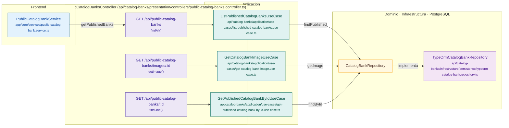

# Mapa de PublicCatalogBanksController

Módulo: **Catálogo de bancos (catalog-banks)** · Fuente editable: [`publiccatalogbankscontroller.mmd`](publiccatalogbankscontroller.mmd) · [Índice de diagramas](../../README.md)

## Explicación

1. **¿Qué proceso representa?** Relación real entre archivos: componentes y servicios Angular que llaman a PublicCatalogBanksController, sus 3 rutas, los casos de uso que ejecutan, los puertos de repositorio, sus implementaciones, las funciones SQL y las tablas.
2. **¿Dónde comienza?** Componentes Angular (izquierda) o cualquier cliente HTTP
3. **¿Qué archivos intervienen?** [`comercial-jhoel-api/src/modules/catalog-banks/presentation/controllers/public-catalog-banks.controller.ts`](../../../../comercial-jhoel-api/src/modules/catalog-banks/presentation/controllers/public-catalog-banks.controller.ts), [`comercial-jhoel-app/src/app/core/services/public-catalog-bank.service.ts`](../../../../comercial-jhoel-app/src/app/core/services/public-catalog-bank.service.ts), [`comercial-jhoel-api/src/modules/catalog-banks/application/use-cases/list-published-catalog-banks.use-case.ts`](../../../../comercial-jhoel-api/src/modules/catalog-banks/application/use-cases/list-published-catalog-banks.use-case.ts), [`comercial-jhoel-api/src/modules/catalog-banks/application/use-cases/get-catalog-bank-image.use-case.ts`](../../../../comercial-jhoel-api/src/modules/catalog-banks/application/use-cases/get-catalog-bank-image.use-case.ts), [`comercial-jhoel-api/src/modules/catalog-banks/application/use-cases/get-published-catalog-bank-by-id.use-case.ts`](../../../../comercial-jhoel-api/src/modules/catalog-banks/application/use-cases/get-published-catalog-bank-by-id.use-case.ts), [`comercial-jhoel-api/src/modules/catalog-banks/infrastructure/persistence/typeorm-catalog-bank.repository.ts`](../../../../comercial-jhoel-api/src/modules/catalog-banks/infrastructure/persistence/typeorm-catalog-bank.repository.ts)
4. **¿Qué función ejecuta cada archivo?** Cada nodo muestra la clase y el método (`Clase.metodo`) y, debajo, la ruta del archivo. El color indica la capa: azul = frontend, morado = controlador, verde azulado = caso de uso, amarillo = dominio/puerto, lila = infraestructura, gris = PostgreSQL, amarillo claro = decisión, rojo = error.
5. **¿Qué decisiones toma el sistema?** Ver los flujos de decisiones de cada comando en business-processes/catalog-banks/
6. **¿Dónde se almacenan los datos?** sin tablas detectadas
7. **¿Cómo termina el proceso?** Las flechas terminan en las tablas de PostgreSQL
8. **¿Qué sucede cuando ocurre un error?** Los errores siguen el patrón de 07-error-handling.mmd

> Generado desde el código. Las condiciones de los rombos son el texto literal de los `if … throw` (TypeScript) y de los `IF … RAISE EXCEPTION` (PL/pgSQL).
