# Mapa de PublicCatalogController

Módulo: **Catálogo de teléfonos (catalog)** · Fuente editable: [`publiccatalogcontroller.mmd`](publiccatalogcontroller.mmd) · [Índice de diagramas](../../README.md)

```mermaid
flowchart LR
  subgraph s1["Frontend"]
  n2["PublicCatalogService<br/><small>app/core/services/public-catalog.service.ts</small>"]
  n3["PhoneInterestModalComponent<br/><small>app/features/landing/sections/phones/components/phone-interest-modal/phone-interest-modal.component.ts</small>"]
  n4["PhoneCardComponent<br/><small>app/features/landing/sections/phones/components/phone-card/phone-card.component.ts</small>"]
  end
  subgraph s5["PublicCatalogController (api/catalog/presentation/controllers/public-catalog.controller.ts)"]
  n6["GET /api/public-catalog/phones<br/><small>findAllPublished()</small>"]
  n7["GET /api/public-catalog/phones/:id<br/><small>findOnePublished()</small>"]
  n8["GET /api/public-catalog/phones/images/:imageId<br/><small>getImage()</small>"]
  n9["POST /api/public-catalog/requests<br/><small>createRequest()</small>"]
  n10["POST /api/public-catalog/phones/:id/like<br/><small>like()</small>"]
  n11["POST /api/public-catalog/phones/:id/unlike<br/><small>unlike()</small>"]
  end
  subgraph s12["Aplicación"]
  n13["ListPublishedCatalogPhonesUseCase<br/><small>api/catalog/application/use-cases/list-published-catalog-phones.use-case.ts</small>"]
  n14["GetPublishedCatalogPhoneByIdUseCase<br/><small>api/catalog/application/use-cases/get-published-catalog-phone-by-id.use-case.ts</small>"]
  n15["GetCatalogPhoneImageUseCase<br/><small>api/catalog/application/use-cases/get-catalog-phone-image.use-case.ts</small>"]
  n16["CreateCatalogRequestUseCase<br/><small>api/catalog/application/use-cases/create-catalog-request.use-case.ts</small>"]
  n17["LikeCatalogPhoneUseCase<br/><small>api/catalog/application/use-cases/like-catalog-phone.use-case.ts</small>"]
  end
  subgraph s18["Dominio · Infraestructura · PostgreSQL"]
  n19["CatalogPhoneRepository"]
  n20["TypeOrmCatalogPhoneRepository<br/><small>api/catalog/infrastructure/persistence/typeorm-catalog-phone.repository.ts</small>"]
  n21["CompanySettingsRepository"]
  n22["TypeOrmCompanySettingsRepository<br/><small>api/company-settings/infrastructure/persistence/typeorm-company-settings.repository.ts</small>"]
  n23["CatalogLikeRepository"]
  n24["TypeOrmCatalogLikeRepository<br/><small>api/likes/infrastructure/persistence/typeorm-catalog-like.repository.ts</small>"]
  n25[("catalog_likes")]
  n26["CatalogRequestRepository"]
  n27["TypeOrmCatalogRequestRepository<br/><small>api/catalog/infrastructure/persistence/typeorm-catalog-request.repository.ts</small>"]
  end
  n3 -->|submit→createRequest| n2
  n4 -->|toggleLike→likePhone, toggleLike→unlikePhone| n2
  n2 -->|getPublishedPhones| n6
  n2 -->|getPhoneById| n7
  n2 -->|createRequest| n9
  n2 -->|likePhone| n10
  n2 -->|unlikePhone| n11
  n6 --> n13
  n7 --> n14
  n8 --> n15
  n9 --> n16
  n10 --> n17
  n11 --> n17
  n13 -->|findPublished| n19
  n19 -->|implementa| n20
  n13 -->|get| n21
  n21 -->|implementa| n22
  n13 -->|getCountsBatch, getLikedEntityIds| n23
  n23 -->|implementa| n24
  n24 -->|getCountsBatch| n25
  n24 -->|getLikedEntityIds| n25
  n14 -->|findById| n19
  n14 -->|get| n21
  n14 -->|getCount, getLikedEntityIds| n23
  n15 -->|getImage, findById| n19
  n16 -->|findById| n19
  n16 -->|create| n26
  n26 -->|implementa| n27
  n16 -->|get| n21
  n17 -->|findById| n19
  n17 -->|like, unlike, getCount| n23
  classDef start fill:#e8f5e9,stroke:#2e7d32,color:#1b5e20
  classDef fe fill:#e3f2fd,stroke:#1565c0,color:#0d47a1
  classDef api fill:#ede7f6,stroke:#4527a0,color:#311b92
  classDef app fill:#e0f2f1,stroke:#00695c,color:#004d40
  classDef dom fill:#fff8e1,stroke:#f9a825,color:#5d4037
  classDef infra fill:#f3e5f5,stroke:#6a1b9a,color:#4a148c
  classDef db fill:#eceff1,stroke:#455a64,color:#263238
  classDef dec fill:#fffde7,stroke:#f57f17,color:#3e2723
  classDef err fill:#ffebee,stroke:#c62828,color:#b71c1c
  classDef ok fill:#e8f5e9,stroke:#1b5e20,color:#1b5e20
  class n2,n3,n4 fe
  class n6,n7,n8,n9,n10,n11 api
  class n13,n14,n15,n16,n17 app
  class n19,n21,n23,n26 dom
  class n20,n22,n24,n27 infra
  class n25 db
```

## Explicación

1. **¿Qué proceso representa?** Relación real entre archivos: componentes y servicios Angular que llaman a PublicCatalogController, sus 6 rutas, los casos de uso que ejecutan, los puertos de repositorio, sus implementaciones, las funciones SQL y las tablas.
2. **¿Dónde comienza?** Componentes Angular (izquierda) o cualquier cliente HTTP
3. **¿Qué archivos intervienen?** [`comercial-jhoel-api/src/modules/catalog/presentation/controllers/public-catalog.controller.ts`](../../../../comercial-jhoel-api/src/modules/catalog/presentation/controllers/public-catalog.controller.ts), [`comercial-jhoel-app/src/app/core/services/public-catalog.service.ts`](../../../../comercial-jhoel-app/src/app/core/services/public-catalog.service.ts), [`comercial-jhoel-app/src/app/features/landing/sections/phones/components/phone-interest-modal/phone-interest-modal.component.ts`](../../../../comercial-jhoel-app/src/app/features/landing/sections/phones/components/phone-interest-modal/phone-interest-modal.component.ts), [`comercial-jhoel-app/src/app/features/landing/sections/phones/components/phone-card/phone-card.component.ts`](../../../../comercial-jhoel-app/src/app/features/landing/sections/phones/components/phone-card/phone-card.component.ts), [`comercial-jhoel-api/src/modules/catalog/application/use-cases/list-published-catalog-phones.use-case.ts`](../../../../comercial-jhoel-api/src/modules/catalog/application/use-cases/list-published-catalog-phones.use-case.ts), [`comercial-jhoel-api/src/modules/catalog/application/use-cases/get-published-catalog-phone-by-id.use-case.ts`](../../../../comercial-jhoel-api/src/modules/catalog/application/use-cases/get-published-catalog-phone-by-id.use-case.ts), [`comercial-jhoel-api/src/modules/catalog/application/use-cases/get-catalog-phone-image.use-case.ts`](../../../../comercial-jhoel-api/src/modules/catalog/application/use-cases/get-catalog-phone-image.use-case.ts), [`comercial-jhoel-api/src/modules/catalog/application/use-cases/create-catalog-request.use-case.ts`](../../../../comercial-jhoel-api/src/modules/catalog/application/use-cases/create-catalog-request.use-case.ts), [`comercial-jhoel-api/src/modules/catalog/application/use-cases/like-catalog-phone.use-case.ts`](../../../../comercial-jhoel-api/src/modules/catalog/application/use-cases/like-catalog-phone.use-case.ts), [`comercial-jhoel-api/src/modules/catalog/infrastructure/persistence/typeorm-catalog-phone.repository.ts`](../../../../comercial-jhoel-api/src/modules/catalog/infrastructure/persistence/typeorm-catalog-phone.repository.ts), [`comercial-jhoel-api/src/modules/company-settings/infrastructure/persistence/typeorm-company-settings.repository.ts`](../../../../comercial-jhoel-api/src/modules/company-settings/infrastructure/persistence/typeorm-company-settings.repository.ts), [`comercial-jhoel-api/src/modules/likes/infrastructure/persistence/typeorm-catalog-like.repository.ts`](../../../../comercial-jhoel-api/src/modules/likes/infrastructure/persistence/typeorm-catalog-like.repository.ts), [`comercial-jhoel-api/src/modules/catalog/infrastructure/persistence/typeorm-catalog-request.repository.ts`](../../../../comercial-jhoel-api/src/modules/catalog/infrastructure/persistence/typeorm-catalog-request.repository.ts)
4. **¿Qué función ejecuta cada archivo?** Cada nodo muestra la clase y el método (`Clase.metodo`) y, debajo, la ruta del archivo. El color indica la capa: azul = frontend, morado = controlador, verde azulado = caso de uso, amarillo = dominio/puerto, lila = infraestructura, gris = PostgreSQL, amarillo claro = decisión, rojo = error.
5. **¿Qué decisiones toma el sistema?** Ver los flujos de decisiones de cada comando en business-processes/catalog/
6. **¿Dónde se almacenan los datos?** catalog_likes
7. **¿Cómo termina el proceso?** Las flechas terminan en las tablas de PostgreSQL
8. **¿Qué sucede cuando ocurre un error?** Los errores siguen el patrón de 07-error-handling.mmd

> Generado desde el código. Las condiciones de los rombos son el texto literal de los `if … throw` (TypeScript) y de los `IF … RAISE EXCEPTION` (PL/pgSQL).
