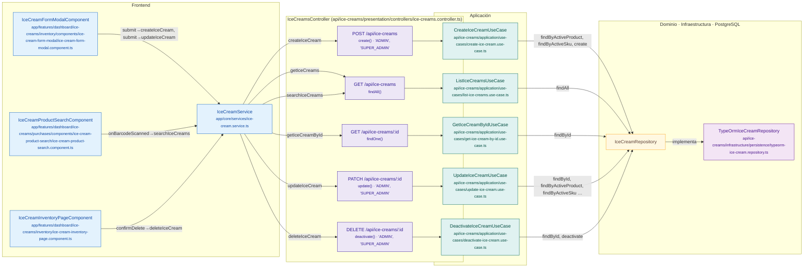

# Mapa de IceCreamsController

Módulo: **Heladería (ice-creams)** · Fuente editable: [`icecreamscontroller.mmd`](icecreamscontroller.mmd) · [Índice de diagramas](../../README.md)

## Explicación

1. **¿Qué proceso representa?** Relación real entre archivos: componentes y servicios Angular que llaman a IceCreamsController, sus 5 rutas, los casos de uso que ejecutan, los puertos de repositorio, sus implementaciones, las funciones SQL y las tablas.
2. **¿Dónde comienza?** Componentes Angular (izquierda) o cualquier cliente HTTP
3. **¿Qué archivos intervienen?** [`comercial-jhoel-api/src/modules/ice-creams/presentation/controllers/ice-creams.controller.ts`](../../../../comercial-jhoel-api/src/modules/ice-creams/presentation/controllers/ice-creams.controller.ts), [`comercial-jhoel-app/src/app/core/services/ice-cream.service.ts`](../../../../comercial-jhoel-app/src/app/core/services/ice-cream.service.ts), [`comercial-jhoel-app/src/app/features/dashboard/ice-creams/inventory/components/ice-cream-form-modal/ice-cream-form-modal.component.ts`](../../../../comercial-jhoel-app/src/app/features/dashboard/ice-creams/inventory/components/ice-cream-form-modal/ice-cream-form-modal.component.ts), [`comercial-jhoel-app/src/app/features/dashboard/ice-creams/purchases/components/ice-cream-product-search/ice-cream-product-search.component.ts`](../../../../comercial-jhoel-app/src/app/features/dashboard/ice-creams/purchases/components/ice-cream-product-search/ice-cream-product-search.component.ts), [`comercial-jhoel-app/src/app/features/dashboard/ice-creams/sales/components/ice-cream-product-search/ice-cream-product-search.component.ts`](../../../../comercial-jhoel-app/src/app/features/dashboard/ice-creams/sales/components/ice-cream-product-search/ice-cream-product-search.component.ts), [`comercial-jhoel-app/src/app/features/dashboard/ice-creams/inventory/ice-cream-inventory-page.component.ts`](../../../../comercial-jhoel-app/src/app/features/dashboard/ice-creams/inventory/ice-cream-inventory-page.component.ts), [`comercial-jhoel-api/src/modules/ice-creams/application/use-cases/create-ice-cream.use-case.ts`](../../../../comercial-jhoel-api/src/modules/ice-creams/application/use-cases/create-ice-cream.use-case.ts), [`comercial-jhoel-api/src/modules/ice-creams/application/use-cases/list-ice-creams.use-case.ts`](../../../../comercial-jhoel-api/src/modules/ice-creams/application/use-cases/list-ice-creams.use-case.ts), [`comercial-jhoel-api/src/modules/ice-creams/application/use-cases/get-ice-cream-by-id.use-case.ts`](../../../../comercial-jhoel-api/src/modules/ice-creams/application/use-cases/get-ice-cream-by-id.use-case.ts), [`comercial-jhoel-api/src/modules/ice-creams/application/use-cases/update-ice-cream.use-case.ts`](../../../../comercial-jhoel-api/src/modules/ice-creams/application/use-cases/update-ice-cream.use-case.ts), [`comercial-jhoel-api/src/modules/ice-creams/application/use-cases/deactivate-ice-cream.use-case.ts`](../../../../comercial-jhoel-api/src/modules/ice-creams/application/use-cases/deactivate-ice-cream.use-case.ts), [`comercial-jhoel-api/src/modules/ice-creams/infrastructure/persistence/typeorm-ice-cream.repository.ts`](../../../../comercial-jhoel-api/src/modules/ice-creams/infrastructure/persistence/typeorm-ice-cream.repository.ts)
4. **¿Qué función ejecuta cada archivo?** Cada nodo muestra la clase y el método (`Clase.metodo`) y, debajo, la ruta del archivo. El color indica la capa: azul = frontend, morado = controlador, verde azulado = caso de uso, amarillo = dominio/puerto, lila = infraestructura, gris = PostgreSQL, amarillo claro = decisión, rojo = error.
5. **¿Qué decisiones toma el sistema?** Ver los flujos de decisiones de cada comando en business-processes/ice-creams/
6. **¿Dónde se almacenan los datos?** sin tablas detectadas
7. **¿Cómo termina el proceso?** Las flechas terminan en las tablas de PostgreSQL
8. **¿Qué sucede cuando ocurre un error?** Los errores siguen el patrón de 07-error-handling.mmd

> Generado desde el código. Las condiciones de los rombos son el texto literal de los `if … throw` (TypeScript) y de los `IF … RAISE EXCEPTION` (PL/pgSQL).
