# Mapa de InventoryController

Módulo: **Inventario (inventory)** · Fuente editable: [`inventorycontroller.mmd`](inventorycontroller.mmd) · [Índice de diagramas](../../README.md)

```mermaid
flowchart LR
  subgraph s1["Frontend"]
  n2["InventoryLocationsService<br/><small>app/core/services/inventory-locations.service.ts</small>"]
  n3["QuickTransferModalComponent<br/><small>app/features/dashboard/inventory/components/quick-transfer-modal/quick-transfer-modal.component.ts</small>"]
  n4["TransferInventoryModalComponent<br/><small>app/features/dashboard/inventory/components/transfer-inventory-modal/transfer-inventory-modal.component.ts</small>"]
  n5["ProductFormModalComponent<br/><small>app/features/dashboard/inventory/components/product-form-modal/product-form-modal.component.ts</small>"]
  n6["PurchaseItemsTableComponent<br/><small>app/features/dashboard/purchases/components/purchase-items-table/purchase-items-table.component.ts</small>"]
  n7["PresentationFormModalComponent<br/><small>app/features/dashboard/inventory/components/presentation-form-modal/presentation-form-modal.component.ts</small>"]
  n8["ProductDetailPageComponent<br/><small>app/features/dashboard/inventory/product-detail-page.component.ts</small>"]
  end
  subgraph s9["InventoryController (api/inventory/presentation/controllers/inventory.controller.ts)"]
  n10["GET /api/inventory/locations<br/><small>findLocations()</small>"]
  n11["GET /api/inventory/products/:productId/presentations<br/><small>findPresentations()</small>"]
  n12["POST /api/inventory/products/:productId/presentations<br/><small>createPresentation() · 'ADMIN', 'SUPER_ADMIN'</small>"]
  n13["PATCH /api/inventory/presentations/:id<br/><small>updatePresentation() · 'ADMIN', 'SUPER_ADMIN'</small>"]
  n14["GET /api/inventory/products/:productId<br/><small>getProductInventory()</small>"]
  n15["PATCH /api/inventory/products/:productId/locations/:locationId/min-stock<br/><small>setMinStock() · 'ADMIN', 'SUPER_ADMIN'</small>"]
  n16["POST /api/inventory/transfers<br/><small>registerTransfer()</small>"]
  n17["POST /api/inventory/transfers/batch<br/><small>registerTransferBatch()</small>"]
  end
  subgraph s18["Aplicación"]
  n19["ListInventoryLocationsUseCase<br/><small>api/inventory/application/use-cases/list-inventory-locations.use-case.ts</small>"]
  n20["ListProductPresentationsUseCase<br/><small>api/inventory/application/use-cases/list-product-presentations.use-case.ts</small>"]
  n21["CreatePresentationUseCase<br/><small>api/inventory/application/use-cases/create-presentation.use-case.ts</small>"]
  n22["UpdatePresentationUseCase<br/><small>api/inventory/application/use-cases/update-presentation.use-case.ts</small>"]
  n23["GetProductInventoryUseCase<br/><small>api/inventory/application/use-cases/get-product-inventory.use-case.ts</small>"]
  n24["SetMinStockUseCase<br/><small>api/inventory/application/use-cases/set-min-stock.use-case.ts</small>"]
  n25["RegisterInventoryTransferUseCase<br/><small>api/inventory/application/use-cases/register-inventory-transfer.use-case.ts</small>"]
  n26["RegisterInventoryTransferBatchUseCase<br/><small>api/inventory/application/use-cases/register-inventory-transfer-batch.use-case.ts</small>"]
  end
  subgraph s27["Dominio · Infraestructura · PostgreSQL"]
  n28["InventoryLocationRepository"]
  n29["TypeOrmInventoryLocationRepository<br/><small>api/inventory/infrastructure/persistence/typeorm-inventory-location.repository.ts</small>"]
  n30["ProductPresentationRepository"]
  n31["TypeOrmProductPresentationRepository<br/><small>api/inventory/infrastructure/persistence/typeorm-product-presentation.repository.ts</small>"]
  n32["ProductRepository"]
  n33["TypeOrmProductRepository<br/><small>api/products/infrastructure/persistence/typeorm-product.repository.ts</small>"]
  n34["PresentationTypeRepository"]
  n35["TypeOrmPresentationTypeRepository<br/><small>api/presentation-types/infrastructure/persistence/typeorm-presentation-type.repository.ts</small>"]
  n36["InventoryStockRepository"]
  n37["TypeOrmInventoryStockRepository<br/><small>api/inventory/infrastructure/persistence/typeorm-inventory-stock.repository.ts</small>"]
  n38["InventoryMovementRepository"]
  n39["TypeOrmInventoryMovementRepository<br/><small>api/inventory/infrastructure/persistence/typeorm-inventory-movement.repository.ts</small>"]
  n40["InventoryTransferRepository"]
  n41["TypeOrmInventoryTransferRepository<br/><small>api/inventory/infrastructure/persistence/typeorm-inventory-transfer.repository.ts</small>"]
  end
  n3 -->|ngOnChanges→getLocations, submit→registerTransferBatch| n2
  n4 -->|ngOnChanges→getLocations, onProductChange→getProductInventory, submit→registerTransfer| n2
  n5 -->|ngOnChanges→getPresentations, createAdditionalPresentations→createPresentation| n2
  n6 -->|ensurePresentationsLoaded→getPresentations| n2
  n7 -->|submit→createPresentation, submit→updatePresentation| n2
  n8 -->|toggleActive→updatePresentation, fetchDetail→getProductInventory, saveMinStock→setMinStock| n2
  n2 -->|getLocations| n10
  n2 -->|getPresentations| n11
  n2 -->|createPresentation| n12
  n2 -->|updatePresentation| n13
  n2 -->|getProductInventory| n14
  n2 -->|setMinStock| n15
  n2 -->|registerTransfer| n16
  n2 -->|registerTransferBatch| n17
  n10 --> n19
  n11 --> n20
  n12 --> n21
  n13 --> n22
  n14 --> n23
  n15 --> n24
  n16 --> n25
  n17 --> n26
  n19 -->|findAll| n28
  n28 -->|implementa| n29
  n20 -->|findByProductId| n30
  n30 -->|implementa| n31
  n20 -->|findById| n32
  n32 -->|implementa| n33
  n21 -->|create| n30
  n21 -->|findById| n32
  n21 -->|findById| n34
  n34 -->|implementa| n35
  n22 -->|findById, update| n30
  n22 -->|findById| n34
  n23 -->|findById| n32
  n23 -->|findByProductId| n30
  n23 -->|findByProductId| n36
  n36 -->|implementa| n37
  n23 -->|findByProductId| n38
  n38 -->|implementa| n39
  n24 -->|setMinStock| n36
  n25 -->|registerTransfer| n40
  n40 -->|implementa| n41
  n26 -->|registerTransferBatch| n40
  classDef start fill:#e8f5e9,stroke:#2e7d32,color:#1b5e20
  classDef fe fill:#e3f2fd,stroke:#1565c0,color:#0d47a1
  classDef api fill:#ede7f6,stroke:#4527a0,color:#311b92
  classDef app fill:#e0f2f1,stroke:#00695c,color:#004d40
  classDef dom fill:#fff8e1,stroke:#f9a825,color:#5d4037
  classDef infra fill:#f3e5f5,stroke:#6a1b9a,color:#4a148c
  classDef db fill:#eceff1,stroke:#455a64,color:#263238
  classDef dec fill:#fffde7,stroke:#f57f17,color:#3e2723
  classDef err fill:#ffebee,stroke:#c62828,color:#b71c1c
  classDef ok fill:#e8f5e9,stroke:#1b5e20,color:#1b5e20
  class n2,n3,n4,n5,n6,n7,n8 fe
  class n10,n11,n12,n13,n14,n15,n16,n17 api
  class n19,n20,n21,n22,n23,n24,n25,n26 app
  class n28,n30,n32,n34,n36,n38,n40 dom
  class n29,n31,n33,n35,n37,n39,n41 infra
```

## Explicación

1. **¿Qué proceso representa?** Relación real entre archivos: componentes y servicios Angular que llaman a InventoryController, sus 8 rutas, los casos de uso que ejecutan, los puertos de repositorio, sus implementaciones, las funciones SQL y las tablas.
2. **¿Dónde comienza?** Componentes Angular (izquierda) o cualquier cliente HTTP
3. **¿Qué archivos intervienen?** [`comercial-jhoel-api/src/modules/inventory/presentation/controllers/inventory.controller.ts`](../../../../comercial-jhoel-api/src/modules/inventory/presentation/controllers/inventory.controller.ts), [`comercial-jhoel-app/src/app/core/services/inventory-locations.service.ts`](../../../../comercial-jhoel-app/src/app/core/services/inventory-locations.service.ts), [`comercial-jhoel-app/src/app/features/dashboard/inventory/components/quick-transfer-modal/quick-transfer-modal.component.ts`](../../../../comercial-jhoel-app/src/app/features/dashboard/inventory/components/quick-transfer-modal/quick-transfer-modal.component.ts), [`comercial-jhoel-app/src/app/features/dashboard/inventory/components/transfer-inventory-modal/transfer-inventory-modal.component.ts`](../../../../comercial-jhoel-app/src/app/features/dashboard/inventory/components/transfer-inventory-modal/transfer-inventory-modal.component.ts), [`comercial-jhoel-app/src/app/features/dashboard/inventory/components/product-form-modal/product-form-modal.component.ts`](../../../../comercial-jhoel-app/src/app/features/dashboard/inventory/components/product-form-modal/product-form-modal.component.ts), [`comercial-jhoel-app/src/app/features/dashboard/purchases/components/purchase-items-table/purchase-items-table.component.ts`](../../../../comercial-jhoel-app/src/app/features/dashboard/purchases/components/purchase-items-table/purchase-items-table.component.ts), [`comercial-jhoel-app/src/app/features/dashboard/inventory/components/presentation-form-modal/presentation-form-modal.component.ts`](../../../../comercial-jhoel-app/src/app/features/dashboard/inventory/components/presentation-form-modal/presentation-form-modal.component.ts), [`comercial-jhoel-app/src/app/features/dashboard/inventory/product-detail-page.component.ts`](../../../../comercial-jhoel-app/src/app/features/dashboard/inventory/product-detail-page.component.ts), [`comercial-jhoel-api/src/modules/inventory/application/use-cases/list-inventory-locations.use-case.ts`](../../../../comercial-jhoel-api/src/modules/inventory/application/use-cases/list-inventory-locations.use-case.ts), [`comercial-jhoel-api/src/modules/inventory/application/use-cases/list-product-presentations.use-case.ts`](../../../../comercial-jhoel-api/src/modules/inventory/application/use-cases/list-product-presentations.use-case.ts), [`comercial-jhoel-api/src/modules/inventory/application/use-cases/create-presentation.use-case.ts`](../../../../comercial-jhoel-api/src/modules/inventory/application/use-cases/create-presentation.use-case.ts), [`comercial-jhoel-api/src/modules/inventory/application/use-cases/update-presentation.use-case.ts`](../../../../comercial-jhoel-api/src/modules/inventory/application/use-cases/update-presentation.use-case.ts), [`comercial-jhoel-api/src/modules/inventory/application/use-cases/get-product-inventory.use-case.ts`](../../../../comercial-jhoel-api/src/modules/inventory/application/use-cases/get-product-inventory.use-case.ts), [`comercial-jhoel-api/src/modules/inventory/application/use-cases/set-min-stock.use-case.ts`](../../../../comercial-jhoel-api/src/modules/inventory/application/use-cases/set-min-stock.use-case.ts), [`comercial-jhoel-api/src/modules/inventory/application/use-cases/register-inventory-transfer.use-case.ts`](../../../../comercial-jhoel-api/src/modules/inventory/application/use-cases/register-inventory-transfer.use-case.ts), [`comercial-jhoel-api/src/modules/inventory/application/use-cases/register-inventory-transfer-batch.use-case.ts`](../../../../comercial-jhoel-api/src/modules/inventory/application/use-cases/register-inventory-transfer-batch.use-case.ts), [`comercial-jhoel-api/src/modules/inventory/infrastructure/persistence/typeorm-inventory-location.repository.ts`](../../../../comercial-jhoel-api/src/modules/inventory/infrastructure/persistence/typeorm-inventory-location.repository.ts), [`comercial-jhoel-api/src/modules/inventory/infrastructure/persistence/typeorm-product-presentation.repository.ts`](../../../../comercial-jhoel-api/src/modules/inventory/infrastructure/persistence/typeorm-product-presentation.repository.ts), [`comercial-jhoel-api/src/modules/products/infrastructure/persistence/typeorm-product.repository.ts`](../../../../comercial-jhoel-api/src/modules/products/infrastructure/persistence/typeorm-product.repository.ts), [`comercial-jhoel-api/src/modules/presentation-types/infrastructure/persistence/typeorm-presentation-type.repository.ts`](../../../../comercial-jhoel-api/src/modules/presentation-types/infrastructure/persistence/typeorm-presentation-type.repository.ts), [`comercial-jhoel-api/src/modules/inventory/infrastructure/persistence/typeorm-inventory-stock.repository.ts`](../../../../comercial-jhoel-api/src/modules/inventory/infrastructure/persistence/typeorm-inventory-stock.repository.ts), [`comercial-jhoel-api/src/modules/inventory/infrastructure/persistence/typeorm-inventory-movement.repository.ts`](../../../../comercial-jhoel-api/src/modules/inventory/infrastructure/persistence/typeorm-inventory-movement.repository.ts), [`comercial-jhoel-api/src/modules/inventory/infrastructure/persistence/typeorm-inventory-transfer.repository.ts`](../../../../comercial-jhoel-api/src/modules/inventory/infrastructure/persistence/typeorm-inventory-transfer.repository.ts)
4. **¿Qué función ejecuta cada archivo?** Cada nodo muestra la clase y el método (`Clase.metodo`) y, debajo, la ruta del archivo. El color indica la capa: azul = frontend, morado = controlador, verde azulado = caso de uso, amarillo = dominio/puerto, lila = infraestructura, gris = PostgreSQL, amarillo claro = decisión, rojo = error.
5. **¿Qué decisiones toma el sistema?** Ver los flujos de decisiones de cada comando en business-processes/inventory/
6. **¿Dónde se almacenan los datos?** sin tablas detectadas
7. **¿Cómo termina el proceso?** Las flechas terminan en las tablas de PostgreSQL
8. **¿Qué sucede cuando ocurre un error?** Los errores siguen el patrón de 07-error-handling.mmd

> Generado desde el código. Las condiciones de los rombos son el texto literal de los `if … throw` (TypeScript) y de los `IF … RAISE EXCEPTION` (PL/pgSQL).
