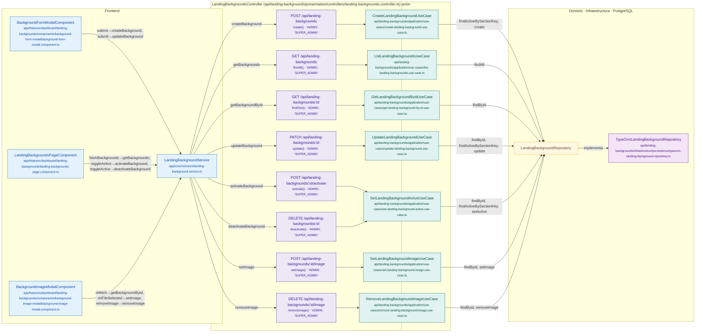

# Mapa de LandingBackgroundsController

Módulo: **Fondos de la landing (landing-backgrounds)** · Fuente editable: [`landingbackgroundscontroller.mmd`](landingbackgroundscontroller.mmd) · [Índice de diagramas](../../README.md)

## Explicación

1. **¿Qué proceso representa?** Relación real entre archivos: componentes y servicios Angular que llaman a LandingBackgroundsController, sus 8 rutas, los casos de uso que ejecutan, los puertos de repositorio, sus implementaciones, las funciones SQL y las tablas.
2. **¿Dónde comienza?** Componentes Angular (izquierda) o cualquier cliente HTTP
3. **¿Qué archivos intervienen?** [`comercial-jhoel-api/src/modules/landing-backgrounds/presentation/controllers/landing-backgrounds.controller.ts`](../../../../comercial-jhoel-api/src/modules/landing-backgrounds/presentation/controllers/landing-backgrounds.controller.ts), [`comercial-jhoel-app/src/app/core/services/landing-background.service.ts`](../../../../comercial-jhoel-app/src/app/core/services/landing-background.service.ts), [`comercial-jhoel-app/src/app/features/dashboard/landing-backgrounds/components/background-form-modal/background-form-modal.component.ts`](../../../../comercial-jhoel-app/src/app/features/dashboard/landing-backgrounds/components/background-form-modal/background-form-modal.component.ts), [`comercial-jhoel-app/src/app/features/dashboard/landing-backgrounds/landing-backgrounds-page.component.ts`](../../../../comercial-jhoel-app/src/app/features/dashboard/landing-backgrounds/landing-backgrounds-page.component.ts), [`comercial-jhoel-app/src/app/features/dashboard/landing-backgrounds/components/background-image-modal/background-image-modal.component.ts`](../../../../comercial-jhoel-app/src/app/features/dashboard/landing-backgrounds/components/background-image-modal/background-image-modal.component.ts), [`comercial-jhoel-api/src/modules/landing-backgrounds/application/use-cases/create-landing-background.use-case.ts`](../../../../comercial-jhoel-api/src/modules/landing-backgrounds/application/use-cases/create-landing-background.use-case.ts), [`comercial-jhoel-api/src/modules/landing-backgrounds/application/use-cases/list-landing-backgrounds.use-case.ts`](../../../../comercial-jhoel-api/src/modules/landing-backgrounds/application/use-cases/list-landing-backgrounds.use-case.ts), [`comercial-jhoel-api/src/modules/landing-backgrounds/application/use-cases/get-landing-background-by-id.use-case.ts`](../../../../comercial-jhoel-api/src/modules/landing-backgrounds/application/use-cases/get-landing-background-by-id.use-case.ts), [`comercial-jhoel-api/src/modules/landing-backgrounds/application/use-cases/update-landing-background.use-case.ts`](../../../../comercial-jhoel-api/src/modules/landing-backgrounds/application/use-cases/update-landing-background.use-case.ts), [`comercial-jhoel-api/src/modules/landing-backgrounds/application/use-cases/set-landing-background-active.use-case.ts`](../../../../comercial-jhoel-api/src/modules/landing-backgrounds/application/use-cases/set-landing-background-active.use-case.ts), [`comercial-jhoel-api/src/modules/landing-backgrounds/application/use-cases/set-landing-background-image.use-case.ts`](../../../../comercial-jhoel-api/src/modules/landing-backgrounds/application/use-cases/set-landing-background-image.use-case.ts), [`comercial-jhoel-api/src/modules/landing-backgrounds/application/use-cases/remove-landing-background-image.use-case.ts`](../../../../comercial-jhoel-api/src/modules/landing-backgrounds/application/use-cases/remove-landing-background-image.use-case.ts), [`comercial-jhoel-api/src/modules/landing-backgrounds/infrastructure/persistence/typeorm-landing-background.repository.ts`](../../../../comercial-jhoel-api/src/modules/landing-backgrounds/infrastructure/persistence/typeorm-landing-background.repository.ts)
4. **¿Qué función ejecuta cada archivo?** Cada nodo muestra la clase y el método (`Clase.metodo`) y, debajo, la ruta del archivo. El color indica la capa: azul = frontend, morado = controlador, verde azulado = caso de uso, amarillo = dominio/puerto, lila = infraestructura, gris = PostgreSQL, amarillo claro = decisión, rojo = error.
5. **¿Qué decisiones toma el sistema?** Ver los flujos de decisiones de cada comando en business-processes/landing-backgrounds/
6. **¿Dónde se almacenan los datos?** sin tablas detectadas
7. **¿Cómo termina el proceso?** Las flechas terminan en las tablas de PostgreSQL
8. **¿Qué sucede cuando ocurre un error?** Los errores siguen el patrón de 07-error-handling.mmd

> Generado desde el código. Las condiciones de los rombos son el texto literal de los `if … throw` (TypeScript) y de los `IF … RAISE EXCEPTION` (PL/pgSQL).
