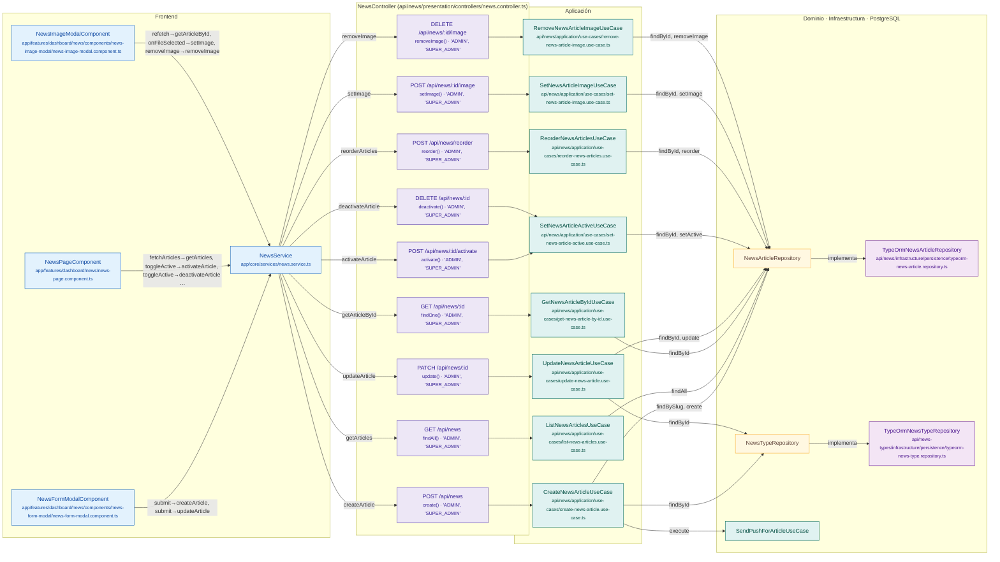

# Mapa de NewsController

Módulo: **Noticias (news)** · Fuente editable: [`newscontroller.mmd`](newscontroller.mmd) · [Índice de diagramas](../../README.md)

## Explicación

1. **¿Qué proceso representa?** Relación real entre archivos: componentes y servicios Angular que llaman a NewsController, sus 9 rutas, los casos de uso que ejecutan, los puertos de repositorio, sus implementaciones, las funciones SQL y las tablas.
2. **¿Dónde comienza?** Componentes Angular (izquierda) o cualquier cliente HTTP
3. **¿Qué archivos intervienen?** [`comercial-jhoel-api/src/modules/news/presentation/controllers/news.controller.ts`](../../../../comercial-jhoel-api/src/modules/news/presentation/controllers/news.controller.ts), [`comercial-jhoel-app/src/app/core/services/news.service.ts`](../../../../comercial-jhoel-app/src/app/core/services/news.service.ts), [`comercial-jhoel-app/src/app/features/dashboard/news/components/news-form-modal/news-form-modal.component.ts`](../../../../comercial-jhoel-app/src/app/features/dashboard/news/components/news-form-modal/news-form-modal.component.ts), [`comercial-jhoel-app/src/app/features/dashboard/news/news-page.component.ts`](../../../../comercial-jhoel-app/src/app/features/dashboard/news/news-page.component.ts), [`comercial-jhoel-app/src/app/features/dashboard/news/components/news-image-modal/news-image-modal.component.ts`](../../../../comercial-jhoel-app/src/app/features/dashboard/news/components/news-image-modal/news-image-modal.component.ts), [`comercial-jhoel-api/src/modules/news/application/use-cases/create-news-article.use-case.ts`](../../../../comercial-jhoel-api/src/modules/news/application/use-cases/create-news-article.use-case.ts), [`comercial-jhoel-api/src/modules/news/application/use-cases/list-news-articles.use-case.ts`](../../../../comercial-jhoel-api/src/modules/news/application/use-cases/list-news-articles.use-case.ts), [`comercial-jhoel-api/src/modules/news/application/use-cases/get-news-article-by-id.use-case.ts`](../../../../comercial-jhoel-api/src/modules/news/application/use-cases/get-news-article-by-id.use-case.ts), [`comercial-jhoel-api/src/modules/news/application/use-cases/update-news-article.use-case.ts`](../../../../comercial-jhoel-api/src/modules/news/application/use-cases/update-news-article.use-case.ts), [`comercial-jhoel-api/src/modules/news/application/use-cases/set-news-article-active.use-case.ts`](../../../../comercial-jhoel-api/src/modules/news/application/use-cases/set-news-article-active.use-case.ts), [`comercial-jhoel-api/src/modules/news/application/use-cases/reorder-news-articles.use-case.ts`](../../../../comercial-jhoel-api/src/modules/news/application/use-cases/reorder-news-articles.use-case.ts), [`comercial-jhoel-api/src/modules/news/application/use-cases/set-news-article-image.use-case.ts`](../../../../comercial-jhoel-api/src/modules/news/application/use-cases/set-news-article-image.use-case.ts), [`comercial-jhoel-api/src/modules/news/application/use-cases/remove-news-article-image.use-case.ts`](../../../../comercial-jhoel-api/src/modules/news/application/use-cases/remove-news-article-image.use-case.ts), [`comercial-jhoel-api/src/modules/news/infrastructure/persistence/typeorm-news-article.repository.ts`](../../../../comercial-jhoel-api/src/modules/news/infrastructure/persistence/typeorm-news-article.repository.ts), [`comercial-jhoel-api/src/modules/news-types/infrastructure/persistence/typeorm-news-type.repository.ts`](../../../../comercial-jhoel-api/src/modules/news-types/infrastructure/persistence/typeorm-news-type.repository.ts)
4. **¿Qué función ejecuta cada archivo?** Cada nodo muestra la clase y el método (`Clase.metodo`) y, debajo, la ruta del archivo. El color indica la capa: azul = frontend, morado = controlador, verde azulado = caso de uso, amarillo = dominio/puerto, lila = infraestructura, gris = PostgreSQL, amarillo claro = decisión, rojo = error.
5. **¿Qué decisiones toma el sistema?** Ver los flujos de decisiones de cada comando en business-processes/news/
6. **¿Dónde se almacenan los datos?** sin tablas detectadas
7. **¿Cómo termina el proceso?** Las flechas terminan en las tablas de PostgreSQL
8. **¿Qué sucede cuando ocurre un error?** Los errores siguen el patrón de 07-error-handling.mmd

> Generado desde el código. Las condiciones de los rombos son el texto literal de los `if … throw` (TypeScript) y de los `IF … RAISE EXCEPTION` (PL/pgSQL).
