# Mapa de QuotationsController

Módulo: **Cotizaciones (quotations)** · Fuente editable: [`quotationscontroller.mmd`](quotationscontroller.mmd) · [Índice de diagramas](../../README.md)

```mermaid
flowchart LR
  subgraph s1["Frontend"]
  n2["QuotationsService<br/><small>app/core/services/quotations.service.ts</small>"]
  n3["CreateQuotationTabComponent<br/><small>app/features/dashboard/quotations/components/create-quotation-tab/create-quotation-tab.component.ts</small>"]
  n4["QuotationHistoryTabComponent<br/><small>app/features/dashboard/quotations/components/quotation-history-tab/quotation-history-tab.component.ts</small>"]
  n5["QuotationDetailModalComponent<br/><small>app/features/dashboard/quotations/components/quotation-detail-modal/quotation-detail-modal.component.ts</small>"]
  end
  subgraph s6["QuotationsController (api/quotations/presentation/controllers/quotations.controller.ts)"]
  n7["POST /api/quotations<br/><small>create()</small>"]
  n8["GET /api/quotations<br/><small>findAll()</small>"]
  n9["GET /api/quotations/:id/pdf<br/><small>getPdf()</small>"]
  n10["POST /api/quotations/:id/void<br/><small>voidQuotation() · 'ADMIN', 'SUPER_ADMIN'</small>"]
  n11["GET /api/quotations/:id<br/><small>findOne()</small>"]
  end
  subgraph s12["Aplicación"]
  n13["CreateQuotationUseCase<br/><small>api/quotations/application/use-cases/create-quotation.use-case.ts</small>"]
  n14["ListQuotationsUseCase<br/><small>api/quotations/application/use-cases/list-quotations.use-case.ts</small>"]
  n15["GetQuotationPdfUseCase<br/><small>api/quotations/application/use-cases/get-quotation-pdf.use-case.ts</small>"]
  n16["VoidQuotationUseCase<br/><small>api/quotations/application/use-cases/void-quotation.use-case.ts</small>"]
  n17["GetQuotationByIdUseCase<br/><small>api/quotations/application/use-cases/get-quotation-by-id.use-case.ts</small>"]
  end
  subgraph s18["Dominio · Infraestructura · PostgreSQL"]
  n19["QuotationRepository"]
  n20["TypeOrmQuotationRepository<br/><small>api/quotations/infrastructure/persistence/typeorm-quotation.repository.ts</small>"]
  n21[["create_quotation()"]]
  n22[("quotation_details")]
  n23[("quotations")]
  n24["ClientRepository"]
  n25["TypeOrmClientRepository<br/><small>api/clients/infrastructure/persistence/typeorm-client.repository.ts</small>"]
  n26["CompanySettingsRepository"]
  n27["TypeOrmCompanySettingsRepository<br/><small>api/company-settings/infrastructure/persistence/typeorm-company-settings.repository.ts</small>"]
  end
  n3 -->|saveQuotation→createQuotation, saveQuotation→exportQuotationPdf| n2
  n4 -->|fetch→getQuotations, regeneratePdf→exportQuotationPdf, confirmVoid→voidQuotation| n2
  n5 -->|ngOnChanges→getQuotationById| n2
  n2 -->|createQuotation| n7
  n2 -->|getQuotations| n8
  n2 -->|exportQuotationPdf| n9
  n2 -->|voidQuotation| n10
  n2 -->|getQuotationById| n11
  n7 --> n13
  n8 --> n14
  n9 --> n15
  n10 --> n16
  n11 --> n17
  n13 -->|createQuotation| n19
  n19 -->|implementa| n20
  n20 -->|createQuotation| n21
  n21 -->|escribe| n22
  n21 -->|escribe| n23
  n13 -->|findById| n24
  n24 -->|implementa| n25
  n14 -->|findAll| n19
  n15 -->|findById| n19
  n15 -->|get| n26
  n26 -->|implementa| n27
  n16 -->|findById, voidQuotation| n19
  n17 -->|findById| n19
  classDef start fill:#e8f5e9,stroke:#2e7d32,color:#1b5e20
  classDef fe fill:#e3f2fd,stroke:#1565c0,color:#0d47a1
  classDef api fill:#ede7f6,stroke:#4527a0,color:#311b92
  classDef app fill:#e0f2f1,stroke:#00695c,color:#004d40
  classDef dom fill:#fff8e1,stroke:#f9a825,color:#5d4037
  classDef infra fill:#f3e5f5,stroke:#6a1b9a,color:#4a148c
  classDef db fill:#eceff1,stroke:#455a64,color:#263238
  classDef dec fill:#fffde7,stroke:#f57f17,color:#3e2723
  classDef err fill:#ffebee,stroke:#c62828,color:#b71c1c
  classDef ok fill:#e8f5e9,stroke:#1b5e20,color:#1b5e20
  class n2,n3,n4,n5 fe
  class n7,n8,n9,n10,n11 api
  class n13,n14,n15,n16,n17 app
  class n19,n24,n26 dom
  class n20,n25,n27 infra
  class n21,n22,n23 db
```

## Explicación

1. **¿Qué proceso representa?** Relación real entre archivos: componentes y servicios Angular que llaman a QuotationsController, sus 5 rutas, los casos de uso que ejecutan, los puertos de repositorio, sus implementaciones, las funciones SQL y las tablas.
2. **¿Dónde comienza?** Componentes Angular (izquierda) o cualquier cliente HTTP
3. **¿Qué archivos intervienen?** [`comercial-jhoel-api/src/modules/quotations/presentation/controllers/quotations.controller.ts`](../../../../comercial-jhoel-api/src/modules/quotations/presentation/controllers/quotations.controller.ts), [`comercial-jhoel-app/src/app/core/services/quotations.service.ts`](../../../../comercial-jhoel-app/src/app/core/services/quotations.service.ts), [`comercial-jhoel-app/src/app/features/dashboard/quotations/components/create-quotation-tab/create-quotation-tab.component.ts`](../../../../comercial-jhoel-app/src/app/features/dashboard/quotations/components/create-quotation-tab/create-quotation-tab.component.ts), [`comercial-jhoel-app/src/app/features/dashboard/quotations/components/quotation-history-tab/quotation-history-tab.component.ts`](../../../../comercial-jhoel-app/src/app/features/dashboard/quotations/components/quotation-history-tab/quotation-history-tab.component.ts), [`comercial-jhoel-app/src/app/features/dashboard/quotations/components/quotation-detail-modal/quotation-detail-modal.component.ts`](../../../../comercial-jhoel-app/src/app/features/dashboard/quotations/components/quotation-detail-modal/quotation-detail-modal.component.ts), [`comercial-jhoel-api/src/modules/quotations/application/use-cases/create-quotation.use-case.ts`](../../../../comercial-jhoel-api/src/modules/quotations/application/use-cases/create-quotation.use-case.ts), [`comercial-jhoel-api/src/modules/quotations/application/use-cases/list-quotations.use-case.ts`](../../../../comercial-jhoel-api/src/modules/quotations/application/use-cases/list-quotations.use-case.ts), [`comercial-jhoel-api/src/modules/quotations/application/use-cases/get-quotation-pdf.use-case.ts`](../../../../comercial-jhoel-api/src/modules/quotations/application/use-cases/get-quotation-pdf.use-case.ts), [`comercial-jhoel-api/src/modules/quotations/application/use-cases/void-quotation.use-case.ts`](../../../../comercial-jhoel-api/src/modules/quotations/application/use-cases/void-quotation.use-case.ts), [`comercial-jhoel-api/src/modules/quotations/application/use-cases/get-quotation-by-id.use-case.ts`](../../../../comercial-jhoel-api/src/modules/quotations/application/use-cases/get-quotation-by-id.use-case.ts), [`comercial-jhoel-api/src/modules/quotations/infrastructure/persistence/typeorm-quotation.repository.ts`](../../../../comercial-jhoel-api/src/modules/quotations/infrastructure/persistence/typeorm-quotation.repository.ts), [`comercial-jhoel-api/src/modules/clients/infrastructure/persistence/typeorm-client.repository.ts`](../../../../comercial-jhoel-api/src/modules/clients/infrastructure/persistence/typeorm-client.repository.ts), [`comercial-jhoel-api/src/modules/company-settings/infrastructure/persistence/typeorm-company-settings.repository.ts`](../../../../comercial-jhoel-api/src/modules/company-settings/infrastructure/persistence/typeorm-company-settings.repository.ts)
4. **¿Qué función ejecuta cada archivo?** Cada nodo muestra la clase y el método (`Clase.metodo`) y, debajo, la ruta del archivo. El color indica la capa: azul = frontend, morado = controlador, verde azulado = caso de uso, amarillo = dominio/puerto, lila = infraestructura, gris = PostgreSQL, amarillo claro = decisión, rojo = error.
5. **¿Qué decisiones toma el sistema?** Ver los flujos de decisiones de cada comando en business-processes/quotations/
6. **¿Dónde se almacenan los datos?** quotation_details, quotations
7. **¿Cómo termina el proceso?** Las flechas terminan en las tablas de PostgreSQL
8. **¿Qué sucede cuando ocurre un error?** Los errores siguen el patrón de 07-error-handling.mmd

> Generado desde el código. Las condiciones de los rombos son el texto literal de los `if … throw` (TypeScript) y de los `IF … RAISE EXCEPTION` (PL/pgSQL).
