# Mapa de RechargeCashBoxController

Módulo: **Caja de recargas (recharge-cash-box)** · Fuente editable: [`rechargecashboxcontroller.mmd`](rechargecashboxcontroller.mmd) · [Índice de diagramas](../../README.md)

```mermaid
flowchart LR
  subgraph s1["Frontend"]
  n2["RechargeCashBoxService<br/><small>app/core/services/recharge-cash-box.service.ts</small>"]
  n3["CashBoxCardComponent<br/><small>app/features/dashboard/recharge-cash-box/components/cash-box-card/cash-box-card.component.ts</small>"]
  n4["CashBoxHistoryComponent<br/><small>app/features/dashboard/recharge-cash-box/components/cash-box-history/cash-box-history.component.ts</small>"]
  n5["CashBoxWithdrawalModalComponent<br/><small>app/features/dashboard/recharge-cash-box/components/cash-box-withdrawal-modal/cash-box-withdrawal-modal.component.ts</small>"]
  n6["CashBoxContributionModalComponent<br/><small>app/features/dashboard/recharge-cash-box/components/cash-box-contribution-modal/cash-box-contribution-modal.component.ts</small>"]
  end
  subgraph s7["RechargeCashBoxController (api/recharge-cash-box/presentation/controllers/recharge-cash-box.controller.ts)"]
  n8["GET /api/recharge-cash-box/balance<br/><small>getBalance()</small>"]
  n9["GET /api/recharge-cash-box/movements<br/><small>getMovements()</small>"]
  n10["POST /api/recharge-cash-box/withdrawals<br/><small>registerWithdrawal() · 'ADMIN', 'SUPER_ADMIN'</small>"]
  n11["POST /api/recharge-cash-box/contributions<br/><small>registerContribution() · 'ADMIN', 'SUPER_ADMIN'</small>"]
  n12["POST /api/recharge-cash-box/movements/:id/void<br/><small>voidMovement() · 'ADMIN', 'SUPER_ADMIN'</small>"]
  end
  subgraph s13["Aplicación"]
  n14["GetCashBoxBalanceUseCase<br/><small>api/recharge-cash-box/application/use-cases/get-cash-box-balance.use-case.ts</small>"]
  n15["GetCashBoxMovementsUseCase<br/><small>api/recharge-cash-box/application/use-cases/get-cash-box-movements.use-case.ts</small>"]
  n16["RegisterCashBoxWithdrawalUseCase<br/><small>api/recharge-cash-box/application/use-cases/register-cash-box-withdrawal.use-case.ts</small>"]
  n17["RegisterCashBoxContributionUseCase<br/><small>api/recharge-cash-box/application/use-cases/register-cash-box-contribution.use-case.ts</small>"]
  n18["VoidCashBoxMovementUseCase<br/><small>api/recharge-cash-box/application/use-cases/void-cash-box-movement.use-case.ts</small>"]
  end
  subgraph s19["Dominio · Infraestructura · PostgreSQL"]
  n20["RechargeCashBoxMovementRepository"]
  n21["TypeOrmRechargeCashBoxRepository<br/><small>api/recharge-cash-box/infrastructure/persistence/typeorm-recharge-cash-box.repository.ts</small>"]
  n22[("recharge_sales")]
  n23[("recharge_sim_sales")]
  n24[("recharge_purchases")]
  n25[("recharge_sim_purchases")]
  n26[("recharge_cash_box_movements")]
  n27[("users")]
  n28[["register_recharge_cash_box_movement()"]]
  end
  n3 -->|fetchBalance→getBalance| n2
  n4 -->|fetch→getMovements| n2
  n5 -->|submit→registerWithdrawal| n2
  n6 -->|submit→registerContribution| n2
  n2 -->|getBalance| n8
  n2 -->|getMovements| n9
  n2 -->|registerWithdrawal| n10
  n2 -->|registerContribution| n11
  n2 -->|voidMovement| n12
  n8 --> n14
  n9 --> n15
  n10 --> n16
  n11 --> n17
  n12 --> n18
  n14 -->|getDailyTotals| n20
  n20 -->|implementa| n21
  n15 -->|findMovements| n20
  n21 -->|findMovements| n22
  n21 -->|findMovements| n23
  n21 -->|findMovements| n24
  n21 -->|findMovements| n25
  n21 -->|findMovements| n26
  n21 -->|findMovements| n27
  n16 -->|registerMovement| n20
  n21 -->|registerMovement| n28
  n28 -->|escribe| n26
  n17 -->|registerMovement| n20
  n18 -->|findById, voidMovement| n20
  classDef start fill:#e8f5e9,stroke:#2e7d32,color:#1b5e20
  classDef fe fill:#e3f2fd,stroke:#1565c0,color:#0d47a1
  classDef api fill:#ede7f6,stroke:#4527a0,color:#311b92
  classDef app fill:#e0f2f1,stroke:#00695c,color:#004d40
  classDef dom fill:#fff8e1,stroke:#f9a825,color:#5d4037
  classDef infra fill:#f3e5f5,stroke:#6a1b9a,color:#4a148c
  classDef db fill:#eceff1,stroke:#455a64,color:#263238
  classDef dec fill:#fffde7,stroke:#f57f17,color:#3e2723
  classDef err fill:#ffebee,stroke:#c62828,color:#b71c1c
  classDef ok fill:#e8f5e9,stroke:#1b5e20,color:#1b5e20
  class n2,n3,n4,n5,n6 fe
  class n8,n9,n10,n11,n12 api
  class n14,n15,n16,n17,n18 app
  class n20 dom
  class n21 infra
  class n22,n23,n24,n25,n26,n27,n28 db
```

## Explicación

1. **¿Qué proceso representa?** Relación real entre archivos: componentes y servicios Angular que llaman a RechargeCashBoxController, sus 5 rutas, los casos de uso que ejecutan, los puertos de repositorio, sus implementaciones, las funciones SQL y las tablas.
2. **¿Dónde comienza?** Componentes Angular (izquierda) o cualquier cliente HTTP
3. **¿Qué archivos intervienen?** [`comercial-jhoel-api/src/modules/recharge-cash-box/presentation/controllers/recharge-cash-box.controller.ts`](../../../../comercial-jhoel-api/src/modules/recharge-cash-box/presentation/controllers/recharge-cash-box.controller.ts), [`comercial-jhoel-app/src/app/core/services/recharge-cash-box.service.ts`](../../../../comercial-jhoel-app/src/app/core/services/recharge-cash-box.service.ts), [`comercial-jhoel-app/src/app/features/dashboard/recharge-cash-box/components/cash-box-card/cash-box-card.component.ts`](../../../../comercial-jhoel-app/src/app/features/dashboard/recharge-cash-box/components/cash-box-card/cash-box-card.component.ts), [`comercial-jhoel-app/src/app/features/dashboard/recharge-cash-box/components/cash-box-history/cash-box-history.component.ts`](../../../../comercial-jhoel-app/src/app/features/dashboard/recharge-cash-box/components/cash-box-history/cash-box-history.component.ts), [`comercial-jhoel-app/src/app/features/dashboard/recharge-cash-box/components/cash-box-withdrawal-modal/cash-box-withdrawal-modal.component.ts`](../../../../comercial-jhoel-app/src/app/features/dashboard/recharge-cash-box/components/cash-box-withdrawal-modal/cash-box-withdrawal-modal.component.ts), [`comercial-jhoel-app/src/app/features/dashboard/recharge-cash-box/components/cash-box-contribution-modal/cash-box-contribution-modal.component.ts`](../../../../comercial-jhoel-app/src/app/features/dashboard/recharge-cash-box/components/cash-box-contribution-modal/cash-box-contribution-modal.component.ts), [`comercial-jhoel-api/src/modules/recharge-cash-box/application/use-cases/get-cash-box-balance.use-case.ts`](../../../../comercial-jhoel-api/src/modules/recharge-cash-box/application/use-cases/get-cash-box-balance.use-case.ts), [`comercial-jhoel-api/src/modules/recharge-cash-box/application/use-cases/get-cash-box-movements.use-case.ts`](../../../../comercial-jhoel-api/src/modules/recharge-cash-box/application/use-cases/get-cash-box-movements.use-case.ts), [`comercial-jhoel-api/src/modules/recharge-cash-box/application/use-cases/register-cash-box-withdrawal.use-case.ts`](../../../../comercial-jhoel-api/src/modules/recharge-cash-box/application/use-cases/register-cash-box-withdrawal.use-case.ts), [`comercial-jhoel-api/src/modules/recharge-cash-box/application/use-cases/register-cash-box-contribution.use-case.ts`](../../../../comercial-jhoel-api/src/modules/recharge-cash-box/application/use-cases/register-cash-box-contribution.use-case.ts), [`comercial-jhoel-api/src/modules/recharge-cash-box/application/use-cases/void-cash-box-movement.use-case.ts`](../../../../comercial-jhoel-api/src/modules/recharge-cash-box/application/use-cases/void-cash-box-movement.use-case.ts), [`comercial-jhoel-api/src/modules/recharge-cash-box/infrastructure/persistence/typeorm-recharge-cash-box.repository.ts`](../../../../comercial-jhoel-api/src/modules/recharge-cash-box/infrastructure/persistence/typeorm-recharge-cash-box.repository.ts)
4. **¿Qué función ejecuta cada archivo?** Cada nodo muestra la clase y el método (`Clase.metodo`) y, debajo, la ruta del archivo. El color indica la capa: azul = frontend, morado = controlador, verde azulado = caso de uso, amarillo = dominio/puerto, lila = infraestructura, gris = PostgreSQL, amarillo claro = decisión, rojo = error.
5. **¿Qué decisiones toma el sistema?** Ver los flujos de decisiones de cada comando en business-processes/recharge-cash-box/
6. **¿Dónde se almacenan los datos?** recharge_sales, recharge_sim_sales, recharge_purchases, recharge_sim_purchases, recharge_cash_box_movements, users
7. **¿Cómo termina el proceso?** Las flechas terminan en las tablas de PostgreSQL
8. **¿Qué sucede cuando ocurre un error?** Los errores siguen el patrón de 07-error-handling.mmd

> Generado desde el código. Las condiciones de los rombos son el texto literal de los `if … throw` (TypeScript) y de los `IF … RAISE EXCEPTION` (PL/pgSQL).
