# Mapa de RechargeDaysController

Módulo: **Recargas electrónicas (recharges)** · Fuente editable: [`rechargedayscontroller.mmd`](rechargedayscontroller.mmd) · [Índice de diagramas](../../README.md)

```mermaid
flowchart LR
  subgraph s1["Frontend"]
  n2["RechargeDaysService<br/><small>app/core/services/recharge-days.service.ts</small>"]
  n3["RechargeDaysPageComponent<br/><small>app/features/dashboard/recharge-days/recharge-days-page.component.ts</small>"]
  n4["RechargeDayDetailModalComponent<br/><small>app/features/dashboard/recharge-days/components/recharge-day-detail-modal/recharge-day-detail-modal.component.ts</small>"]
  end
  subgraph s5["RechargeDaysController (api/recharges/presentation/controllers/recharge-days.controller.ts)"]
  n6["GET /api/recharge-days<br/><small>findAll() · 'ADMIN', 'SUPER_ADMIN'</small>"]
  n7["GET /api/recharge-days/:date<br/><small>findOne() · 'ADMIN', 'SUPER_ADMIN'</small>"]
  n8["POST /api/recharge-days/:date/reopen<br/><small>reopen() · 'ADMIN', 'SUPER_ADMIN'</small>"]
  n9["POST /api/recharge-days/:date/cancel<br/><small>cancel() · 'ADMIN', 'SUPER_ADMIN'</small>"]
  end
  subgraph s10["Aplicación"]
  n11["ListClosedRechargeDaysUseCase<br/><small>api/recharges/application/use-cases/list-closed-recharge-days.use-case.ts</small>"]
  n12["GetRechargeDayDetailUseCase<br/><small>api/recharges/application/use-cases/get-recharge-day-detail.use-case.ts</small>"]
  n13["ReopenRechargeDayUseCase<br/><small>api/recharges/application/use-cases/reopen-recharge-day.use-case.ts</small>"]
  n14["CancelRechargeDayUseCase<br/><small>api/recharges/application/use-cases/cancel-recharge-day.use-case.ts</small>"]
  end
  subgraph s15["Dominio · Infraestructura · PostgreSQL"]
  n16["RechargeDayOpeningRepository"]
  n17["TypeOrmRechargeDayOpeningRepository<br/><small>api/recharges/infrastructure/persistence/typeorm-recharge-day-opening.repository.ts</small>"]
  n18[("recharge_sales_closures")]
  n19["RechargeSalesClosureRepository"]
  n20["TypeOrmRechargeSalesClosureRepository<br/><small>api/recharges/infrastructure/persistence/typeorm-recharge-sales-closure.repository.ts</small>"]
  n21["RechargeDayAuditLogRepository"]
  n22["TypeOrmRechargeDayAuditLogRepository<br/><small>api/recharges/infrastructure/persistence/typeorm-recharge-day-audit-log.repository.ts</small>"]
  n23[["reopen_recharge_day()"]]
  n24[("recharge_day_audit_logs")]
  n25[("recharge_day_openings")]
  n26[["cancel_recharge_day()"]]
  end
  n3 -->|fetch→getClosedDays, confirmReopen→reopenDay, confirmCancel→cancelDay| n2
  n4 -->|fetch→getDayDetail| n2
  n2 -->|getClosedDays| n6
  n2 -->|getDayDetail| n7
  n2 -->|reopenDay| n8
  n2 -->|cancelDay| n9
  n6 --> n11
  n7 --> n12
  n8 --> n13
  n9 --> n14
  n11 -->|findClosedDays| n16
  n16 -->|implementa| n17
  n17 -->|findClosedDays| n18
  n12 -->|findByDate| n16
  n12 -->|findAllByDate| n19
  n19 -->|implementa| n20
  n12 -->|findByDate| n21
  n21 -->|implementa| n22
  n13 -->|reopen| n16
  n17 -->|reopen| n23
  n23 -->|escribe| n24
  n23 -->|escribe| n25
  n13 -->|execute| n12
  n14 -->|cancel| n16
  n17 -->|cancel| n26
  n26 -->|escribe| n24
  n26 -->|escribe| n25
  n14 -->|execute| n12
  classDef start fill:#e8f5e9,stroke:#2e7d32,color:#1b5e20
  classDef fe fill:#e3f2fd,stroke:#1565c0,color:#0d47a1
  classDef api fill:#ede7f6,stroke:#4527a0,color:#311b92
  classDef app fill:#e0f2f1,stroke:#00695c,color:#004d40
  classDef dom fill:#fff8e1,stroke:#f9a825,color:#5d4037
  classDef infra fill:#f3e5f5,stroke:#6a1b9a,color:#4a148c
  classDef db fill:#eceff1,stroke:#455a64,color:#263238
  classDef dec fill:#fffde7,stroke:#f57f17,color:#3e2723
  classDef err fill:#ffebee,stroke:#c62828,color:#b71c1c
  classDef ok fill:#e8f5e9,stroke:#1b5e20,color:#1b5e20
  class n2,n3,n4 fe
  class n6,n7,n8,n9 api
  class n11,n12,n13,n14 app
  class n16,n19,n21 dom
  class n17,n20,n22 infra
  class n18,n23,n24,n25,n26 db
```

## Explicación

1. **¿Qué proceso representa?** Relación real entre archivos: componentes y servicios Angular que llaman a RechargeDaysController, sus 4 rutas, los casos de uso que ejecutan, los puertos de repositorio, sus implementaciones, las funciones SQL y las tablas.
2. **¿Dónde comienza?** Componentes Angular (izquierda) o cualquier cliente HTTP
3. **¿Qué archivos intervienen?** [`comercial-jhoel-api/src/modules/recharges/presentation/controllers/recharge-days.controller.ts`](../../../../comercial-jhoel-api/src/modules/recharges/presentation/controllers/recharge-days.controller.ts), [`comercial-jhoel-app/src/app/core/services/recharge-days.service.ts`](../../../../comercial-jhoel-app/src/app/core/services/recharge-days.service.ts), [`comercial-jhoel-app/src/app/features/dashboard/recharge-days/recharge-days-page.component.ts`](../../../../comercial-jhoel-app/src/app/features/dashboard/recharge-days/recharge-days-page.component.ts), [`comercial-jhoel-app/src/app/features/dashboard/recharge-days/components/recharge-day-detail-modal/recharge-day-detail-modal.component.ts`](../../../../comercial-jhoel-app/src/app/features/dashboard/recharge-days/components/recharge-day-detail-modal/recharge-day-detail-modal.component.ts), [`comercial-jhoel-api/src/modules/recharges/application/use-cases/list-closed-recharge-days.use-case.ts`](../../../../comercial-jhoel-api/src/modules/recharges/application/use-cases/list-closed-recharge-days.use-case.ts), [`comercial-jhoel-api/src/modules/recharges/application/use-cases/get-recharge-day-detail.use-case.ts`](../../../../comercial-jhoel-api/src/modules/recharges/application/use-cases/get-recharge-day-detail.use-case.ts), [`comercial-jhoel-api/src/modules/recharges/application/use-cases/reopen-recharge-day.use-case.ts`](../../../../comercial-jhoel-api/src/modules/recharges/application/use-cases/reopen-recharge-day.use-case.ts), [`comercial-jhoel-api/src/modules/recharges/application/use-cases/cancel-recharge-day.use-case.ts`](../../../../comercial-jhoel-api/src/modules/recharges/application/use-cases/cancel-recharge-day.use-case.ts), [`comercial-jhoel-api/src/modules/recharges/infrastructure/persistence/typeorm-recharge-day-opening.repository.ts`](../../../../comercial-jhoel-api/src/modules/recharges/infrastructure/persistence/typeorm-recharge-day-opening.repository.ts), [`comercial-jhoel-api/src/modules/recharges/infrastructure/persistence/typeorm-recharge-sales-closure.repository.ts`](../../../../comercial-jhoel-api/src/modules/recharges/infrastructure/persistence/typeorm-recharge-sales-closure.repository.ts), [`comercial-jhoel-api/src/modules/recharges/infrastructure/persistence/typeorm-recharge-day-audit-log.repository.ts`](../../../../comercial-jhoel-api/src/modules/recharges/infrastructure/persistence/typeorm-recharge-day-audit-log.repository.ts)
4. **¿Qué función ejecuta cada archivo?** Cada nodo muestra la clase y el método (`Clase.metodo`) y, debajo, la ruta del archivo. El color indica la capa: azul = frontend, morado = controlador, verde azulado = caso de uso, amarillo = dominio/puerto, lila = infraestructura, gris = PostgreSQL, amarillo claro = decisión, rojo = error.
5. **¿Qué decisiones toma el sistema?** Ver los flujos de decisiones de cada comando en business-processes/recharges/
6. **¿Dónde se almacenan los datos?** recharge_sales_closures, recharge_day_audit_logs, recharge_day_openings
7. **¿Cómo termina el proceso?** Las flechas terminan en las tablas de PostgreSQL
8. **¿Qué sucede cuando ocurre un error?** Los errores siguen el patrón de 07-error-handling.mmd

> Generado desde el código. Las condiciones de los rombos son el texto literal de los `if … throw` (TypeScript) y de los `IF … RAISE EXCEPTION` (PL/pgSQL).
