# Mapa de BankMovementsReportController

Módulo: **Reportería (reports)** · Fuente editable: [`bankmovementsreportcontroller.mmd`](bankmovementsreportcontroller.mmd) · [Índice de diagramas](../../README.md)

```mermaid
flowchart LR
  subgraph s1["Frontend"]
  n2["ReportsService<br/><small>app/core/services/reports.service.ts</small>"]
  n3["BankMovementsReportPageComponent<br/><small>app/features/dashboard/reports/bank-movements/bank-movements-report-page.component.ts</small>"]
  end
  subgraph s4["BankMovementsReportController (api/reports/presentation/controllers/bank-movements-report.controller.ts)"]
  n5["GET /api/reports/bank-movements<br/><small>findAll() · 'ADMIN', 'SUPER_ADMIN'</small>"]
  n6["GET /api/reports/bank-movements/export<br/><small>export() · 'ADMIN', 'SUPER_ADMIN'</small>"]
  end
  subgraph s7["Aplicación"]
  n8["ListBankMovementsUseCase<br/><small>api/banks/application/use-cases/list-bank-movements.use-case.ts</small>"]
  n9["ExportBankMovementsReportPdfUseCase<br/><small>api/reports/application/use-cases/export-bank-movements-report-pdf.use-case.ts</small>"]
  end
  subgraph s10["Dominio · Infraestructura · PostgreSQL"]
  n11["BankMovementRepository"]
  n12["TypeOrmBankMovementRepository<br/><small>api/banks/infrastructure/persistence/typeorm-bank-movement.repository.ts</small>"]
  n13[("bank_account_movements")]
  n14["BankRepository"]
  n15["TypeOrmBankRepository<br/><small>api/banks/infrastructure/persistence/typeorm-bank.repository.ts</small>"]
  n16["UserRepository"]
  n17["TypeOrmUserRepository<br/><small>api/users/infrastructure/persistence/typeorm-user.repository.ts</small>"]
  end
  n3 -->|fetch→getBankMovementsReport, exportPdf→exportBankMovementsReportPdf| n2
  n2 -->|getBankMovementsReport| n5
  n2 -->|exportBankMovementsReportPdf| n6
  n5 --> n8
  n6 --> n9
  n8 -->|findMovements| n11
  n11 -->|implementa| n12
  n12 -->|findMovements| n13
  n9 -->|execute| n8
  n9 -->|findById| n14
  n14 -->|implementa| n15
  n9 -->|findById| n16
  n16 -->|implementa| n17
  classDef start fill:#e8f5e9,stroke:#2e7d32,color:#1b5e20
  classDef fe fill:#e3f2fd,stroke:#1565c0,color:#0d47a1
  classDef api fill:#ede7f6,stroke:#4527a0,color:#311b92
  classDef app fill:#e0f2f1,stroke:#00695c,color:#004d40
  classDef dom fill:#fff8e1,stroke:#f9a825,color:#5d4037
  classDef infra fill:#f3e5f5,stroke:#6a1b9a,color:#4a148c
  classDef db fill:#eceff1,stroke:#455a64,color:#263238
  classDef dec fill:#fffde7,stroke:#f57f17,color:#3e2723
  classDef err fill:#ffebee,stroke:#c62828,color:#b71c1c
  classDef ok fill:#e8f5e9,stroke:#1b5e20,color:#1b5e20
  class n2,n3 fe
  class n5,n6 api
  class n8,n9 app
  class n11,n14,n16 dom
  class n12,n15,n17 infra
  class n13 db
```

## Explicación

1. **¿Qué proceso representa?** Relación real entre archivos: componentes y servicios Angular que llaman a BankMovementsReportController, sus 2 rutas, los casos de uso que ejecutan, los puertos de repositorio, sus implementaciones, las funciones SQL y las tablas.
2. **¿Dónde comienza?** Componentes Angular (izquierda) o cualquier cliente HTTP
3. **¿Qué archivos intervienen?** [`comercial-jhoel-api/src/modules/reports/presentation/controllers/bank-movements-report.controller.ts`](../../../../comercial-jhoel-api/src/modules/reports/presentation/controllers/bank-movements-report.controller.ts), [`comercial-jhoel-app/src/app/core/services/reports.service.ts`](../../../../comercial-jhoel-app/src/app/core/services/reports.service.ts), [`comercial-jhoel-app/src/app/features/dashboard/reports/bank-movements/bank-movements-report-page.component.ts`](../../../../comercial-jhoel-app/src/app/features/dashboard/reports/bank-movements/bank-movements-report-page.component.ts), [`comercial-jhoel-api/src/modules/banks/application/use-cases/list-bank-movements.use-case.ts`](../../../../comercial-jhoel-api/src/modules/banks/application/use-cases/list-bank-movements.use-case.ts), [`comercial-jhoel-api/src/modules/reports/application/use-cases/export-bank-movements-report-pdf.use-case.ts`](../../../../comercial-jhoel-api/src/modules/reports/application/use-cases/export-bank-movements-report-pdf.use-case.ts), [`comercial-jhoel-api/src/modules/banks/infrastructure/persistence/typeorm-bank-movement.repository.ts`](../../../../comercial-jhoel-api/src/modules/banks/infrastructure/persistence/typeorm-bank-movement.repository.ts), [`comercial-jhoel-api/src/modules/banks/infrastructure/persistence/typeorm-bank.repository.ts`](../../../../comercial-jhoel-api/src/modules/banks/infrastructure/persistence/typeorm-bank.repository.ts), [`comercial-jhoel-api/src/modules/users/infrastructure/persistence/typeorm-user.repository.ts`](../../../../comercial-jhoel-api/src/modules/users/infrastructure/persistence/typeorm-user.repository.ts)
4. **¿Qué función ejecuta cada archivo?** Cada nodo muestra la clase y el método (`Clase.metodo`) y, debajo, la ruta del archivo. El color indica la capa: azul = frontend, morado = controlador, verde azulado = caso de uso, amarillo = dominio/puerto, lila = infraestructura, gris = PostgreSQL, amarillo claro = decisión, rojo = error.
5. **¿Qué decisiones toma el sistema?** Ver los flujos de decisiones de cada comando en business-processes/reports/
6. **¿Dónde se almacenan los datos?** bank_account_movements
7. **¿Cómo termina el proceso?** Las flechas terminan en las tablas de PostgreSQL
8. **¿Qué sucede cuando ocurre un error?** Los errores siguen el patrón de 07-error-handling.mmd

> Generado desde el código. Las condiciones de los rombos son el texto literal de los `if … throw` (TypeScript) y de los `IF … RAISE EXCEPTION` (PL/pgSQL).
