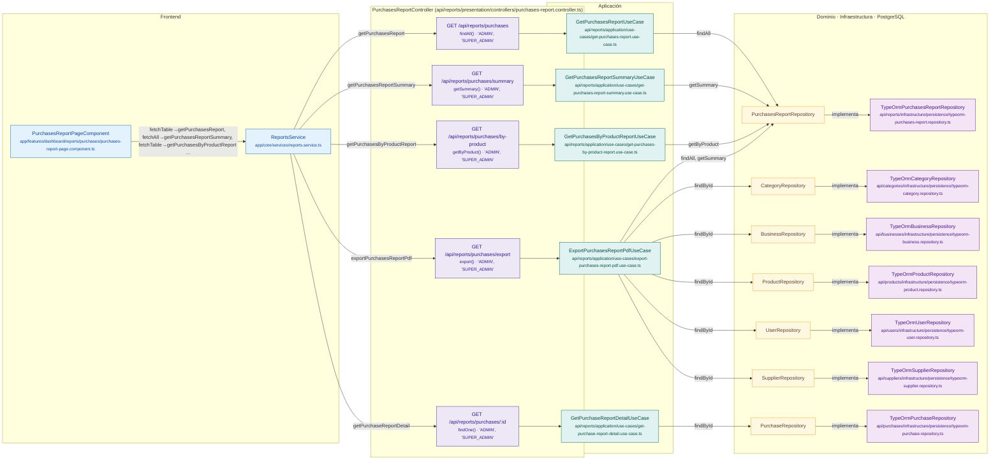

# Mapa de PurchasesReportController

Módulo: **Reportería (reports)** · Fuente editable: [`purchasesreportcontroller.mmd`](purchasesreportcontroller.mmd) · [Índice de diagramas](../../README.md)

## Explicación

1. **¿Qué proceso representa?** Relación real entre archivos: componentes y servicios Angular que llaman a PurchasesReportController, sus 5 rutas, los casos de uso que ejecutan, los puertos de repositorio, sus implementaciones, las funciones SQL y las tablas.
2. **¿Dónde comienza?** Componentes Angular (izquierda) o cualquier cliente HTTP
3. **¿Qué archivos intervienen?** [`comercial-jhoel-api/src/modules/reports/presentation/controllers/purchases-report.controller.ts`](../../../../comercial-jhoel-api/src/modules/reports/presentation/controllers/purchases-report.controller.ts), [`comercial-jhoel-app/src/app/core/services/reports.service.ts`](../../../../comercial-jhoel-app/src/app/core/services/reports.service.ts), [`comercial-jhoel-app/src/app/features/dashboard/reports/purchases/purchases-report-page.component.ts`](../../../../comercial-jhoel-app/src/app/features/dashboard/reports/purchases/purchases-report-page.component.ts), [`comercial-jhoel-api/src/modules/reports/application/use-cases/get-purchases-report.use-case.ts`](../../../../comercial-jhoel-api/src/modules/reports/application/use-cases/get-purchases-report.use-case.ts), [`comercial-jhoel-api/src/modules/reports/application/use-cases/get-purchases-report-summary.use-case.ts`](../../../../comercial-jhoel-api/src/modules/reports/application/use-cases/get-purchases-report-summary.use-case.ts), [`comercial-jhoel-api/src/modules/reports/application/use-cases/get-purchases-by-product-report.use-case.ts`](../../../../comercial-jhoel-api/src/modules/reports/application/use-cases/get-purchases-by-product-report.use-case.ts), [`comercial-jhoel-api/src/modules/reports/application/use-cases/export-purchases-report-pdf.use-case.ts`](../../../../comercial-jhoel-api/src/modules/reports/application/use-cases/export-purchases-report-pdf.use-case.ts), [`comercial-jhoel-api/src/modules/reports/application/use-cases/get-purchase-report-detail.use-case.ts`](../../../../comercial-jhoel-api/src/modules/reports/application/use-cases/get-purchase-report-detail.use-case.ts), [`comercial-jhoel-api/src/modules/reports/infrastructure/persistence/typeorm-purchases-report.repository.ts`](../../../../comercial-jhoel-api/src/modules/reports/infrastructure/persistence/typeorm-purchases-report.repository.ts), [`comercial-jhoel-api/src/modules/categories/infrastructure/persistence/typeorm-category.repository.ts`](../../../../comercial-jhoel-api/src/modules/categories/infrastructure/persistence/typeorm-category.repository.ts), [`comercial-jhoel-api/src/modules/businesses/infrastructure/persistence/typeorm-business.repository.ts`](../../../../comercial-jhoel-api/src/modules/businesses/infrastructure/persistence/typeorm-business.repository.ts), [`comercial-jhoel-api/src/modules/products/infrastructure/persistence/typeorm-product.repository.ts`](../../../../comercial-jhoel-api/src/modules/products/infrastructure/persistence/typeorm-product.repository.ts), [`comercial-jhoel-api/src/modules/users/infrastructure/persistence/typeorm-user.repository.ts`](../../../../comercial-jhoel-api/src/modules/users/infrastructure/persistence/typeorm-user.repository.ts), [`comercial-jhoel-api/src/modules/suppliers/infrastructure/persistence/typeorm-supplier.repository.ts`](../../../../comercial-jhoel-api/src/modules/suppliers/infrastructure/persistence/typeorm-supplier.repository.ts), [`comercial-jhoel-api/src/modules/purchases/infrastructure/persistence/typeorm-purchase.repository.ts`](../../../../comercial-jhoel-api/src/modules/purchases/infrastructure/persistence/typeorm-purchase.repository.ts)
4. **¿Qué función ejecuta cada archivo?** Cada nodo muestra la clase y el método (`Clase.metodo`) y, debajo, la ruta del archivo. El color indica la capa: azul = frontend, morado = controlador, verde azulado = caso de uso, amarillo = dominio/puerto, lila = infraestructura, gris = PostgreSQL, amarillo claro = decisión, rojo = error.
5. **¿Qué decisiones toma el sistema?** Ver los flujos de decisiones de cada comando en business-processes/reports/
6. **¿Dónde se almacenan los datos?** sin tablas detectadas
7. **¿Cómo termina el proceso?** Las flechas terminan en las tablas de PostgreSQL
8. **¿Qué sucede cuando ocurre un error?** Los errores siguen el patrón de 07-error-handling.mmd

> Generado desde el código. Las condiciones de los rombos son el texto literal de los `if … throw` (TypeScript) y de los `IF … RAISE EXCEPTION` (PL/pgSQL).
