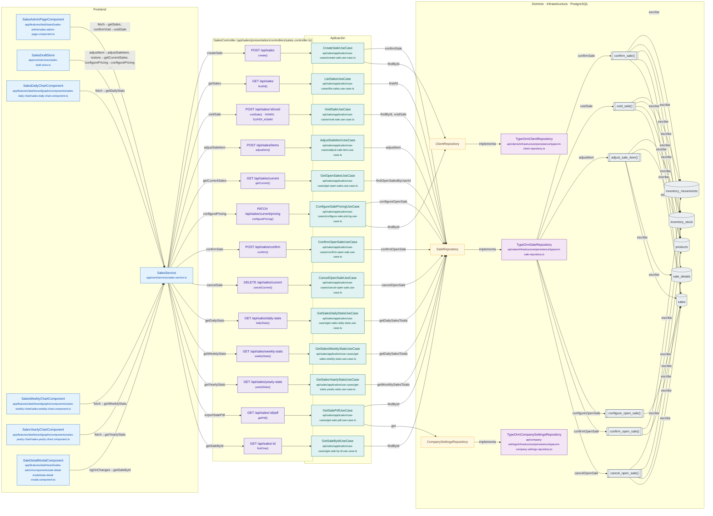

# Mapa de SalesController

Módulo: **Ventas (sales)** · Fuente editable: [`salescontroller.mmd`](salescontroller.mmd) · [Índice de diagramas](../../README.md)

## Explicación

1. **¿Qué proceso representa?** Relación real entre archivos: componentes y servicios Angular que llaman a SalesController, sus 13 rutas, los casos de uso que ejecutan, los puertos de repositorio, sus implementaciones, las funciones SQL y las tablas.
2. **¿Dónde comienza?** Componentes Angular (izquierda) o cualquier cliente HTTP
3. **¿Qué archivos intervienen?** [`comercial-jhoel-api/src/modules/sales/presentation/controllers/sales.controller.ts`](../../../../comercial-jhoel-api/src/modules/sales/presentation/controllers/sales.controller.ts), [`comercial-jhoel-app/src/app/core/services/sales.service.ts`](../../../../comercial-jhoel-app/src/app/core/services/sales.service.ts), [`comercial-jhoel-app/src/app/features/dashboard/sales-admin/sales-admin-page.component.ts`](../../../../comercial-jhoel-app/src/app/features/dashboard/sales-admin/sales-admin-page.component.ts), [`comercial-jhoel-app/src/app/core/services/sales-draft.store.ts`](../../../../comercial-jhoel-app/src/app/core/services/sales-draft.store.ts), [`comercial-jhoel-app/src/app/features/dashboard/graphs/components/sales-daily-chart/sales-daily-chart.component.ts`](../../../../comercial-jhoel-app/src/app/features/dashboard/graphs/components/sales-daily-chart/sales-daily-chart.component.ts), [`comercial-jhoel-app/src/app/features/dashboard/graphs/components/sales-weekly-chart/sales-weekly-chart.component.ts`](../../../../comercial-jhoel-app/src/app/features/dashboard/graphs/components/sales-weekly-chart/sales-weekly-chart.component.ts), [`comercial-jhoel-app/src/app/features/dashboard/graphs/components/sales-yearly-chart/sales-yearly-chart.component.ts`](../../../../comercial-jhoel-app/src/app/features/dashboard/graphs/components/sales-yearly-chart/sales-yearly-chart.component.ts), [`comercial-jhoel-app/src/app/features/dashboard/sales-admin/components/sale-detail-modal/sale-detail-modal.component.ts`](../../../../comercial-jhoel-app/src/app/features/dashboard/sales-admin/components/sale-detail-modal/sale-detail-modal.component.ts), [`comercial-jhoel-api/src/modules/sales/application/use-cases/create-sale.use-case.ts`](../../../../comercial-jhoel-api/src/modules/sales/application/use-cases/create-sale.use-case.ts), [`comercial-jhoel-api/src/modules/sales/application/use-cases/list-sales.use-case.ts`](../../../../comercial-jhoel-api/src/modules/sales/application/use-cases/list-sales.use-case.ts), [`comercial-jhoel-api/src/modules/sales/application/use-cases/void-sale.use-case.ts`](../../../../comercial-jhoel-api/src/modules/sales/application/use-cases/void-sale.use-case.ts), [`comercial-jhoel-api/src/modules/sales/application/use-cases/adjust-sale-item.use-case.ts`](../../../../comercial-jhoel-api/src/modules/sales/application/use-cases/adjust-sale-item.use-case.ts), [`comercial-jhoel-api/src/modules/sales/application/use-cases/get-open-sales.use-case.ts`](../../../../comercial-jhoel-api/src/modules/sales/application/use-cases/get-open-sales.use-case.ts), [`comercial-jhoel-api/src/modules/sales/application/use-cases/configure-sale-pricing.use-case.ts`](../../../../comercial-jhoel-api/src/modules/sales/application/use-cases/configure-sale-pricing.use-case.ts), [`comercial-jhoel-api/src/modules/sales/application/use-cases/confirm-open-sale.use-case.ts`](../../../../comercial-jhoel-api/src/modules/sales/application/use-cases/confirm-open-sale.use-case.ts), [`comercial-jhoel-api/src/modules/sales/application/use-cases/cancel-open-sale.use-case.ts`](../../../../comercial-jhoel-api/src/modules/sales/application/use-cases/cancel-open-sale.use-case.ts), [`comercial-jhoel-api/src/modules/sales/application/use-cases/get-sales-daily-stats.use-case.ts`](../../../../comercial-jhoel-api/src/modules/sales/application/use-cases/get-sales-daily-stats.use-case.ts), [`comercial-jhoel-api/src/modules/sales/application/use-cases/get-sales-weekly-stats.use-case.ts`](../../../../comercial-jhoel-api/src/modules/sales/application/use-cases/get-sales-weekly-stats.use-case.ts), [`comercial-jhoel-api/src/modules/sales/application/use-cases/get-sales-yearly-stats.use-case.ts`](../../../../comercial-jhoel-api/src/modules/sales/application/use-cases/get-sales-yearly-stats.use-case.ts), [`comercial-jhoel-api/src/modules/sales/application/use-cases/get-sale-pdf.use-case.ts`](../../../../comercial-jhoel-api/src/modules/sales/application/use-cases/get-sale-pdf.use-case.ts), [`comercial-jhoel-api/src/modules/sales/application/use-cases/get-sale-by-id.use-case.ts`](../../../../comercial-jhoel-api/src/modules/sales/application/use-cases/get-sale-by-id.use-case.ts), [`comercial-jhoel-api/src/modules/sales/infrastructure/persistence/typeorm-sale.repository.ts`](../../../../comercial-jhoel-api/src/modules/sales/infrastructure/persistence/typeorm-sale.repository.ts), [`comercial-jhoel-api/src/modules/clients/infrastructure/persistence/typeorm-client.repository.ts`](../../../../comercial-jhoel-api/src/modules/clients/infrastructure/persistence/typeorm-client.repository.ts), [`comercial-jhoel-api/src/modules/company-settings/infrastructure/persistence/typeorm-company-settings.repository.ts`](../../../../comercial-jhoel-api/src/modules/company-settings/infrastructure/persistence/typeorm-company-settings.repository.ts)
4. **¿Qué función ejecuta cada archivo?** Cada nodo muestra la clase y el método (`Clase.metodo`) y, debajo, la ruta del archivo. El color indica la capa: azul = frontend, morado = controlador, verde azulado = caso de uso, amarillo = dominio/puerto, lila = infraestructura, gris = PostgreSQL, amarillo claro = decisión, rojo = error.
5. **¿Qué decisiones toma el sistema?** Ver los flujos de decisiones de cada comando en business-processes/sales/
6. **¿Dónde se almacenan los datos?** inventory_movements, inventory_stock, products, sale_details, sales
7. **¿Cómo termina el proceso?** Las flechas terminan en las tablas de PostgreSQL
8. **¿Qué sucede cuando ocurre un error?** Los errores siguen el patrón de 07-error-handling.mmd

> Generado desde el código. Las condiciones de los rombos son el texto literal de los `if … throw` (TypeScript) y de los `IF … RAISE EXCEPTION` (PL/pgSQL).
