# Mapa de PublicSiteVisitsController

Módulo: **Visitas al sitio (site-visits)** · Fuente editable: [`publicsitevisitscontroller.mmd`](publicsitevisitscontroller.mmd) · [Índice de diagramas](../../README.md)

```mermaid
flowchart LR
  subgraph s1["Frontend"]
  n2["SiteVisitsService<br/><small>app/core/services/site-visits.service.ts</small>"]
  end
  subgraph s3["PublicSiteVisitsController (api/site-visits/presentation/controllers/public-site-visits.controller.ts)"]
  n4["POST /api/public-site-visits<br/><small>register()</small>"]
  n5["GET /api/public-site-visits<br/><small>getTotal()</small>"]
  end
  subgraph s6["Aplicación"]
  n7["RegisterVisitUseCase<br/><small>api/site-visits/application/use-cases/register-visit.use-case.ts</small>"]
  n8["GetVisitCountUseCase<br/><small>api/site-visits/application/use-cases/get-visit-count.use-case.ts</small>"]
  end
  subgraph s9["Dominio · Infraestructura · PostgreSQL"]
  n10["SiteVisitsRepository"]
  n11["TypeOrmSiteVisitsRepository<br/><small>api/site-visits/infrastructure/persistence/typeorm-site-visits.repository.ts</small>"]
  n12[("site_visits")]
  end
  n2 -->|registerVisit| n4
  n2 -->|getVisitCount| n5
  n4 --> n7
  n5 --> n8
  n7 -->|increment| n10
  n10 -->|implementa| n11
  n11 -->|increment| n12
  n8 -->|getTotal| n10
  n11 -->|getTotal| n12
  classDef start fill:#e8f5e9,stroke:#2e7d32,color:#1b5e20
  classDef fe fill:#e3f2fd,stroke:#1565c0,color:#0d47a1
  classDef api fill:#ede7f6,stroke:#4527a0,color:#311b92
  classDef app fill:#e0f2f1,stroke:#00695c,color:#004d40
  classDef dom fill:#fff8e1,stroke:#f9a825,color:#5d4037
  classDef infra fill:#f3e5f5,stroke:#6a1b9a,color:#4a148c
  classDef db fill:#eceff1,stroke:#455a64,color:#263238
  classDef dec fill:#fffde7,stroke:#f57f17,color:#3e2723
  classDef err fill:#ffebee,stroke:#c62828,color:#b71c1c
  classDef ok fill:#e8f5e9,stroke:#1b5e20,color:#1b5e20
  class n2 fe
  class n4,n5 api
  class n7,n8 app
  class n10 dom
  class n11 infra
  class n12 db
```

## Explicación

1. **¿Qué proceso representa?** Relación real entre archivos: componentes y servicios Angular que llaman a PublicSiteVisitsController, sus 2 rutas, los casos de uso que ejecutan, los puertos de repositorio, sus implementaciones, las funciones SQL y las tablas.
2. **¿Dónde comienza?** Componentes Angular (izquierda) o cualquier cliente HTTP
3. **¿Qué archivos intervienen?** [`comercial-jhoel-api/src/modules/site-visits/presentation/controllers/public-site-visits.controller.ts`](../../../../comercial-jhoel-api/src/modules/site-visits/presentation/controllers/public-site-visits.controller.ts), [`comercial-jhoel-app/src/app/core/services/site-visits.service.ts`](../../../../comercial-jhoel-app/src/app/core/services/site-visits.service.ts), [`comercial-jhoel-api/src/modules/site-visits/application/use-cases/register-visit.use-case.ts`](../../../../comercial-jhoel-api/src/modules/site-visits/application/use-cases/register-visit.use-case.ts), [`comercial-jhoel-api/src/modules/site-visits/application/use-cases/get-visit-count.use-case.ts`](../../../../comercial-jhoel-api/src/modules/site-visits/application/use-cases/get-visit-count.use-case.ts), [`comercial-jhoel-api/src/modules/site-visits/infrastructure/persistence/typeorm-site-visits.repository.ts`](../../../../comercial-jhoel-api/src/modules/site-visits/infrastructure/persistence/typeorm-site-visits.repository.ts)
4. **¿Qué función ejecuta cada archivo?** Cada nodo muestra la clase y el método (`Clase.metodo`) y, debajo, la ruta del archivo. El color indica la capa: azul = frontend, morado = controlador, verde azulado = caso de uso, amarillo = dominio/puerto, lila = infraestructura, gris = PostgreSQL, amarillo claro = decisión, rojo = error.
5. **¿Qué decisiones toma el sistema?** Ver los flujos de decisiones de cada comando en business-processes/site-visits/
6. **¿Dónde se almacenan los datos?** site_visits
7. **¿Cómo termina el proceso?** Las flechas terminan en las tablas de PostgreSQL
8. **¿Qué sucede cuando ocurre un error?** Los errores siguen el patrón de 07-error-handling.mmd

> Generado desde el código. Las condiciones de los rombos son el texto literal de los `if … throw` (TypeScript) y de los `IF … RAISE EXCEPTION` (PL/pgSQL).
