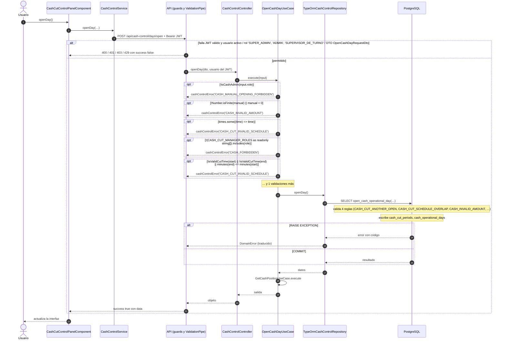

# Secuencia — Control de Efectivo: apertura del día operativo de efectivo

Módulo: **Control de Efectivo (Kardex, cortes, arqueos, Bodega) (cash-control)** · Fuente editable: [`control-de-efectivo-apertura-del-d-a-operativo-de-efectivo.mmd`](control-de-efectivo-apertura-del-d-a-operativo-de-efectivo.mmd) · [Índice de diagramas](../README.md)

## Explicación

1. **¿Qué proceso representa?** Interacción Usuario → Angular → API → caso de uso → repositorio → PostgreSQL para POST /api/cash-control/days/open, con las validaciones y la transacción
2. **¿Dónde comienza?** CashControlService.openDay
3. **¿Qué archivos intervienen?** [`comercial-jhoel-api/src/modules/cash-control/presentation/controllers/cash-control.controller.ts`](../../../comercial-jhoel-api/src/modules/cash-control/presentation/controllers/cash-control.controller.ts), [`comercial-jhoel-app/src/app/features/dashboard/cash-control/components/cut-control-panel/cut-control-panel.component.ts`](../../../comercial-jhoel-app/src/app/features/dashboard/cash-control/components/cut-control-panel/cut-control-panel.component.ts), [`comercial-jhoel-app/src/app/core/services/cash-control.service.ts`](../../../comercial-jhoel-app/src/app/core/services/cash-control.service.ts), [`comercial-jhoel-api/src/modules/cash-control/application/use-cases/cash-cut-commands.use-cases.ts`](../../../comercial-jhoel-api/src/modules/cash-control/application/use-cases/cash-cut-commands.use-cases.ts), [`comercial-jhoel-api/src/modules/cash-control/infrastructure/persistence/typeorm-cash-control.repository.ts`](../../../comercial-jhoel-api/src/modules/cash-control/infrastructure/persistence/typeorm-cash-control.repository.ts)
4. **¿Qué función ejecuta cada archivo?** Cada nodo muestra la clase y el método (`Clase.metodo`) y, debajo, la ruta del archivo. El color indica la capa: azul = frontend, morado = controlador, verde azulado = caso de uso, amarillo = dominio/puerto, lila = infraestructura, gris = PostgreSQL, amarillo claro = decisión, rojo = error.
5. **¿Qué decisiones toma el sistema?** Bloques alt/opt = validaciones reales; flujo completo en business-processes/cash-control/post-cash-control-days-open.mmd
6. **¿Dónde se almacenan los datos?** PostgreSQL (ver notas "escribe")
7. **¿Cómo termina el proceso?** success true con data y actualización de la interfaz
8. **¿Qué sucede cuando ocurre un error?** Ramas alt/opt: el error vuelve a la pantalla como { success: false, message }

> Generado desde el código. Las condiciones de los rombos son el texto literal de los `if … throw` (TypeScript) y de los `IF … RAISE EXCEPTION` (PL/pgSQL).
