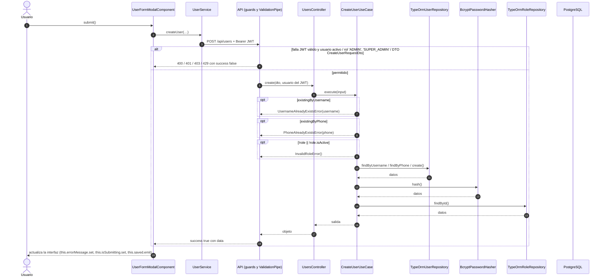

# Secuencia — Creación de usuarios (administración)

Módulo: **Usuarios (users)** · Fuente editable: [`creaci-n-de-usuarios-administraci-n.mmd`](creaci-n-de-usuarios-administraci-n.mmd) · [Índice de diagramas](../README.md)

## Explicación

1. **¿Qué proceso representa?** Interacción Usuario → Angular → API → caso de uso → repositorio → PostgreSQL para POST /api/users, con las validaciones y la transacción
2. **¿Dónde comienza?** UserService.createUser
3. **¿Qué archivos intervienen?** [`comercial-jhoel-api/src/modules/users/presentation/controllers/users.controller.ts`](../../../comercial-jhoel-api/src/modules/users/presentation/controllers/users.controller.ts), [`comercial-jhoel-app/src/app/features/dashboard/users/components/user-form-modal/user-form-modal.component.ts`](../../../comercial-jhoel-app/src/app/features/dashboard/users/components/user-form-modal/user-form-modal.component.ts), [`comercial-jhoel-app/src/app/core/services/user.service.ts`](../../../comercial-jhoel-app/src/app/core/services/user.service.ts), [`comercial-jhoel-api/src/modules/users/application/use-cases/create-user.use-case.ts`](../../../comercial-jhoel-api/src/modules/users/application/use-cases/create-user.use-case.ts), [`comercial-jhoel-api/src/modules/users/infrastructure/persistence/typeorm-user.repository.ts`](../../../comercial-jhoel-api/src/modules/users/infrastructure/persistence/typeorm-user.repository.ts), [`comercial-jhoel-api/src/shared/infrastructure/services/bcrypt-password-hasher.service.ts`](../../../comercial-jhoel-api/src/shared/infrastructure/services/bcrypt-password-hasher.service.ts), [`comercial-jhoel-api/src/modules/roles/infrastructure/persistence/typeorm-role.repository.ts`](../../../comercial-jhoel-api/src/modules/roles/infrastructure/persistence/typeorm-role.repository.ts)
4. **¿Qué función ejecuta cada archivo?** Cada nodo muestra la clase y el método (`Clase.metodo`) y, debajo, la ruta del archivo. El color indica la capa: azul = frontend, morado = controlador, verde azulado = caso de uso, amarillo = dominio/puerto, lila = infraestructura, gris = PostgreSQL, amarillo claro = decisión, rojo = error.
5. **¿Qué decisiones toma el sistema?** Bloques alt/opt = validaciones reales; flujo completo en business-processes/users/post-users.mmd
6. **¿Dónde se almacenan los datos?** PostgreSQL (ver notas "escribe")
7. **¿Cómo termina el proceso?** success true con data y actualización de la interfaz
8. **¿Qué sucede cuando ocurre un error?** Ramas alt/opt: el error vuelve a la pantalla como { success: false, message }

> Generado desde el código. Las condiciones de los rombos son el texto literal de los `if … throw` (TypeScript) y de los `IF … RAISE EXCEPTION` (PL/pgSQL).
