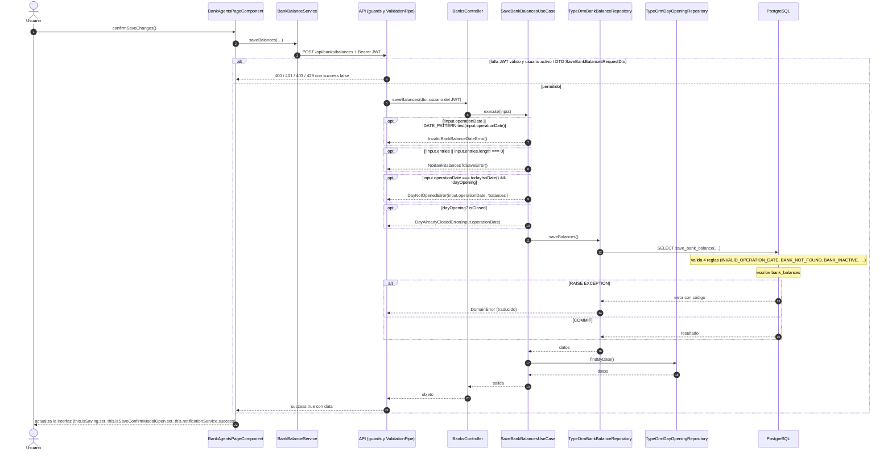

# Secuencia — Guardar saldos bancarios del día

Módulo: **Bancos y Agentes Bancarios (día, saldos, cuadre, transferencias) (banks)** · Fuente editable: [`guardar-saldos-bancarios-del-d-a.mmd`](guardar-saldos-bancarios-del-d-a.mmd) · [Índice de diagramas](../README.md)

## Explicación

1. **¿Qué proceso representa?** Interacción Usuario → Angular → API → caso de uso → repositorio → PostgreSQL para POST /api/banks/balances, con las validaciones y la transacción
2. **¿Dónde comienza?** BankBalanceService.saveBalances
3. **¿Qué archivos intervienen?** [`comercial-jhoel-api/src/modules/banks/presentation/controllers/banks.controller.ts`](../../../comercial-jhoel-api/src/modules/banks/presentation/controllers/banks.controller.ts), [`comercial-jhoel-app/src/app/features/dashboard/bank-agents/bank-agents-page.component.ts`](../../../comercial-jhoel-app/src/app/features/dashboard/bank-agents/bank-agents-page.component.ts), [`comercial-jhoel-app/src/app/core/services/bank-balance.service.ts`](../../../comercial-jhoel-app/src/app/core/services/bank-balance.service.ts), [`comercial-jhoel-api/src/modules/banks/application/use-cases/save-bank-balances.use-case.ts`](../../../comercial-jhoel-api/src/modules/banks/application/use-cases/save-bank-balances.use-case.ts), [`comercial-jhoel-api/src/modules/banks/infrastructure/persistence/typeorm-bank-balance.repository.ts`](../../../comercial-jhoel-api/src/modules/banks/infrastructure/persistence/typeorm-bank-balance.repository.ts), [`comercial-jhoel-api/src/modules/banks/infrastructure/persistence/typeorm-day-opening.repository.ts`](../../../comercial-jhoel-api/src/modules/banks/infrastructure/persistence/typeorm-day-opening.repository.ts)
4. **¿Qué función ejecuta cada archivo?** Cada nodo muestra la clase y el método (`Clase.metodo`) y, debajo, la ruta del archivo. El color indica la capa: azul = frontend, morado = controlador, verde azulado = caso de uso, amarillo = dominio/puerto, lila = infraestructura, gris = PostgreSQL, amarillo claro = decisión, rojo = error.
5. **¿Qué decisiones toma el sistema?** Bloques alt/opt = validaciones reales; flujo completo en business-processes/banks/post-banks-balances.mmd
6. **¿Dónde se almacenan los datos?** PostgreSQL (ver notas "escribe")
7. **¿Cómo termina el proceso?** success true con data y actualización de la interfaz
8. **¿Qué sucede cuando ocurre un error?** Ramas alt/opt: el error vuelve a la pantalla como { success: false, message }

> Generado desde el código. Las condiciones de los rombos son el texto literal de los `if … throw` (TypeScript) y de los `IF … RAISE EXCEPTION` (PL/pgSQL).
