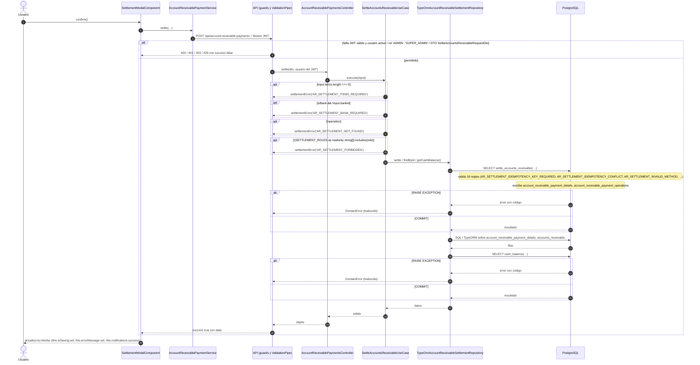

# Secuencia — Pago / cancelación de Cuentas por Cobrar

Módulo: **Cuentas por Cobrar (accounts-receivable)** · Fuente editable: [`pago-cancelaci-n-de-cuentas-por-cobrar.mmd`](pago-cancelaci-n-de-cuentas-por-cobrar.mmd) · [Índice de diagramas](../README.md)

## Explicación

1. **¿Qué proceso representa?** Interacción Usuario → Angular → API → caso de uso → repositorio → PostgreSQL para POST /api/account-receivable-payments, con las validaciones y la transacción
2. **¿Dónde comienza?** AccountReceivablePaymentService.settle
3. **¿Qué archivos intervienen?** [`comercial-jhoel-api/src/modules/accounts-receivable/presentation/controllers/account-receivable-payments.controller.ts`](../../../comercial-jhoel-api/src/modules/accounts-receivable/presentation/controllers/account-receivable-payments.controller.ts), [`comercial-jhoel-app/src/app/features/dashboard/accounts-receivable/components/settlement-modal/settlement-modal.component.ts`](../../../comercial-jhoel-app/src/app/features/dashboard/accounts-receivable/components/settlement-modal/settlement-modal.component.ts), [`comercial-jhoel-app/src/app/core/services/account-receivable-payment.service.ts`](../../../comercial-jhoel-app/src/app/core/services/account-receivable-payment.service.ts), [`comercial-jhoel-api/src/modules/accounts-receivable/application/use-cases/account-receivable-settlement.use-cases.ts`](../../../comercial-jhoel-api/src/modules/accounts-receivable/application/use-cases/account-receivable-settlement.use-cases.ts), [`comercial-jhoel-api/src/modules/accounts-receivable/infrastructure/persistence/typeorm-account-receivable-settlement.repository.ts`](../../../comercial-jhoel-api/src/modules/accounts-receivable/infrastructure/persistence/typeorm-account-receivable-settlement.repository.ts)
4. **¿Qué función ejecuta cada archivo?** Cada nodo muestra la clase y el método (`Clase.metodo`) y, debajo, la ruta del archivo. El color indica la capa: azul = frontend, morado = controlador, verde azulado = caso de uso, amarillo = dominio/puerto, lila = infraestructura, gris = PostgreSQL, amarillo claro = decisión, rojo = error.
5. **¿Qué decisiones toma el sistema?** Bloques alt/opt = validaciones reales; flujo completo en business-processes/accounts-receivable/post-account-receivable-payments.mmd
6. **¿Dónde se almacenan los datos?** PostgreSQL (ver notas "escribe")
7. **¿Cómo termina el proceso?** success true con data y actualización de la interfaz
8. **¿Qué sucede cuando ocurre un error?** Ramas alt/opt: el error vuelve a la pantalla como { success: false, message }

> Generado desde el código. Las condiciones de los rombos son el texto literal de los `if … throw` (TypeScript) y de los `IF … RAISE EXCEPTION` (PL/pgSQL).
