# Secuencia — Transaccionar: anular una operación

Módulo: **Transaccionar (operaciones bancarias) (bank-deposits)** · Fuente editable: [`transaccionar-anular-una-operaci-n.mmd`](transaccionar-anular-una-operaci-n.mmd) · [Índice de diagramas](../README.md)

```mermaid
sequenceDiagram
  autonumber
  actor U as Usuario
  participant C as BankDepositsReportPageComponent
  participant S as BankDepositService
  participant G as API (guards y ValidationPipe)
  participant CT as BankDepositsController
  participant UC0 as VoidBankDepositOperationUseCase
  participant R0 as TypeOrmBankDepositRepository
  participant DB as PostgreSQL
  U->>C: confirmVoid()
  C->>S: voidOperation(…)
  S->>G: POST /api/bank-deposits/:id/void + Bearer JWT
  alt falla JWT válido y usuario activo / rol 'ADMIN', 'SUPER_ADMIN' / DTO VoidBankDepositOperationRequestDto
    G-->>C: 400 / 401 / 403 / 429 con success false
  else permitido
  G->>CT: voidOperation(dto, usuario del JWT)
  CT->>UC0: execute(input)
  opt !operation
    UC0-->>G: BankDepositOperationNotFoundError(input.id)
  end
  opt operation.isVoided
    UC0-->>G: BankDepositOperationAlreadyVoidedError(input.id)
  end
  UC0->>R0: findById / voidOperation()
  R0->>DB: SELECT void_bank_deposit_operation(…)
  Note over DB: valida 2 reglas (BANK_DEPOSIT_OPERATION_NOT_FOUND, BANK_DEPOSIT_OPERATION_ALREADY_VOIDED)
  Note over DB: escribe bank_deposit_operations
  alt RAISE EXCEPTION
    DB-->>R0: error con código
    R0-->>G: DomainError (traducido)
  else COMMIT
    DB-->>R0: resultado
  end
  R0-->>UC0: datos
  UC0-->>CT: salida
  CT-->>G: objeto
  G-->>C: success true con data
  end
  C-->>U: actualiza la interfaz (this.isSavingVoid.set, this.isVoidModalOpen.set, this.notificationService.success)
```

## Explicación

1. **¿Qué proceso representa?** Interacción Usuario → Angular → API → caso de uso → repositorio → PostgreSQL para POST /api/bank-deposits/:id/void, con las validaciones y la transacción
2. **¿Dónde comienza?** BankDepositService.voidOperation
3. **¿Qué archivos intervienen?** [`comercial-jhoel-api/src/modules/bank-deposits/presentation/controllers/bank-deposits.controller.ts`](../../../comercial-jhoel-api/src/modules/bank-deposits/presentation/controllers/bank-deposits.controller.ts), [`comercial-jhoel-app/src/app/features/dashboard/reports/bank-deposits/bank-deposits-report-page.component.ts`](../../../comercial-jhoel-app/src/app/features/dashboard/reports/bank-deposits/bank-deposits-report-page.component.ts), [`comercial-jhoel-app/src/app/core/services/bank-deposit.service.ts`](../../../comercial-jhoel-app/src/app/core/services/bank-deposit.service.ts), [`comercial-jhoel-api/src/modules/bank-deposits/application/use-cases/void-bank-deposit-operation.use-case.ts`](../../../comercial-jhoel-api/src/modules/bank-deposits/application/use-cases/void-bank-deposit-operation.use-case.ts), [`comercial-jhoel-api/src/modules/bank-deposits/infrastructure/persistence/typeorm-bank-deposit.repository.ts`](../../../comercial-jhoel-api/src/modules/bank-deposits/infrastructure/persistence/typeorm-bank-deposit.repository.ts)
4. **¿Qué función ejecuta cada archivo?** Cada nodo muestra la clase y el método (`Clase.metodo`) y, debajo, la ruta del archivo. El color indica la capa: azul = frontend, morado = controlador, verde azulado = caso de uso, amarillo = dominio/puerto, lila = infraestructura, gris = PostgreSQL, amarillo claro = decisión, rojo = error.
5. **¿Qué decisiones toma el sistema?** Bloques alt/opt = validaciones reales; flujo completo en business-processes/bank-deposits/post-bank-deposits-id-void.mmd
6. **¿Dónde se almacenan los datos?** PostgreSQL (ver notas "escribe")
7. **¿Cómo termina el proceso?** success true con data y actualización de la interfaz
8. **¿Qué sucede cuando ocurre un error?** Ramas alt/opt: el error vuelve a la pantalla como { success: false, message }

> Generado desde el código. Las condiciones de los rombos son el texto literal de los `if … throw` (TypeScript) y de los `IF … RAISE EXCEPTION` (PL/pgSQL).
